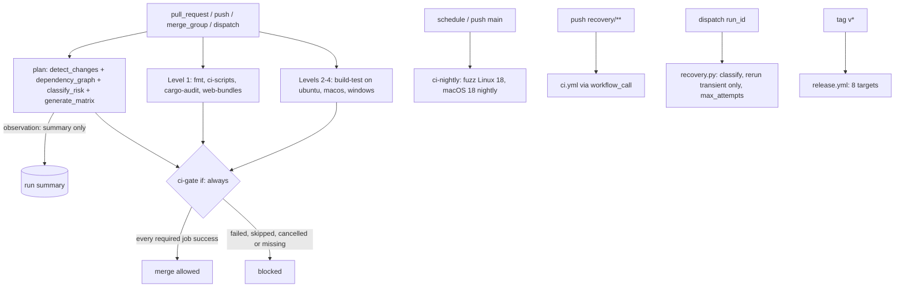
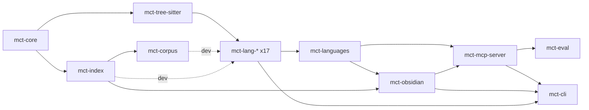

# CI/CD: diagnosis, incremental planner and recovery

Decision record: [ADR-038](adrs/038-incremental-ci.md). This page has the evidence, the design and the procedures. Revision analysed: `origin/main` at `d45cf53c` (2026-11-17).

## 1. Diagnosis (2026-11-17)

Data: the last 100 `CI` runs (2026-11-16 and 2026-11-17), taken with `python3 scripts/ci/main.py metrics --repo Zubiarka8/mini-consumes-tokens --since 2026-11-16`, plus job logs and annotations through `gh`.

| Job | Outcomes (100 runs) | Queue median / max (min) | Run median (min) |
|---|---|---|---|
| build + test + clippy (macos-latest) | 75 success, 3 failure, **22 cancelled** | 11.9 / 95.0 | 10.4 |
| build + test + clippy (ubuntu-latest) | 88 success, 7 failure, 5 cancelled | 3.9 / 33.8 | 8.4 |
| build + test + clippy (windows-latest) | 92 success, 3 failure, 5 cancelled | 1.4 / 28.8 | 14.1 |
| cargo-audit | 20 success, **79 failure**, 1 cancelled | 4.9 / 32.7 | 0.3 |
| fuzz (macos), 18 jobs per push to main | 273 success, 15 cancelled | **44.8 / 138.0** | 1.2 |
| fuzz (ubuntu), 18 jobs per push to main | 288 success, 168 skipped | 2.5 / 28.4 | 0.9 |
| rustfmt | 99 success, 1 cancelled | 3.3 / 34.6 | 0.2 |
| web bundles | 98 success, 1 failure, 1 cancelled | 3.1 / 35.5 | 0.5 |

Run outcomes: PR 16 success, 46 failure, 22 cancelled; push 4 success, 12 failure. Runner time of completed jobs: 3,532 min.

### Confirmed root causes

1. **`cargo-audit` fails every run, on `main` too.** RUSTSEC-2026-0544, `libz-sys` 1.1.31, heap buffer overflow, fixed in 1.1.33 (run 44104590502, step "Fail only on high/critical severity": `error: 1 vulnerability found!`). The advisory has no CVSS score, so `severity_threshold = "high"` does not filter it. That is the fail-safe the job comment describes. Reproduced locally with cargo-audit 0.22.2. `libz-sys` comes in through `git2` → `libgit2-sys`. The `mct-index` fuzz lockfile had 1.1.29.
   *Fix in this branch:* `cargo update -p libz-sys --precise 1.1.33` (root and `crates/mct-index/fuzz`). `rustix` 1.1.5 → 1.1.6 for RUSTSEC-2026-0486, a warning that does not gate.
   *Still open:* RUSTSEC-2026-0459, `libsqlite3-sys` 0.38.2, medium 6.8, fixed in 0.39.0. It does not gate. It needs a `rusqlite` upgrade (0.40 pins `libsqlite3-sys` 0.38), which changes `mct-index`'s SQLite dependency, so it is a separate change for the maintainer to decide.
2. **The macOS pool is saturated by fuzzing on `main`.** Each push to `main` (12 on 2026-11-17) queued 18 macOS fuzz jobs on a pool of 5. Annotation on run 44104590502: "The job was not acquired by Runner of type hosted even after multiple attempts" and "Due to capacity constraints, jobs targeting macOS arm64 runners may experience longer queue times". The required macOS check of pull requests waited behind them, with a median queue of 11.9 min and a maximum of 95 min, against 3.9 min on Linux and 1.4 min on Windows. Annotations of the 24 cancelled macOS PR jobs since 2026-11-16: 17 superseded by a newer push to the same PR while they waited ("Canceling since a higher priority waiting request for CI-<PR> exists"), 2 never acquired a runner (PR run 44105697892 is one of them), and 5 had no annotations left (HTTP 404). So the long macOS queue does most of its damage indirectly: the longer a PR waits, the more likely a new push cancels it.
   *Fix:* fuzzing moves to `ci-nightly.yml`. Linux still runs on every push to `main`. macOS runs only nightly or on demand, with `max-parallel: 4`.

### Secondary problems

- **The cache is over quota:** 10.67 GB in 110 entries against GitHub's 10 GB per repository, 88 of them on `main` and mostly per-crate fuzz caches. Each save evicts another entry. *Fix:* the `build-test` cache saves only on `main` (`save-if`), and fuzz caches are written nightly instead of on every push. The effect is not measured yet (see section 5).
- **Branch-specific failures are code failures, not CI failures.** Example: PR #497, run 44093968778, `the_coverage_score_table_matches_the_checklists` (`crates/mct-languages/tests/coverage_scores.rs:164`). This test reads `docs/` checklists, so a docs change can break a Rust test. The policy therefore runs `mct-languages` and `mct-eval` for any docs change.
- **Superseded runs.** `cancel-in-progress` cancels a PR run when a newer push arrives. That is intended. It cancelled 17 of the 24 macOS PR jobs counted above, and it has a cost only because those jobs had waited so long in the queue.
- **Historical comparison (as asked).** 100 to 200 merges ago, a PR had 42 checks (#445 and #391, all green: 6 jobs plus 18 × 2 fuzz jobs), and #333 had 84 (push and PR runs). Since #555, #556 and #558 (2026-11-16/17) a PR has 6 jobs, and fuzz runs only on pushes to `main`. That moved the macOS pressure from PRs to `main`, and the pool stayed saturated.

### Needs a human

- Making `CI gate` the required check, and dropping the four current ones, changes branch protection. It needs the maintainer's explicit authorization, and should wait until the gate has a track record.
- The `libsqlite3-sys` / `rusqlite` upgrade (medium advisory).
- Any paid or third-party CI provider (section 6).

## 2. Architecture

```text
.github/workflows/
  ci.yml           PRs, pushes, manual runs, and workflow_call: plan (observation), ci-scripts,
                   fmt, web-bundles, build-test x3, cargo-audit, ci-gate
  ci-nightly.yml   fuzz smoke tests: Linux on push to main and nightly, macOS nightly only
  ci-full.yml      weekly + dispatch: cargo test on ARM64, MUSL, macOS Intel, Windows ARM64
  ci-recovery.yml  push to recovery/** = full ci.yml on that commit; dispatch = diagnose/rerun
  release.yml      tags v* and manual runs (unchanged)
  docs.yml, quality-report.yml  unchanged
scripts/ci/
  main.py              CLI: plan | run | gate | cache-key | recovery | metrics
  policy.py            loads ci_policy.toml, glob matching, exit codes, key=value logs (leaf module)
  detect_changes.py    git diff --name-status -M against the merge base
  dependency_graph.py  cargo metadata graph, owner lookup, reverse transitive closure
                       (also the planned affected_crates.py: same data structure, one module)
  classify_risk.py     R0-R4 per path, the highest level wins, one reason per path
  generate_matrix.py   GitHub matrix, validated targets, each skipped platform with its reason
  run_tests.py         the cargo build/test/clippy commands of a plan (--dry-run prints them)
  cache_manager.py     cache key inputs and the runner architecture check
  collect_results.py   the final gate over toJSON(needs)
  recovery.py          infrastructure vs code failures, bounded reruns
  metrics.py           queue and run time, outcomes, runner minutes
  ci_policy.toml       every rule, level, platform, required job and transient pattern
  tests/               unittest suite (88 tests, randomized property tests included)
```

Imports go one way: `main` imports every module, and `classify_risk` imports `policy`, `dependency_graph` and `detect_changes`. Nothing imports `main`, and `policy` imports nothing from the package. All modules run on Linux, macOS and Windows Python 3.11+ (`tomllib`).



### Crate graph used for selection

From `cargo metadata` at `d45cf53c`, with every dependency kind:



Two language crates depend on others: `mct-lang-html` on CSS and JS/TS, `mct-lang-xaml` on C#. Every language crate has a dev-dependency on `mct-index` through `mct-corpus`, so a change to `mct-index` or `mct-corpus` reaches the whole workspace.

`python3 scripts/ci/dependency_graph.py` prints the real adjacency list. `python3 scripts/ci/dependency_graph.py mct-lang-go` prints the transitive dependents of one crate.

### Selection policy (`ci_policy.toml`)

| Level | Matches | Runs |
|---|---|---|
| R0 | `docs/**`, `*.md` at the top level, `website/**`, `errors/**`, `internal/**`, `benchmarks/**` | `mct-languages` and `mct-eval` tests (they read docs), Linux only |
| R1 | a crate's `tests/`, `benches/` or `examples/`, or a crate with no dependents | that crate |
| R2 | crate source with dependents, a crate `Cargo.toml`, `scripts/unix|windows/**` | the crate and its transitive dependents (scripts: full) |
| R3 | `mct-core`, `mct-index`, `mct-tree-sitter`, `mct-languages`, `mct-mcp-server`, root `Cargo.toml`, `crates/*/fuzz/**`, any unmatched path, a path in no crate, dependents covering 60% or more of the workspace | full workspace, every PR platform |
| R4 | `.github/**`, `scripts/ci/**`, `Cargo.lock`, fuzz lockfiles, installers, `packaging/**`, `.cargo/**`, toolchain files, `SECURITY.md` | full workspace and reinforced review |

When files of several levels change, the highest level wins, and a rename counts both paths. A crate that is OS-sensitive (`mct-cli`, `mct-mcp-server`, `mct-index`) in the selection runs every PR platform. Otherwise Linux only. Measured on real merges: #520 (`mct-lang-rust`) → R2, 6 of 26 crates. #508 (`mct-lang-java`) → R2, 6 of 26. Both still run three OSes, because `mct-cli` depends on every language crate.

### Platforms

| Platform | Runner | Target | PR | Full / release | Mode |
|---|---|---|---|---|---|
| Linux GNU x64 | ubuntu-latest | x86_64-unknown-linux-gnu | yes | yes | native |
| macOS Apple Silicon | macos-latest | aarch64-apple-darwin | yes | yes | native |
| Windows x64 | windows-latest | x86_64-pc-windows-msvc | yes | yes | native |
| Linux GNU ARM64 | ubuntu-24.04-arm | aarch64-unknown-linux-gnu | no | yes | native (release.yml cross-compiles it from x64 and does not run it) |
| Linux MUSL x64 | ubuntu-latest | x86_64-unknown-linux-musl | no | yes | native |
| Linux MUSL ARM64 | ubuntu-24.04-arm | aarch64-unknown-linux-musl | no | yes | native |
| macOS Intel | macos-26-intel | x86_64-apple-darwin | no | yes | native |
| Windows ARM64 | windows-11-arm | aarch64-pc-windows-msvc | no | yes | native |

The eight targets equal `release.yml`'s matrix, and the test `test_release_workflow_targets_match_the_policy` keeps them in sync. These runner labels are evidenced by `release.yml`'s green runs (43437608826, v0.3.2). `ci-full.yml` runs the whole `cargo test` natively on the five targets that pull requests do not cover (`plan --scope extra`). It runs weekly (Sunday 04:41 UTC), on demand with `scope: all`, and on a PR that changes it or the platform policy. Before this change, those targets were only built, and smoke-tested at release time. It is not a required check.

### Cache

- `Swatinem/rust-cache@v2` already keys on the rustc version, `Cargo.lock`, every `Cargo.toml` and the `CARGO_*`/`RUST*` environment, per job and OS.
- `cache_manager.py` adds the target, host architecture, profile, features and a hash of the build-configuration files, for jobs that build several targets on one image. `main.py cache-key` exits 1 when a native target lands on a runner of the wrong architecture. It is not wired into a job yet, because no job builds several targets.
- PR caches are not saved (`save-if`). PRs read `main`'s cache, and GitHub already scopes a PR's own caches to its ref. Losing the cache only costs time: tests in `tests/test_cli.py` show that cache keys change with the inputs, and no step needs the cache to succeed.
- `sccache`: not adopted. With `rust-cache` restoring `target/`, sccache would mostly duplicate it and needs its own storage backend. Revisit if build time, not queueing, becomes the bottleneck.
- `cargo-nextest`: not adopted yet. `cargo test` also runs doctests, and nextest does not. Adopting it needs a measured comparison on this workspace, which this branch does not have.

## 3. Recovery

### When CI blocks its own fix

1. Branch the fix from `origin/main` (`scripts/unix/branch-worktree.sh recovery/<topic>`).
2. Push it. `ci-recovery.yml` runs the full `ci.yml` on that exact commit through `workflow_call`, with no PR. This works before the workflow is on `main`, because a `push` trigger is read from the pushed branch, whereas `workflow_dispatch` is only offered for workflows on the default branch.
3. When it is green, open the PR from the same commit. The PR run must pass as usual. Nothing bypasses the required checks.

### When a run failed

`python3 scripts/ci/main.py recovery --repo Zubiarka8/mini-consumes-tokens --run <id>` (or the manual `CI recovery` workflow once it is on `main`) prints, per failed job:

- `transient`: an annotation matches `[recovery].transient_patterns`, for example "The job was not acquired by Runner". With `--apply`, only these jobs are rerun, and only while `run_attempt < max_attempts` (2).
- `deterministic`: anything else that failed. It is never rerun, and the command exits 1.
- `cancelled`: a cancel with no infrastructure message (superseded or manual). It is not rerun.

Loop safety: a rerun creates a new attempt of the same run, never a new run, and does not trigger `ci-recovery.yml`. The recovery workflow does not push, tag or dispatch, so it cannot start itself or `release.yml`.

### Rollback

Each commit of this branch reverts on its own. Branch protection is not touched, so reverting leaves the four current required checks working. To undo the fuzz move, revert the commit that adds `ci-nightly.yml` and restore the two jobs in `ci.yml`.

## 4. Activation plan (not done yet)

1. **Observation (this branch).** `plan` writes R-level, crates and platforms to every run summary.
2. **Compare.** For 2 weeks or 50 PRs, whichever comes later: for every full run that fails, check whether the plan's selected crates include the failing test's crate. Any miss is a policy bug: fix it before going on.
3. **Gate.** Ask the maintainer to make `CI gate` the required check.
4. **Enforce.** Feed `needs.plan.outputs.matrix` into `build-test`, and pass `-p` lists from `run_tests.py`. Allow `build-test` skips in the gate only for R0 plans.
5. **Full runs.** `workflow_dispatch` of `ci.yml`, and pushes to `main`, keep the full suite.

## 5. Performance

- **Before:** section 1 table (100 runs, 3,532 runner minutes in completed jobs).
- **After:** not measured yet. The change has not run on GitHub. Expected direction, not a claim: 18 fewer macOS jobs per push to `main`, and 216 macOS jobs a day fewer at 12 pushes a day, against 18 nightly. Re-measure with `metrics --since <merge date>` after one week and compare queue medians for `build + test + clippy (macos-latest)`.
- Runner minutes saved are not wait time saved: a PR's wall-clock time is set by its slowest required job (Windows, ~14 min) plus its queue time.
- Cold vs warm cache: not measured in this branch.

## 6. Other CI providers

Not evaluated hands-on in this branch, and no prices or free-tier limits were verified. Section 1 shows that the blocking failures are a vulnerable dependency and macOS pool contention caused by this repository's own job layout. Neither needs another provider. If one is ever added, the constraint is that `scripts/ci/main.py run` is the only entry point, so a provider can run the same commands. A test failure is deterministic on any provider (`recovery.py` never reruns it), and no paid plan may be enabled without the maintainer's approval.

## 7. Sources

- GitHub Actions: [workflow_dispatch needs the default branch](https://docs.github.com/en/actions/writing-workflows/choosing-when-your-workflow-runs/events-that-trigger-workflows#workflow_dispatch), [reusable workflows](https://docs.github.com/en/actions/sharing-automations/reusing-workflows), [skipped required checks pass](https://docs.github.com/en/pull-requests/collaborating-with-pull-requests/collaborating-on-repositories-with-code-quality-features/troubleshooting-required-status-checks#handling-skipped-but-required-checks), [cache limits](https://docs.github.com/en/actions/writing-workflows/choosing-what-your-workflow-does/caching-dependencies-to-speed-up-workflows#usage-limits-and-eviction-policy), [concurrency](https://docs.github.com/en/actions/writing-workflows/choosing-what-your-workflow-does/control-the-concurrency-of-workflows-and-jobs).
- Cargo: [`cargo metadata`](https://doc.rust-lang.org/cargo/commands/cargo-metadata.html).
- [Swatinem/rust-cache](https://github.com/Swatinem/rust-cache) (`save-if`, key inputs), [cargo-nextest](https://nexte.st/) (doctests not supported), [sccache](https://github.com/mozilla/sccache), [RustSec](https://rustsec.org/), [actionlint](https://github.com/rhysd/actionlint) (v1.7.12, sha256 from the release checksums file).
- [zed-industries/cargo-deltabuild](https://github.com/zed-industries/cargo-deltabuild): a reference for file-level impact. Not adopted, because crate-level `cargo metadata` selection is enough for this workspace and needs no extra tool.
