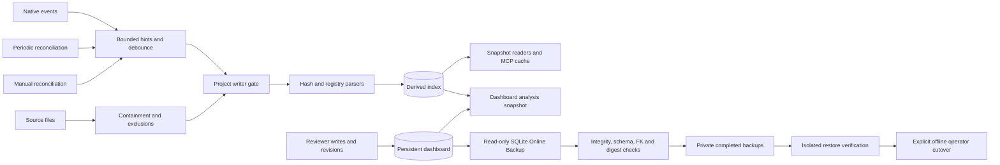
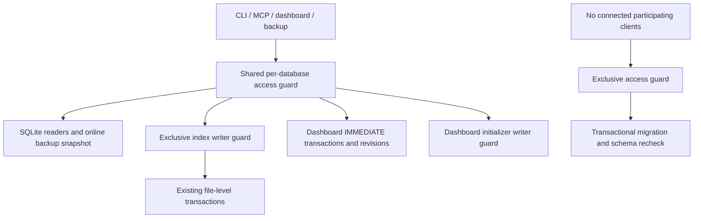
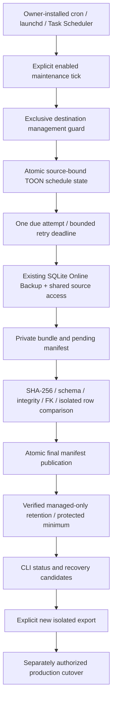

# Reliable indexing, user-state backup and recovery

Status: proposed whole-system architecture; incremental implementation in review.
Date: 2026-10-25. Owner: storage/indexing maintainer; current executor: Codex.
Baseline and limitations: [verified audit](storage-reliability-audit.md).
Existing dashboard semantics remain defined by [ADR-019](adrs/019-dashboard-sqlite-store.md)
and [lifecycle](web-database-lifecycle.md); this specification does not duplicate
the review API contract. Decisions: [ADR-020](adrs/020-user-state-backup.md)
and [ADR-021](adrs/021-index-writer-and-generations.md).

## Problem, goals and non-goals

Derived graphs are recoverable from source; reviewer work is not. Native events,
SQLite transaction atomicity and revision checks each solve different problems.
They do not by themselves guarantee complete change detection, repository-wide
snapshot consistency, power-loss durability or recoverable user-state backups.

Goals, in order: recoverability and integrity, correct/fresh queries, bounded
concurrency and resource use, compact relevant context, simple local operation,
Linux/macOS/Windows support and conservative backward compatibility.

Non-goals: external database services, distributed leases, network filesystem
WAL, arbitrary historical recovery, executing repository code, following external
symlinks, automatic production restore, arbitrary old-binary write support,
introducing a telemetry service or weakening review association to hide findings.

## Constraints and ownership

| Owner | Permitted actions | Coordination |
| --- | --- | --- |
| Index writer (CLI or MCP background worker) | Reconcile and mutate derived index; migrate only supported schemas | One project-scoped OS lock covering migrations and each complete run |
| MCP/CLI readers | Query supported index; no user-data migration | Connection-local read transactions for composite results; generation checks |
| Dashboard store | User-state CRUD with revisions and content checks | Short SQLite IMMEDIATE transactions; independent of index writer lock |
| Background maintenance | Reconcile/refresh embeddings, backup scheduling | Same writer gate for index changes; one backup scheduler per project |
| Backup worker | Read-only snapshot of supported user database; write private artifacts | Separate connection; no Store::open on source, no source migration/checkpoint |
| Restore operator | Validate candidate and explicitly perform offline cutover | All user-database clients closed; ownership evidence and authorization |

Keep the two databases. No cross-database atomic-write invariant is required;
the dashboard joins immutable analysis snapshots with independently revisioned
annotations and fails stale writes closed. Retain orphan notes and decisions.
Never use index row IDs as durable user identities. Never delete `.mct-index`
as a rebuild shortcut. Existing public MCP signatures and LanguageParser stay
unchanged in the first slices. Schema/trait/tool changes need the repository's
prior-issue process before implementation/publication.

## Functional requirements and acceptance

| ID | Requirement | Acceptance evidence |
| --- | --- | --- |
| IDX-01 | Events are hints; reconcile content at startup, on errors/overflow, periodically and manually | Miss a notification deliberately; periodic scan converges to fresh full-index fixture |
| IDX-02 | Added/changed/deleted/renamed files and ignore edits converge without stale graph edges | Compare path-scoped and full rebuild graphs, including move+edit and case-only rename |
| IDX-03 | Hash unchanged bytes before skipping parser; persist parser/exclusion compatibility metadata | Unchanged parse counter stays zero; parser/exclusion changes invalidate affected inputs |
| IDX-04 | Parse complete bounded UTF-8 buffers through registry plugins; grammar selection stays in language crates | Polyglot fixtures, syntax failure, oversized/invalid input, no input execution |
| IDX-05 | File graph replacement is atomic; composite readers pin one SQL snapshot; completed generation is explicit | Concurrent reader sees coherent snapshot or explicit stale/unavailable status |
| IDX-06 | Persist run-start/run-finish state; recover interrupted runs before reporting clean freshness | Kill writer after a file commit and before completion; restart reconciles outstanding state |
| IDX-07 | Bound event queue/path set, batch age, parse buffers and workers | Event flood causes one dirty/full-scan flag; memory plateau and starvation check |
| DB-01 | All writable connections enable foreign keys, explicit busy deadline and appropriate WAL durability | Per-role pragma tests and bounded busy tests |
| DB-02 | User saves survive reindex; revisions never regress or silently reattach ambiguous records | Notes/comments/decisions/copy-label fixtures remain byte/logically equivalent |
| DB-03 | Refuse unsupported future schema before unsafe writes; migrations are transactional and backed up | Future-version refusal, injected migration failure, original backup reopens |
| DB-04 | One project writer gate covers index migration and run; process death releases ownership | Two real processes contend; kill holder; next compatible writer succeeds |
| BAK-01 | Back up dashboard with SQLite Online Backup, including committed WAL | Writer remains open with autocheckpoint disabled; restored rows contain WAL-only commits |
| BAK-02 | Validate structure, FK constraints and supported schema; hash artifact; publish completion atomically | Corrupt, truncated, wrong-schema, mismatched-manifest and incomplete bundles rejected |
| BAK-03 | Do not mutate source, reindex, migrate, overwrite or silently delete data | Source values/version unchanged; existing backups survive failed operations |
| BAK-04 | Configurable interval/destination/count/age/space budget; clean only verified owned artifacts after new success | Deterministic retention/space/failure tests, symlink/foreign artifact preservation |
| REC-01 | Restore candidate only into an isolated private workspace by default; never auto-cutover | Full table/metadata comparison on restored fixture; live destination remains untouched |
| REC-02 | Operator cutover requires verification, client shutdown, pre-restore preservation and rollback plan | Offline process matrix and explicitly authorized rehearsal; stale WAL cannot replay over replacement |
| OBS-01 | Expose minimal freshness, compatibility, backup and conflict diagnostics | Status tests distinguish unknown/never/stale/failure; no notes/tokens/source text in logs |
| MCP-01 | Keep results accurate, bounded, paginated and deduplicated across cache/index changes | Existing quality/budget suites plus concurrent-generation fixture; no relevance regression |

## Data lifecycle and indexing pipeline

## Phase 4 — autonomous, atomic index reconciliation (2026-10-25)

### Verified starting behavior

`Index::reindex` walks the project tree, uses content hashes to skip unchanged
registered source files, and removes rows only after considering unreadable
paths. `Index::reindex_paths` handles watcher hints for files/directories and
falls back to a full walk for ignore-rule changes. A successful run resolves
symbols and references from persisted rows. Per-file and sweep transactions
make each mutation internally consistent, but they commit before the overall
run completes. A later SQL error can therefore leave several files updated and
the rest old. The watcher coalesces events, caps its final distinct path batch,
and requests a full scan for reported errors/overflow or failed updates. It
currently waits indefinitely when idle, uses an unbounded event channel, and
exits when that channel disconnects. MCP requests in one server share an async
mutex around the same `Index`; separate processes can read while the writer is
between committed file updates. Query-cache hits are revalidated against the
current index before reuse.

### Decision and guarantees

IDX4-01: Keep native notifications as low-latency hints and add periodic full
hash reconciliation (default five minutes, configurable with
`--reconcile-interval-seconds` or `MCT_REINDEX_RECONCILE_SECS`). A zero debounce
continues to disable the watcher and its reconciliation. Missed intervals
coalesce to one full scan. Notification errors, queue overflow and a failed
update request a full reconciliation. A disconnected watcher reports the
failure, makes one final scan attempt, then exits; the periodic path cannot
revive a failed OS watcher. Manual `reindex` remains available.

IDX4-02: Use one SQLite `BEGIN IMMEDIATE` transaction for each complete full or
path-scoped indexing run, including row sweeps, issue updates, completion time
and a monotonically incremented `index_meta` generation. This reuses the
existing key-value metadata table and requires no schema migration. The
transaction commits only after traversal, writes and symbol-change accounting
finish. Any database error or panic rolls it back; process termination relies
on SQLite rollback. In WAL mode, readers that began before publication keep
seeing the previous committed state; new readers see the new generation.
Generation is a database commit sequence, not a filesystem snapshot: a source
edit after that path was read may be reflected on the next event or scheduled
reconciliation. Status reports the last completed full reconciliation and
generation; read failures keep old rows and prevent a clean-freshness claim.

IDX4-03: Hold the existing project writer guard through the transaction and
run, without holding it for read queries. Preserve parser plugins, hash skip,
ignore rules, symlink containment, file-level update semantics, and the
independent dashboard database. Readers continue under WAL, subject to normal
SQLite busy behavior and retained WAL pages while long readers remain open.

IDX4-04: Bound worker-side pending event delivery to one coalesced message and
at most 256 distinct paths; saturation promotes work to a full scan. Cap the
quiet wait at 30 seconds from the first event in a batch so continuous writes
cannot starve indexing. Keep full-tree traversal and parser input limits as the
resource bounds. This does not bound the OS/debouncer's internal allocation for
a single very large native event burst.

IDX4-05: A generation is a completed database transaction. Syntax errors,
unsupported formats and unreadable paths are per-file diagnostics; unreadable
paths retain their last-good rows and mean the source view may be stale. A
SQLite/index-wide failure aborts publication. Successful cache entries remain
safe because cached symbol hits are checked against current rows and file
fingerprints before reuse.

### Alternatives and consequences

A staging-generation schema could keep a long writer's new rows fully separate,
but needs a schema issue, duplicate storage and reader pinning. A temporary
database plus replacement complicates WAL, lock ownership and Windows cutover.
Keeping per-file commits has lower writer occupancy but cannot prevent readers
from seeing mixed repository states. The selected single transaction is the
smallest schema-free mechanism that gives all SQLite readers an old-or-new
committed database state. Its tradeoff is a longer SQLite writer transaction
and possible WAL growth if old read snapshots remain open; realistic large-repo
duration/RSS/WAL measurements remain acceptance work.

### Acceptance and Definition of Done

- Idle watcher reconciliation detects a missed add, edit, rename and deletion.
- Event channel saturation and watcher errors converge via full reconciliation;
  continuous event streams dispatch within the maximum batch age.
- Full and path-scoped indexing increment generation only on successful
  publication. A second SQLite reader sees the previous generation while a
  deterministic writer is paused mid-run, then sees the complete new state.
- Injected failure and subprocess termination leave the prior committed graph
  intact; restart reconciliation converges from current source.
- Read failures, parser diagnostics, future-schema rejection, writer conflicts,
  ignore rules, symlinks, dashboard data and backup concurrency retain their
  defined behavior.
- MCP evaluation, token budgets and response correctness remain unchanged;
  report the tested OS and reproducible scan/query measurements.

Cross-platform watcher behavior remains subject to native CI. Advisory locks do
not constrain legacy or external SQLite writers. A generation does not freeze
the source tree; events plus reconciliation provide eventual freshness.

This diagram is the target design. The writer gate, periodic timer, durable run
generations, scheduled retention and production cutover are not delivered by the
manual backup slice.

1. Exclusion and containment checks reject generated/private/backup paths before
   queuing. Do not follow directory symlinks. Protect physical root and test
   Windows case folding, reparse points, path prefixes and file replacement.
2. Native notifications coalesce into a bounded set; overflow, backend failure
   or uncertain directory rename marks the project dirty. Debounce defaults
   remain backward compatible (currently 15 seconds); a proposed 60-second max
   batch age prevents continuous writes from starving indexing.
3. Independently schedule full content reconciliation every five minutes by
   default, configurable from 30 seconds to 24 hours. Disabling notifications
   must not silently disable an explicitly configured reconciliation timer.
4. Acquire the writer gate, preflight schema, mark run in progress, read/hash
   bounded files, parse changed buffers and transactionally replace each graph.
   Keep language grammar state local to the parser's concurrency contract;
   file-level incremental processing does not imply retained Tree-sitter trees.
5. Queries resolve cross-file targets from current records. Composite reads pin
   one read transaction. A completed generation advances only after the sweep,
   diagnostics and dependent index work succeed. Readers may use a consistent
   partial working snapshot only when explicitly labeled updating/stale; they
   must not present it as a completed repository generation. If callers require
   the last completed graph during a run, staging/generation tables are a later
   separately reviewed schema option, not an implied property of per-file WAL.
6. After a crash, a durable incomplete-run marker triggers content reconciliation
   before clean freshness. SQLite rolls back unfinished transactions. No user
   database rebuild or automatic user-data deletion occurs.

## Concurrency and compatibility

Use a maintained portable OS advisory-lock abstraction, or stable Rust file
locks when the supported MSRV/platform matrix allows them. Lock a persistent,
owner-controlled project lock file; do not unlink/recreate it while clients run.
OS close/crash releases ownership. PID/timestamp text is diagnostic only; never
steal ownership based on age or PID reuse. Acquire before writable open/migration.
Reader-only clients do not compete for the indexing gate.

Legacy executables that do not participate cannot be made safe by adding a lock
to new code. Inventory and stop them through an explicitly authorized operator
procedure before deployment. Unsupported schema refusal is an additional boundary,
not a substitute for that rollout. Minimum compatible reader/writer versions
and parser/exclusion versions need a reviewed schema decision and issue.

Dashboard SQLite serializes its writers independently. Keep optimistic revision
checks inside each write transaction. Prefer `synchronous=FULL` for durable user
saves, subject to measured cost and explicit behavior documentation; index
durability can be lower because it is reconstructible. Bound busy retries;
report conflicts/busy errors, never replace a failed mutation with partial success.

## Backup strategy

Select Online Backup API with bounded page steps, a pinned source read snapshot,
bounded busy retries/deadline and a separate private destination connection.
The source opens read-only without migration/import. Validate source schema,
then copy; release source snapshot before slower verification to bound WAL pinning.
Check the destination with `PRAGMA integrity_check` (all results must be exactly
`ok`), `foreign_key_check` (zero rows), and the supported dashboard schema.
Reopen the closed standalone artifact; calculate streaming SHA-256.

Publish a versioned TOON manifest last, atomically, after syncing database and
metadata. Manifest fields: artifact format, creation/completion time, schema,
SQLite/application version, byte size and digest. Do not include source paths,
source content, notes or capability tokens. A directory without a completed
manifest is incomplete and never eligible for restore. A digest detects damage,
not malicious tampering/authenticity or encryption.

Proposed automation defaults: hourly while dirty, first backup after first
successful save, 24 successful snapshots, age cleanup disabled, 256 MiB per
snapshot and 1 GiB retained total. These are conservative configurable policy
limits, not current production guarantees. Never delete the last known-good
backup to free space for a new one. Refuse new work when limits cannot be met;
keep an explicit failure/age signal. Maintenance enumerates only its own manifest
format in its private directory, rejects links, and prunes only after a verified
new backup is durable. Quotas must account for in-progress space and safety margin.

Default destination: `.mct-index/backups`, excluded by the existing `.mct-index`
rule. Custom destinations inside source are refused unless under `.mct-index`;
external destinations require owner-controlled private permissions and cannot
be assumed excluded from a different indexed project. Backups have Unix 0700
directories / 0600 files; Windows requires an owner-only ACL validation in release
acceptance. No encryption until a key-management threat model is agreed. Never
serve backup routes through the dashboard or MCP; files remain confidential.

## Recovery runbook and failure scenarios

| Scenario | Controlled response | Limits |
| --- | --- | --- |
| A: derived corruption | Stop index writers with authorization; preserve evidence; rebuild only analysis through project tooling in isolation, then validated cutover | Do not delete the directory or dashboard; source revision determines reconstructed graph |
| B: user corruption | Refuse unsafe writes; inventory completed candidates; verify hash/schema/integrity/FKs and isolated restoration; request operator cutover | No automatic replacement; latest snapshot can omit later saves |
| C: interrupted indexing | Detect incomplete run, reconcile content, publish clean completion only afterward | Per-file commits survive; no claim of all-or-nothing run rollback |
| D: failed migration | Transaction rollback, preserve original and pre-migration snapshot, report version/error; use a compatible binary on an isolated copy | Downgrade unsupported; restoring older snapshot discards later work |
| E: accidental user edit | Restore snapshot to an isolated workspace; inspect/export recoverable values, then explicit revision-checked correction | Comment edits/copy-note history may not exist; no arbitrary point-in-time claim |
| F: outdated executables | Refuse incompatible schema/ownership; identify loaded binaries; authorized shutdown/upgrade rollout | New advisory locks cannot constrain noncooperating legacy processes |

Before destructive cutover: record candidate identity/hash/schema, verify a full
isolated restore, establish all clients closed (including MCP review readers),
preserve current DB plus WAL consistently if readable, retain corrupt evidence
if not, and obtain explicit operator authorization. Stage replacement on the same
filesystem and sync it. Closed old WAL/SHM files must be quarantined with the old
state; never leave them beside a replacement DB. Use a documented recoverable
cutover journal because a multi-file rename is not one portable atomic operation.
Open the new DB with a compatible binary, run integrity/FK checks, verify known
records and only then resume writes. Rollback after new writes requires manual
reconciliation; copying the old file back loses those writes.

No production restore command is part of the first implementation slice.
The isolated verification command rehearses the SQLite copy and validation path;
it is not proof that production shutdown/cutover works.

### Delivered manual interface (phase 2a)

The local uncommitted implementation adds `dashboard-backup [--destination DIR]`
and `dashboard-backup-verify --backup DIR`; see [command details](../../COMMANDS.md#dashboard-backup-and-isolated-verification).
It accepts only the current dashboard schema and verifies the expected tables
and columns, without applying a migration. Older snapshots require their matching
compatible binary; this first interface does not upgrade them. The source remains
logically read-only. A bundle is complete only after its atomic manifest appears.
It has a fixed 256 MiB snapshot limit and a 60-second stepped-copy deadline, not
configurable automation/retention or a hard wall-time bound on integrity checks.
New bundles and restore-check workspaces explicitly request Unix 0700; database
and manifest files are 0600. Windows ACLs and directory flush semantics remain
release acceptance gaps. No stored last-restore marker or production restore is
implemented. This slice alone does not satisfy BAK-04, REC-02 or whole-system DoD.

SQLite mechanism references: [Online Backup API](https://www.sqlite.org/backup.html),
[VACUUM INTO](https://www.sqlite.org/lang_vacuum.html#vacuum_with_an_into_clause),
[WAL](https://www.sqlite.org/wal.html) and
[integrity/FK checks](https://www.sqlite.org/pragma.html#pragma_integrity_check).

## Diagnostics, security and performance

Reuse tracing and existing status surfaces. Add last successful/attempted index,
duration, parsed/skipped/removed counts, generation, in-progress/dirty state,
schema compatibility, busy/ownership conflicts, last backup/failure/age and last
isolated-restore verification. Unknown must remain unknown. A full integrity
scan is explicit or scheduled during low activity, not on each MCP query.
Do not log source, symbol names, notes, sensitive absolute paths or access tokens.

Reject path traversal, links and nonregular backup artifacts; no interpolation of
untrusted SQL/path strings. Validate manifests with strict keys and size bounds.
Use trusted directory ownership to address path-check/open races. No scripts
execute repository source. A read-only WAL connection may need SHM access;
read-only means no logical user writes, not a promise of no SQLite sidecar I/O.

Performance targets are **proposed acceptance budgets**, not measured gains:
on a documented 1,000-file/100,000-symbol local SSD fixture, unchanged runs parse
zero files; one-file update settles within debounce + 2 seconds p95; empty-event
reconciliation within its interval + scan duration; metadata MCP p95 <100 ms
outside active maintenance; no >10% relevance/latency regression versus an
identified baseline without explanation. Backup busy waits stop within a bounded
deadline; long integrity/IO syscalls are not hard-real-time bounded. Collect
RSS peak, wall/CPU time, bytes written/WAL growth, DB bytes, latency p50/p95,
top-k expected-symbol recall/MRR and response bytes/estimated tokens. State the
estimator; never present estimated tokens as a model's exact tokenizer count.

Benchmark cold/warm full build, unchanged scan, one-file edit, rename/delete,
burst/overflow, backup under writes and query-during-index. Use generated or
licensed fixed fixtures, pinned revision/toolchain/platform, three warmups and
at least ten measured repetitions (more for p95), separate cold results. Existing
`mct-eval`, query-cache/budget tests and token-report tooling remain the baseline;
do not overwrite the baseline to conceal regressions. No benchmarks claimed here.

## Milestones and affected files

| Phase | Priority / dependency | Scope and ownership | Required checks |
| --- | --- | --- | --- |
| 1 Integrity foundation | P0 / audit | This SDD, inventory, ADRs; compatibility and WAL/recovery fixture tests; single implementation agent | Preservation, schema rejection, migration rollback, reindex-with-reviews |
| 2a Manual backup / isolated verification | P0 / 1 | `mct-cli/src/web/backup.rs`, shared store schema preflight, CLI dispatch, command/runbook docs | Live WAL, corruption, manifest damage, future/wrong schema, no source creation/migration, private paths, round trip |
| 2b Automated backup policy | P0 / 2a reviewed | Separate scheduler/config/retention module beside backup; dashboard save/maintenance integration | Interrupted publication, disk limits/full, retention links/foreign files, retry and failure diagnostics |
| 3 Index reliability | P1 / issue for schema work | `mct-index/src/indexer.rs`, schema/run metadata, `mct-mcp-server/src/background.rs` | Lost events, overflow, continuous stream, subprocess crash/restart, complete-generation semantics |
| 4 Runtime coordination | P0 before production / reviewed compatibility issue | Index writable-open gate, CLI/MCP lifecycle, status/diagnostics | Multi-process contention/crash/restart, old binaries, Linux/macOS/Windows |
| 5 MCP acceptance | P1 / 3–4 | Composite query snapshots, generation/cache checks, existing evaluation/benchmarks | Query consistency, relevance/budgets, reproducible latency/RSS/write baselines, runtime review lifecycle |

Each phase is independently reviewable; no parallel agents on shared contracts.
If independent work is delegated later, use separate Git worktrees/branches and
explicit ownership, with one integration owner. Do not commit/publish without
the owner's permission. Current Git ref-write restrictions must be resolved
before branch-isolated integration.

## Definition of Done and production preconditions

- All requirement rows have implementation and executed acceptance evidence;
  pending phase rows cannot count as complete architecture.
- Persistent reviews/notes/comments survive changed and full reindexes;
  conservative identity/orphan semantics and optimistic revisions remain intact.
- Backups include WAL commits, validate, retain safely and restore successfully
  in isolated fixtures; failures, corruption, wrong schema and disk limits fail
  closed. Production cutover has its own authorized rehearsal and rollback plan.
- Concurrent processes cannot silently interleave unsafe runs; legacy writer
  inventory/upgrade is complete. Network filesystem use is excluded.
- MCP queries remain correct, bounded and relevant; reproducible baseline and
  changed measurements support any performance claim.
- `cargo fmt --all -- --check`, workspace tests and all-target Clippy pass;
  official all-feature strict CI checks and mct-eval are recorded separately.
  Native backend and Windows ACL/filesystem acceptance are executed on real OSes.
- Documentation states actual implementation status, commands and limits;
  runtime/browser evidence is distinguished from historical/operator evidence.
- Deployment, production migration, shutdown and destructive restore require
  separate explicit authorization. No such authorization is inferred here.

## Writer coordination slice — 2026-10-25

Design review: APPROVED for local implementation by the single coordinator under
this owner request. No SQL schema, parser trait or MCP signature changes. This
approval does not authorize deployment, production migrations or restoration.
ADR-021 defines the selected protocol and limitations. Acceptance remains REVIEW
until the new tests and platform matrix have evidence.

### Requirements and boundaries

- WC-01: Use Rust standard-library OS file locks (Rust >=1.89), persistent sibling
  lock files keyed by canonical database parent/name. Never unlink, truncate,
  steal by PID/age, or inherit a shared handle into a child intentionally.
- WC-02: Hold a shared access barrier for each participating SQLite connection.
  Ordinary readers and writers coexist. Acquire an exclusive barrier for schema
  migration or future offline replacement; no restore command is introduced.
- WC-03: Acquire an independent exclusive writer lock for each complete index
  run, exclusion-driven reindex and embedding mutation. Release before invoking
  post-reindex hooks to avoid recursive lock acquisition. In-memory tests need
  no filesystem locks. Different database files/projects remain independent.
- WC-04: Dashboard CRUD stays serialized by SQLite IMMEDIATE transactions and
  optimistic revisions. Serialize initialization/import with its writer lock;
  migrate only under exclusive access. Multiple dashboard Store handles coexist.
- WC-05: Inspect schema before changing WAL/settings; reject future schemas.
  If migration is needed, close the provisional connection and release shared
  access before exclusive acquisition. Recheck schema under exclusive access.
  A current open connection prevents a cooperating incompatible migration.
- WC-06: Lock polling uses nonblocking OS calls and a monotonic bounded deadline
  (default five seconds per acquisition, 10ms polling). Index mutations use
  zero timeout and explicit contention, so an MCP-held local mutex never sleeps
  waiting for another process. Startup/migration/maintenance may wait. No fairness or
  hard-real-time filesystem guarantee. No async cancellation API is introduced:
  synchronous callers finish or fail within the contention deadline; process
  termination releases locks. Never hold an SQL transaction while waiting.
- WC-07: Online backup holds shared access only, plus its existing pinned SQLite
  snapshot. Verification of isolated artifacts needs no production lock. A
  replacement operator must close all clients and acquire exclusive access;
  no automatic cutover or protection from nonparticipating tools is claimed.
- WC-08: Reject linked/nonregular DB and lock files, Unix hardlinks/public lock
  files, and Windows reparse points. Canonical parent resolves project aliases.
  Trusted owner-controlled local directories are required; hostile local path
  replacement and network filesystems are outside the safety boundary.
- WC-09: Unexpected replacement by external tools is unsupported; shared access
  prevents cooperative replacement only. Never delete lock files to fix busy.
  Legacy executable inventory/authorized shutdown remains a production gate.

Acceptance: real subprocess handshakes test same-project contention, distinct
projects, readers, normal/abnormal exit, deadlines, migration/maintenance refusal,
future schema, concurrent index runs and legacy bypass; retain backup and review
revision tests. Report OSes actually run. Run official workspace checks and eval.
Measure baseline/changed fixture runs and lock acquisition overhead separately;
never infer production performance or token improvement from microbenchmarks.
DoD requires these checks plus Linux/macOS/Windows and controlled legacy rollout;
unavailable native acceptance keeps the phase PARTIALLY DONE.

### Ordered follow-up (supersedes phase numbering above for new work)

1. Current phase: writer coordination, no schema change or production operation.
2. Phase 3: automatic backup scheduling, retention, quotas, validation/diagnostics.
3. Phase 4: periodic reconciliation, missed events, crash/run generation metadata
   (prior issue required for SQL schema changes).
4. Phase 5: operator process inventory/compatibility, production backup and offline
   cutover rehearsal, native platform/browser checks and reproducible benchmarks.

### Implemented component flow

The shared guard is not an exclusive read lock: normal readers and writers
coexist. Exclusive maintenance is acquired only after provisional shared handles
close. This does not add completed repository generations or production restore.

## Phase 3 — Automated backup management (2026-10-25)

Design approved for local implementation under the owner request; production
scheduling/cutover remains separately authorized. Reuse ADR-020 and the existing
Online Backup engine. No SQL migration, daemon, MCP API or frontend change.

### Decision and requirements

AB-01: Use an external-scheduler maintenance command, disabled unless `--enabled`
is supplied. cron/launchd/Task Scheduler invoke once per minute with identical
explicit policy flags. Unlike an in-process worker this works when MCP/web are
closed and has no shutdown thread. Installation is an operator action. One
catch-up backup is due immediately on first use or a missed interval, never a
burst. UTC persisted timestamps cross restarts; bounded SQLite copy and OS-lock
waits use monotonic clocks. Backwards wall-clock movement fails closed.

AB-02: Hold an exclusive OS-backed destination management guard across discovery,
state transition, snapshot, verification and retention. Manual snapshots use the
same guard. Distinct destinations/projects are independent; bind managed state
and receipts to the canonical source identity and refuse mixed managed sources.
Legacy processes/external tools remain outside the cooperative boundary.

AB-03: Defaults: interval 24h, retry delay 5m doubling to 1h (bounded attempts per
invocation: one), 7 backups, age 30d, quota 1GiB, minimum 2 verified points,
reverification every 7d. Persist last attempt/success/verification, failure class,
consecutive failures and lifecycle in bounded atomic TOON state. No notes/paths
in failure logs. Enable and policy are explicit command configuration, not hidden
application defaults. Process kill leaves bounded temporary output; next run
reconciles actual verified bundles and does not trust state alone.

AB-04: Completion requires manifest, digest, schema, SQLite integrity/FK and
isolated Online Backup restoration checks. Discover manually created valid
bundles too, but retain/delete only matching managed receipts. Missing/incomplete,
future-schema, corrupt and unknown contents are never recovery points. Periodic
verification uses the same verifier. Listing reports verified current evidence;
status must not call manifest presence recovery readiness.

AB-05: Retention follows successful creation/verification or successful scheduled
reverification only. Never delete after a failed new backup. Protect newest,
minimum count and explicit `preserve` marker. Delete only exact known regular
bundle files with matching ownership receipt; unknown files/links prevent delete.
Do not recursively remove arbitrary directories. Recheck before deletion. Count
and quota are soft safety limits when minimum/preserved/incomplete/foreign files
prevent compliance; report unsatisfied constraints and never remove last point.
Bound catalog traversal; refuse ambiguous or hostile layouts. Trusted private
local directories required; network filesystems and malicious owner mutation are
unsupported. Windows ACL/directory flush require native acceptance.

AB-06: Persist isolated recovery into a new private destination only. Verify the
candidate, restored schema/integrity and logical table contents before atomic
publication. Never replace an existing directory or active dashboard DB. Production
requires authorization, legacy inventory, all clients stopped and exclusive
maintenance, precautionary snapshot where feasible, verified cutover and rollback.

AB-07: Synchronous one-shot cancellation: normal completion is bounded by engine
copy deadlines; termination releases OS locks and leaves incomplete output
unrecognized. No automatic production replacement or unattended cleanup of
incomplete output. No guaranteed hard deadline for filesystem/integrity calls.

### Acceptance and Definition of Done

Deterministic due/restart/backoff/retention/corruption/symlink/quota tests, real
subprocess duplicate-execution and lock-release tests, existing WAL/review/schema
and writer tests, isolated restore table equivalence, workspace fmt/tests/strict
all-feature Clippy/eval/diff checks. Measure fixture backup/verify/retention and
MCP behavior without inferring production improvement. Report unavailable fault
injection, memory/disk-write and OS evidence explicitly. Completion requires native
OS matrix and authorized operational rehearsal; local implementation may enter
REVIEW independently. Subsequent phase 4 adds periodic source reconciliation and
index generations; phase 5 covers controlled rollout and production acceptance.

Receipt identity includes canonical-source digest, exact attempt and ordering.
Malformed receipts never grant deletion ownership. Recovery of a published attempt
also runs missed retention. Storage inventories include unknown regular files;
unsupported nested layouts/links fail closed. A source relocation does not silently
rebind old managed ownership. The new isolated directory can remain empty/incomplete
on an OS publication error; existing destinations are never overwritten.

## Phase 4 — Autonomous incremental and consistent indexing

### Verified baseline and requirements

The source index already hashes source contents, skips unchanged files, parses
through the registered Tree-sitter language parsers, and accepts incremental
path batches from the filesystem watcher. The watcher debounces events, applies
ignore rules, and requests a full walk when notify reports a rescan condition,
a batch is too large, or an earlier update fails. Before this phase, individual
file/sweep changes committed separately; no periodic idle reconciliation ran.
The MCP server's in-process `Index` mutex already serialized its own watcher and
tool calls. Separate processes could read between individual SQLite commits.

### Chosen consistency contract

- IDX-01: A successful `reindex` or `reindex_paths` run is one
  `BEGIN IMMEDIATE` SQLite transaction. File rows, symbols, issue/dependency
  sweeps, run timestamp and generation increment commit together. A returned
  error, panic, or process exit before commit does not publish its changes.
- IDX-02: `index_meta.published_generation` is a monotonically increasing run
  sequence in the existing key/value table; old indexes without the key report
  generation zero. It is not a source-tree snapshot identifier.
- IDX-03: After parsing source bytes, the indexer rereads and hashes that file
  before writing its rows. If bytes changed during parsing, the run aborts and
  the watcher/full reconciliation retries. Changes after that validation are
  found on the next event or periodic reconciliation.
- IDX-04: File-level conditions with existing conservative semantics remain
  visible in status: syntax/unsupported-language diagnostics can be recorded in
  a committed generation; unreadable paths retain their last good rows and are
  reported as stale. A full walk with unreadable paths does not advance
  `last_full_reconciled_at`. Transaction-wide failures publish no generation.
- IDX-05: MCP handlers pin one SQLite read transaction before their related
  reads, including composite symbol/relation/source handlers. Cache validation
  checks the committed generation before and after its multi-query decision and
  rejects a result that crosses publication. Separate pagination requests and
  separate subcalls in an MCP batch are independent requests and may use
  different generations. `navigation_snapshot` reuses a caller-pinned snapshot
  instead of starting a nested transaction.
- IDX-06: Event-driven updates remain enabled by default. A full hash walk is
  also run after five idle minutes (configurable with
  `--reconcile-interval-seconds` or `MCT_REINDEX_RECONCILE_SECS`, minimum 60).
  Missed intervals coalesce. Notify overflow/error or a bounded queue overflow
  becomes a full walk. Debounced path batches contain at most 256 unique paths;
  continuous changes dispatch within 30 seconds. Failed work uses the existing
  bounded retry/backoff. Setting watcher delay to off disables both paths.
- IDX-07: Full scans reuse file hashes, so unchanged source content is not
  reparsed. Existing `.mct-index` exclusions and safe no-follow path behavior
  remain authoritative. Dashboard storage and review identities are untouched.
- IDX-08: Missing generation metadata is treated as legacy generation zero;
  malformed or exhausted counters fail closed instead of silently resetting.

### Alternatives and tradeoffs

One run-wide write transaction is selected over per-file transactions because
it is the smallest atomic publication mechanism with SQLite WAL. A reader in
another process sees the prior committed state, then the new generation after
commit. In this server process, the existing async mutex serializes indexing and
tools, so requests wait for the run; this phase does not claim concurrent local
MCP reads during a long scan. A long writer can grow the WAL while old read
transactions remain open. Staging tables, duplicate generation databases, or
copy-on-write replacement would permit a more concurrent long-running rebuild
but add substantial storage, migration, and lifecycle complexity. Per-file
transactions were rejected because they expose mixed repositories to external
readers.

This transaction boundary guarantees a coherent committed database state, not
an immutable filesystem snapshot. Source mutations observed during parsing abort
the run; mutations afterward converge through notifications or the next
periodic reconciliation. Unreadable files retain prior rows and are surfaced as
stale, rather than being falsely counted as a successful full reconciliation.

### Phase 4 acceptance and recovery

Use isolated temporary repositories and databases to verify: add/edit/delete/
rename, unchanged hash skip, missed event and idle reconciliation, parser-time
source mutation, reader old/new visibility across commit, killed writer rollback,
generation monotonicity, watch overflow/retry behavior, and unchanged dashboard
records. MCP composite calls must be snapshot-pinned and query-cache decisions
must reject cross-generation validation. Existing backup tests must remain
unaffected. Platform-specific notify behavior and native lock semantics must be
recorded only on platforms actually run. Production index rebuild is never an
authorization to touch `dashboard.sqlite3`.

Definition of Done additionally requires official workspace fmt, tests, strict
all-feature Clippy and MCP evaluation; documented measurement of full,
incremental and unchanged reconciliation cost; accurate Linux/macOS/Windows
results; and controlled production/legacy-process acceptance. This local change
does not claim benchmark improvements or native Linux/Windows acceptance.

## Phase 5 — detection and effective review stability (2026-10-25)

### Scope and verified gaps

Existing identities, exact block fingerprints and the shared read-only
`ReviewSnapshot` already implement most review semantics (ADR-018/019).
Finding decisions are pending/confirmed/false_positive/ignored. Copy workflow
labels are pending/accepted/rejected/in_review/ignored and never suppress groups.
At the start of this phase the detector aggregated relation target names across
languages: unrelated homonyms could hide candidates. At the start of this phase dashboard and CLI composite analysis reads did not
pin an index snapshot, unlike MCP operations from Phase 4. The Phase 5
implementation below addresses those two gaps; verification is tracked separately.

### Required semantics and design before implementation

- Keep all identity namespaces and existing user schemas. Dead identities include
  language/path/kind/parent/name and an ordinal resolved conservatively through
  retained fingerprints. Duplicate identities include language and sorted member
  path/name/kind tuples. Ambiguous associations remain unverified.
- Fingerprints use complete verified source blocks, including whitespace,
  comments and line endings. Line movement and edits outside those blocks keep
  decisions; any in-block text change requires reevaluation. Renamed paths/names,
  changed group membership and unverifiable source cannot inherit suppression.
  Restoring the original identity/content can reactivate its current stored
  decision; arbitrary historical decisions are not automatically replayed.
- Only current verified false_positive/ignored finding decisions suppress normal
  actionable output. Confirmed/pending, changed, ambiguous and unreadable findings
  stay visible. Dashboard All and CLI --include-reviewed retain raw findings.
- Dead-code candidates remain heuristic, never proof of dead code. Count indexed
  references within the explicit parser target language when supplied, otherwise
  the source language, without hard-coded language lists.
  Cross-language FFI/reflection and same-language homonyms remain uncertain;
  names alone do not establish cross-language usage. No visibility/CFG inference
  or new language support is claimed.
- Pin a bounded SQLite read snapshot across each dashboard snapshot build and CLI
  analysis/report operation, including fingerprint inputs. Existing WAL writers
  continue independently; separate requests can observe later generations.
- Preserve user decisions, copy labels, notes, comments, history, revisions,
  archive rules, compatibility checks and backups. No migration or production
  write is required. Reuse existing suppression/identity APIs.

### Acceptance, limits and Definition of Done

Isolated regressions must cover cross-language homonyms, same-language
references, unchanged full/incremental indexing, line movement, block text edits,
renames, membership changes, disappearance/reappearance, independent copy labels,
source verification and MCP/CLI/dashboard effective decisions. Existing conflict,
backup, coordination and generation tests must pass. Target: zero repeated
review tasks for verified unchanged fixtures and all deliberately changed/new
fixture findings remain actionable. No latency regression claim without paired
measurements; preserve current query/token budgets and run quality evaluation.
Full acceptance additionally needs labeled precision/recall beyond these
fixtures, platform CI and native dashboard acceptance. Record unavailable
evidence explicitly; passing regression counts alone do not prove accuracy.

## Phase 6 — authoritative saved and effective review state (2026-10-25)

Design before implementation: reuse ADR-019, schema4, exact verified block
fingerprints and the shared read-only ReviewSnapshot. No migration, new tool,
identity namespace, automatic note reassociation or frontend redesign.

The current model has finding statuses pending/confirmed/false_positive/ignored
and independent copy statuses pending/accepted/rejected/in_review/ignored.
Every explicit transition between allowed values is permitted. Restoring a
finding means explicitly saving pending; invalidation changes only effective
state and never rewrites the saved decision. Confirmed means confirmed problem,
not resolved/suppressed. Accepted is a copy workflow label, not a group decision.
Only valid false_positive/ignored finding decisions suppress actionable output.

The finding detail API must expose saved_decision separately from effective
state, including retained orphans and explicit resets. Add review_validity with
not_reviewed/reset/unchanged/changed/unavailable/not_current, effective_decision
(null when no decision applies), and actionable (current and not suppressed).
Unavailable source includes stale, unreadable and ambiguous verification; do not
claim these are proven edits. Keep existing state/status fields compatible.
Legacy decisions may apply without a SQLite saved_decision and have no timestamp.
Use existing State evaluation rather than another suppression policy engine.

Pin a bounded deferred SQLite read transaction while composing finding detail:
state, revision, stored record, history, comments and copy revisions must share
one WAL snapshot. Other connections may commit; old replies must carry the old
revision and conflict on save. Read errors return500, never fabricated pending.
RAII releases snapshots on all response/error paths. No network waits inside.

Acceptance: all copy transitions and explicit finding resets remain independent;
forced failures roll back decision/history/revisions; concurrent connections
preserve snapshot/revision coherence; orphan/changed/unavailable/reset details
explain validity without losing historical records. Reuse Phase5 full/incremental,
line movement, renames, membership and MCP/CLI suppression fixtures. Target zero
repeated actionable tasks for verified unchanged suppressing decisions and zero
suppression of deliberately changed/new labeled findings. Existing409/draft,
backup/isolated restore, coordination and generation tests must pass. Bound history
at existing50000 rows, copy rows20000, active/restored decisions100000 each;
no unlimited audit promise. Measure actual write/validation cost and MCP eval.
Done requires checks, native/platform acceptance and documented operational limits;
local automated success alone does not establish deployment acceptance.

## Phase 7 — dashboard concurrency and acceptance (2026-10-25)

Implementation scope authorized by the Phase 7 request. Reuse schema 4, WAL,
review aggregate revisions and existing authenticated, same-origin POST routes.
No new database, service, migration or automatic reassociation.

### Contract and implementation order

1. Comment edit/delete requires `kind`, `id`, `comment_id`, `expected_revision`
   (and `body` on edit). The token is the owning finding revision from the
   coherent finding detail. Validate ownership and compare inside the same
   IMMEDIATE transaction before mutation. Missing/invalid token:400; stale:409;
   absent or differently owned comment:404. Legacy unsafe requests fail closed.
   Creation remains append-only and does not require a token. Each successful
   mutation advances the existing aggregate revision exactly once. No timestamp
   is a concurrency token. Unrelated annotation writes may conservatively conflict.
2. Add a shared comment editor to existing dashboard views. Key in-memory drafts
   by finding and comment id, preserve original revision/text across refresh,
   navigation, collapsing and 409. Fetch latest explicitly before rebasing;
   deleted comments remain unavailable and cannot be recreated by an edit.
   Disable duplicate submissions; preserve input typed during a pending save.
   No browser restart/crash durability or automatic retry of append is promised.
3. Display saved versus effective decision and validity using Phase 6 fields.
   Copy labels remain independent. Open/Close All never writes and retains drafts.
4. Use native buttons/labels, visible focus, live status, escaped text, responsive
   wrapping, keyboard-operated controls. No claimed WCAG certification.

### Acceptance and safeguards

Deterministic independent-connection stale edit/delete and ownership tests;
HTTP 400/404/409 plus unchanged stored text/revision on rejection; atomic comment
creation; Node draft/conflict/in-flight save and bulk-control regressions.
Run official workspace fmt/tests/strict Clippy/eval, Node and diff checks.
Real browser: isolated fixture and exact rebuilt binary/assets, two-tab review
AND comment conflicts, request methods/tokens, 375px/tablet/desktop, keyboard and
focus. If native control/socket unavailable, record NOT TESTED and provide
operator steps; Node does not establish browser acceptance. No production data
or existing server is modified. No new dependencies.

DoD requires passing available automation AND documented actual native acceptance.
Unverified native/platform/resource checks keep the phase PARTIALLY DONE.

Phase7 native finding: a rendered `muerto` GET after unchanged reindex keeps
the old Site stamp, unlike API GETs; source validation then conservatively
marks a saved decision unavailable. Reuse existing refresh_if_stale before
rendered analysis/review GETs, excluding assets and version polling. Preserve
CSRF and POST stale-snapshot rejection. Add a real-handler unchanged reindex
regression before the correction. Explicitly label group versus copy comments.

The existing refresh is asynchronous and throttled; scheduling it alone does not
fix the first rendered read. Separate read applicability from write freshness:
verify identity and exact source against indexed file hashes for reads, without
using an unrelated generation stamp as evidence of changed source. Writes still
require the current stamp AND verified content. Old-generation freshness remains
observable through version/rebuilding diagnostics; changed/unreadable content
still cannot validate a decision. No synchronous long rebuild on the HTTP thread.

## Phase 8.1 — MCP duplicate discovery

The owner-approved additive contract is issue #233, implemented using the
existing index and dashboard reader. The authoritative MCP input/output,
review validity, generation, budget, failure and acceptance requirements live
in [mcp-protocol-spec.md](mcp-protocol-spec.md#phase-81--review-aware-duplicate-retrieval-233)
and ADR-022; this section does not duplicate that contract.

Storage invariants: no new migration/database, no writes to reviews/history,
no source bodies or notes in retrieval. One index snapshot includes detector,
navigation and published generation; review state uses its own independent
snapshot. Cross-database and cross-request atomicity are not claimed. Shared
`duplicate_states` supplies both diagnostics and existing CLI visibility flags.
A valid group-level dismissal suppresses only the verifiable unchanged group;
copy labels do not decide group visibility. Source changes/unavailability and
ambiguous identities preserve history without claiming current applicability.
Existing backup/restore/coordination checks remain release gates.

## Phase 9 — Integrated acceptance and hardening

Scope: verify the current uncommitted candidate, not the deployed/installed
executable. Preserve production databases and running services. No schema, MCP
contract, detector threshold or authentication redesign is authorized by this
verification scope. Fix only reproduced defects with focused regressions.

### Required gates and threat model

- Integrity: unchanged reindex preserves decisions, notes, comments and history;
  valid false-positive/ignored decisions suppress findings before pagination;
  changed/unavailable/ambiguous source cannot inherit verified suppression.
  Copy statuses remain independent. Stale review/comment edits and deletions
  return 409 without changing newer data; in-tab drafts remain available.
- Index publication: independent readers see complete committed generations;
  killed writers roll back, source changes during parsing abort publication;
  idle reconciliation repairs missed notifications without reparsing unchanged
  content. Overflow/disconnection recovery must be distinguished from native
  platform event delivery, and tested separately.
- Backup: Online Backup, digest/manifest/schema/integrity/FK checks and isolated
  restoration preserve user rows. Failed/interrupted verification never becomes
  a valid recovery point. Retention protects minimum verified points, arbitrary
  files and symlinks. Concurrent ticks have one participating owner.
- Boundaries: untrusted HTTP/MCP inputs and repository text must not escape the
  root, execute code, inject SQL/HTML or leak notes/tokens. Exercise same-origin,
  CSRF, bounded request parsing, parameter validation, symlink refusal and CAS.
  OS locks are advisory: nonparticipating legacy binaries remain an explicit
  operational blocker, not a guarantee supplied by the new protocol.
- MCP: real client handshake/tools/list/tools/call, immutable read-only review
  state, per-operation snapshots, deterministic offset pages and explicit budget
  truncation. No cross-request pinned generation or cross-database atomicity.
- Frontend: official pinned asset regeneration and byte comparison; exact built
  asset delivery; native desktop/tablet/375px, keyboard/focus/labels/live status,
  two-tab conflicts and network inspection. Node tests do not prove WCAG AA.
- Platforms: run native macOS, Linux and Windows tests against the SAME candidate
  source, using CI's pinned Rust 1.96.0. Historical remote runs cannot validate
  uncommitted source. Missing platforms stay NOT TESTED until operator evidence.
- Dependencies: fresh native audits against authoritative lockfiles. Cached
  advisory results must disclose database revision/date and update failures.

### Measurement and evidence

Use the existing verification document as the requirement-to-test/gate matrix;
keep raw logs under target/phase9-logs. Record environment, source/binary digest,
commands, passed/failed/ignored counts and unsupported checks. Measure identical
synthetic fixtures at multiple sizes, repeated samples, median/p95/variance,
index size, available CPU/RSS/I/O counters and real MCP transport exchanges.
Response, catalog and whole-workflow estimates are separate; no claim of billed
or agent-reasoning tokens. Existing evaluation baseline quality must not regress;
its existing 500ms per-case p95 gate applies. New resource/large-query results
are baselines, not invented improvement targets. Cancellation/fairness and full
agent workflows require explicit evidence beyond short single-client timings.

DoD: all mandatory gates PASS, or owner explicitly accepts the documented
platform/operational exceptions. FAIL/BLOCKED/NOT TESTED gates prevent a full
Phase 9 DONE claim. Production rollout, legacy shutdown, real-user restoration,
rollback drills and final operational acceptance belong to Phase 10 and require
separate authorization. Never equate unit-test success with release readiness.

## Phase 9.1 — Blocker resolution and release evidence

Scope: stabilization of the preserved candidate, no schema/tool contract or
detector changes. QA-002 remains unresolved until reproduced with diagnostics
or an explicitly accepted, tested risk disposition; repeated passes alone do
not close it. Preserve the 30-second test bound and distinguish test kqueue
from normal-build FSEvents. Capture bounded child diagnostics on failures.

Deadline acceptance: an already expired worker deadline must take precedence
over queued notifications, including excluded/access-only events. Otherwise a
ready channel can starve reconciliation and the maximum batch age. Test this
with an injected monotonic Instant and a pre-filled channel, without sleeps.
This is independent of the historical intermittent failure unless evidence
links them. Record the actual selected backend at watcher startup.

Mandatory gates remain the Phase 9 gates, with separate frontend official
regeneration/byte correspondence, fresh RustSec fetch, native Linux/Windows,
corrected executable browser delivery, keyboard/focus/screen-reader/contrast,
and sustained resource measurements. Each gate requires dated commands and
candidate identity; missing evidence is NOT TESTED or BLOCKED, never PASS.
Registry/authentication/integrity protections must not be weakened to fetch
packages. No unapproved publication to obtain CI. No production replacement.

Use bounded repeated tests, normal dependency-only builds for production
backend acceptance, isolated fixtures and existing profiling harnesses. Record
failures even if later retries pass. DoD requires all mandatory gates or an
explicit owner-approved exception; prepare remediation instead of deployment
when a critical or infrastructure gate remains unresolved.

Generation test isolation: temporary database roots must be distinct even when
SystemTime repeats a clock tick across parallel tests/processes. Reserve the
fixture directory atomically and assert seeded old-generation symbols before
starting an interrupted update. A forced repeated nonce must not share roots.
Keep any historical generation failure open until its cause is established;
an isolation correction alone does not prove the observed rollback was sound.

Security follow-up after native advisory refresh: current RustSec21d909e4
(2026-10-24,1352advisories) flags Tokio1.53.1 underRUSTSEC-2026-0386, an
unsound AsyncFd constructor API with potential I/O-lifetime misuse. Official
patched1.53line begins1.53.3. Assess the minimal existing-dependency patch
and run affected asynchronous/MCP/CLI tests plus strict all-feature checks;
no new dependency/service/schema/tool contract. Do not call the advisory a
proven reachable exploit without call-site evidence. paste maintenance and
yoke-derive yanked warnings remain separate, not equivalent severities.

Relocated build caches must not reuse integration executables embedding old
CARGO_BIN_EXE paths. Clean/recompile binary-owning workspace packages in the
isolated target; inspect generated .d environment dependencies to confirm
that spawned binaries belong to that target. Copying a cache alone is not
a proof of isolation. Native builds must remain in a separate directory.
