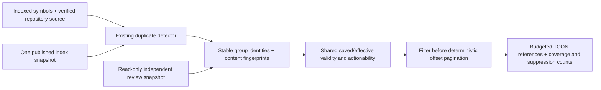

# Storage reliability implementation and verification

Date: 2026-10-25. Base `b61cc7ce971fdc46a61259af95af7fac823ae352`,
`feature/dead-code-editor` plus pre-existing uncommitted work. No commit created.
Owner and continuation: [checkpoint](../../project-management/checkpoints/storage-reliability.md).
Architecture requirements: [SDD](storage-reliability-spec.md).

## Delivered slice

Manual consistent dashboard backup and isolated restore verification, with no
schema change, new service, automatic production migration or user-data cutover.

| Exact changed path | This task's change |
| --- | --- |
| `crates/mct-cli/Cargo.toml` | Enable rusqlite's existing `backup` feature; no dependency-version bump |
| `crates/mct-cli/src/main.rs` | Add backup/verify commands before any index open |
| `crates/mct-cli/src/web.rs` | Register the backup module only; retain prior dashboard edits |
| `crates/mct-cli/src/web/store.rs` | Extract existing migration list without changing it; add nonmigrating current-schema/table/column preflight |
| `crates/mct-cli/src/web/backup.rs` | Read-only WAL-aware snapshot, copy limit/deadline, validation, SHA-256, private artifacts, atomic completion manifest and disposable restore verification |
| `crates/mct-cli/src/web/backup_tests.rs` | Seventeen integrity, failure, isolation, permissions and round-trip tests |
| `README.md`, `COMMANDS.md`, `CHANGELOG.md`, `ARCHITECTURE.md` | Document manual commands and the distinction between rebuildable index and irreplaceable dashboard data |
| `docs/01-architecture/web-database-lifecycle.md` | Add a dated pointer to this follow-up; preserve earlier runtime/browser evidence |
| `docs/00-system/00-index.md` | Link audit, SDD and documentation inventory |
| `docs/01-architecture/storage-reliability-audit.md` | Verified architecture, evidence limits and ranked risks |
| `docs/01-architecture/storage-reliability-spec.md` | Requirements, recovery matrix, target architecture, milestones and DoD |
| `docs/01-architecture/storage-documentation-inventory.md` | Markdown purpose/audience/update/relationship inventory |
| `docs/01-architecture/adrs/020-user-state-backup.md` | Snapshot alternatives and tradeoffs |
| `docs/01-architecture/adrs/021-index-writer-and-generations.md` | Proposed ownership/generation/reconciliation decision |
| `docs/01-architecture/storage-reliability-verification.md` | This evidence record |
| `project-management/checkpoints/storage-reliability.md` | Authoritative task/checkpoint/continuation |
| `project-management/{PROJECT_STATE,TASKS,AGENT_REGISTRY,DECISIONS,HANDOFF,REPORT,SESSION_LOG}.md` | Short task references; earlier records retained |
| `errors/REGISTRY.md`, `errors/HISTORY.md` | Append the repeated known eighteen parse diagnostics without declaring resolution |

## New focused verification

Environment: native Darwin arm64, rustc 1.98.1 (48a229cea, 2026-09-01),
cargo 1.98.1 (797e8a9bc, 2026-08-05). Dedicated build directory
`target/storage-reliability`; the existing executable was not replaced or restarted.
The locked libsqlite3-sys 0.38.2 source header reports bundled SQLite 3.53.2;
this is build-input evidence, not a version check of already running binaries.

Executed:

```sh
CARGO_TARGET_DIR=target/storage-reliability cargo test -p mct-cli web::backup -- --nocapture
```

Final focused result: **17 passed, 0 failed, 0 ignored**, 0.34 seconds test time
(not a backup performance benchmark). Earlier development attempts failed on
unsupported `u64` SQL reads and then on temporary-directory permissions; both
were corrected before this result. Temp directories now explicitly request 0700
on Unix instead of relying on tempfile defaults. Formatting passed afterward.

Tests establish committed live-WAL recovery while the writer remains open,
full restored equality of reviews/history/comments/copy labels/meta/sequences,
source preservation, absent-source noncreation, old/future/wrong schema refusal,
corrupt source rejection, incomplete/tampered manifests and artifacts, bounded
copy timeout and busy target, pinned snapshots across independent commits,
foreign-key failure rejection, actual store migration rollback, no-overwrite
bundles, project-path exclusion and Unix permissions/link checks.

The interrupted-bundle test removes a completion marker; it is not a subprocess
kill or power-loss experiment. Busy/deadline checks do not prove hard-real-time
bounds on blocking filesystem IO or integrity scans. The migration fixture injects
a schema-name collision; it is not an exercised production migration.

Both commands' `--help` outputs executed successfully. Negative CLI checks against
an empty physical temporary root returned failure without creating `.mct-index`
or user data. No production database was accessed by these checks.

## Workspace checks

Executed through the official script:

```sh
MCT_CHECK_TARGET_DIR=target/storage-reliability \
MCT_CHECK_LOG_DIR=target/storage-reliability-logs \
scripts/unix/check.sh --isolated-target --no-fail-fast
```

This ran workspace formatting, workspace tests without fail-fast, all-target,
all-feature strict Clippy and mct-eval. Result: **all checks passed**.

| Check | Actual result |
| --- | --- |
| Formatting | PASS |
| Workspace tests | 1,887 passed, 0 failed, 24 ignored |
| Clippy, workspace/all-targets/all-features | PASS, with `-D warnings -D clippy::unwrap_used -D clippy::expect_used -D clippy::panic` |
| mct-eval | PASS, no regressions versus the existing checked-in baseline |
| Final focused backup tests after publication hardening | 17 passed, 0 failed, 0 ignored |
| `git diff --check` and new architecture-document local links | PASS |

The full workspace suite was repeated after final backup-only parent-directory
sync, clock validation and pre-open digest-order hardening: **1,887 passed,
0 failed, 24 ignored**, exit 0. Command: the script above with `--only test` and
log directory `target/storage-reliability-final-tests`. The final focused rerun,
Clippy, evaluation and formatting also cover the final source. No subsequent
source changes were made.
Local verbose logs are in `target/storage-reliability-logs`; they must not be
mistaken for permanent published artifacts.

## Benchmarks and historical evidence

No new indexing/backup RSS, disk-write, database-size, p95-latency or relevance
improvement is claimed. The SDD defines reproducible workloads and targets.
The new `mct-eval` run used `omni-app`, 33 cases and five timed iterations each:

| Metric | New observation |
| --- | --- |
| Accuracy / success rate | 1.000 / 100.0% |
| MRR, ranked cases | 0.917 |
| Query latency p50 / p95 / max | 2.49 / 11.98 / 20.11 ms |
| Fixture index build | 147.4 ms |
| Response / tool catalog tokens | approximately 6,843 / 11,433 |

These are fixture measurements from the existing evaluation harness, not a
production benchmark or evidence of an improvement caused by backups. Tokens are
estimates from that harness. Reproduce with the official script above or
`CARGO_TARGET_DIR=target/storage-reliability cargo run -q -p mct-eval`.
Broader storage-performance baselines remain pending.
The prior lifecycle's Rust/Node/browser/WAL claims were read, not rerun as that
same historical revision. Earlier successful browser checks do not prove current
production cutover or Windows/Linux/native FSEvents behavior.

## Data protection and remaining acceptance

No production service shutdown, dashboard schema migration, restoration,
database deletion, commit, push, merge, publication or browser automation.
Existing user work was retained; unrelated dirty files were checked against
pre-edit SHA-256 hashes. Source/destination link checks require trusted private
directories; adversarial directory replacement and Windows ACL/directory flush
acceptance remain unresolved.

Phases 2b–5 are pending: scheduled policy/retention, total-space limits, writer
coordination/legacy rollout, durable run generations, periodic reconciliation,
diagnostics, crash/multiple-process campaigns, performance baselines and authorized
production cutover. The manual feature's 256 MiB limit does not limit total
accumulated backups. Current-schema-only preflight does not upgrade older backups.
Schema/tool/trait changes still require the repository's prior-issue process;
no issue was published. Git ref creation and process listing were denied even
after requesting outside-sandbox execution. Branch isolation and live ownership
evidence remain integration/deployment prerequisites.

Overall status: **PARTIALLY DONE**. The audit/design and a tested manual backup
slice do not constitute completed reliability architecture or production readiness.

## Final tested source fingerprints

Uncommitted source identity after all checks; SHA-256:

| Path | SHA-256 |
| --- | --- |
| `crates/mct-cli/Cargo.toml` | `787c9fb33cd309bdbd9b687bc8f4a0757c5db7bf43d078e1a30b578932f2d0a9` |
| `crates/mct-cli/src/main.rs` | `4c98acf6ffb81e88683c25a1942ec9a1d5ad0af791207fd5af3fd69d45a421f2` |
| `crates/mct-cli/src/web.rs` | `3e06f197312ec3d24a594c9e20cb7bcd869e3528e0fcb90a4176c2e26ad7e6b6` |
| `crates/mct-cli/src/web/store.rs` | `5a7f7a940bd2a436c9980471266f0b17c25a5824f98ece3257b9a59bb881d6c1` |
| `crates/mct-cli/src/web/backup.rs` | `148c971fa4b08841fe353ffaef5c6d60c2b61976962c39471ef6feba8b84a686` |
| `crates/mct-cli/src/web/backup_tests.rs` | `462c5e86ca5be60febcfb947a43aba8ff99446b2dbb1444727a34736849b6cdc` |


## Writer coordination — current slice, 2026-10-25

This section supersedes earlier statements that writer coordination is wholly
unimplemented. Automatic backup policy, completed index generations and production
cutover remain future work. The preceding backup-only measurements and source
fingerprints describe the previous slice, not this final source tree.

### Implementation and reviewed boundaries

New `crates/mct-index/src/coordination.rs` supplies OS-backed RAII shared access,
exclusive writer and exclusive maintenance guards. No dependency or SQL schema
was added. `Index` holds access until after connection close and guards complete
runs, exclusion updates and embedding mutations. Hooks execute after writer
release. Index contention fails immediately, before persistent mutation.
`IndexError::Coordination` carries actionable errors without source/user content.
`ReviewSnapshot` holds shared access and refuses dashboard schema versions newer
than its supported version; a regression checks that the actual Store migration
version agrees with that cap.

`Store::open` serializes initialization/import and requires exclusive connection
access for pending migrations. Its existing short SQLite/revision transactions
still coordinate ordinary review/comment saves. Online backup holds shared access
and its pinned SQLite snapshot, so ordinary writes remain possible. Verification
restores only disposable candidates. No production restore command was added;
maintenance guards are a prerequisite for a future cooperative offline cutover.

New tests: `crates/mct-cli/tests/writer_coordination.rs` (nine tests, real child
processes with READY/stdin handshakes), and
`crates/mct-cli/src/web/coordination_bench.rs` (schema-cap regression and explicit
paired fixture measurement). `web.rs` registers that test-only module.
`ISSUES_PENDING.md` records why the performance test is deliberately ignored in
the correctness suite. No timing assertion substitutes for correctness.

Real-process coverage includes same-database contention, different databases,
connected SQLite readers, normal exit, killed child cleanup, bounded timeout,
migration refusal while a reader is connected, maintenance refusal, future schema
rejection before WAL changes, concurrent indexing, fail-fast reindex, and a hook
which performs a separately guarded embedding mutation. A deliberate direct
SQLite writer test demonstrates that legacy/nonparticipating clients bypass the
protocol; this is a documented limitation, not a safety claim.

The first development run failed because connection-local SQL functions needed
registration before migrations; this was fixed with `open_with_setup`. Subsequent
validation found a missing ignored-test ledger entry and child cleanup on the
failed-start path; both were corrected. An additional measurement setup run reused one Cargo target for baseline and
candidate concurrently; mismatched build artifacts caused unresolved-symbol
errors. Both processes finished, then the current source was rebuilt sequentially.
Those failed/mixed-artifact logs are not acceptance evidence. Child cleanup only terminates children created by these isolated tests.

### Operational acceptance and protection

Branch remains `feature/dead-code-editor` at
`b61cc7ce971fdc46a61259af95af7fac823ae352`, with all prior uncommitted work retained.
New branch creation failed even after escalation (cannot create/lock Git refs).
Process enumeration was also denied even after escalation (`operation not
permitted: ps`). Live executable identity, project roots and legacy ownership
therefore remain unverified. No existing service was stopped, production database
opened for tests, schema migrated in production, commit or publication performed.
Builds use `target/storage-reliability`, preserving installed/running executables.

Only macOS arm64 native execution is available here. Linux and Windows subprocess,
ACL, file sharing and crash acceptance must run on their native runners. The
protocol assumes private owner-controlled local directories; network filesystems,
external replacement and lock-file unlinking are unsupported. Read-only clients
need access to the coordination files, but never acquire the writer gate for a
query. Timeout is per acquisition, not a total startup deadline; no async cancel
API or fairness guarantee is introduced.

Operator sequence: inventory all loaded executables and canonical project roots;
verify compatible versions, validate a dashboard backup, obtain any required
shutdown authorization, close all clients before migration/offline cutover, and
restart only participating executables. Never delete lock files to clear busy.
Keep rollback binaries compatible with the installed schema. Locks cannot enforce
this policy against an executable that ignores them.

Copyright attribution now names Arkaitz Zubizarreta alongside contributors in
`LICENSE` and `README.md`, as requested. Apache-2.0 terms and third-party notices
are unchanged; no ownership transfer or legal immunity is implied.


### Executed acceptance for this source

Official execution (2026-10-25, macOS arm64, rustc1.98.1/cargo1.98.1):

```bash
MCT_CHECK_TARGET_DIR=target/storage-reliability \
MCT_CHECK_LOG_DIR=target/writer-coordination-verified \
scripts/unix/check.sh --isolated-target --no-fail-fast
```

| Check | New result |
| --- | --- |
| `cargo fmt --all -- --check` | Passed |
| Workspace tests | 1,897 passed; 0 failed; 25 ignored |
| Strict workspace/all-target/all-feature Clippy | Passed, no warnings; additionally denies unwrap/expect/panic outside permitted tests |
| Nine subprocess/ownership regressions | Passed, included above |
| Existing 17 backup tests and review/revision regressions | Passed, included above |
| `mct-eval` | Passed, 33 cases, accuracy1.000, MRR0.917, 100% success |
| `git diff --check` | Passed |
| Native Linux / Windows | Not executed; runners unavailable |
| Frontend / browser | Not executed for this backend-only slice; prior UI changes preserved |

The additional ignored test is the explicitly run performance fixture, not a
skipped correctness regression. Older 1,887/24 results remain historical evidence.
Current MCP harness: ~6,843 response tokens, ~11,433 catalog tokens, p50/p95/max
2.08/13.99/55.01ms and fixture index build126.7ms. These are debug fixture
observations, not production bounds. No relevance/token reduction is claimed.

Source SHA-256 after the successful checks:

| Path | SHA-256 |
| --- | --- |
| `crates/mct-index/src/coordination.rs` | `be018b1b3b4d777cef44dab832f9bee18d0028ffcb3217a0bd354fdb0f754750` |
| `crates/mct-index/src/lib.rs` | `6c92ca85a542c5279874145196b973fbc4fff31d6b6be528695b71630f6fcdbe` |
| `crates/mct-index/src/error.rs` | `fe29cd742e3e8f16e50ba55c9f55542acaa30b308b0130ba0889056a6632facb` |
| `crates/mct-index/src/review_state.rs` | `e210cacc2b5f7c1567742d2715664cc1b52a5115a9e9aed59beb3282aac351d6` |
| `crates/mct-cli/src/web/store.rs` | `e27362ae1225ffaf9532b06a48bd326e7aea679c743535b6cd93e942becb3bb8` |
| `crates/mct-cli/src/web/backup.rs` | `db5461ce41c2803816ec0c096ba427be0658b77e33d2bce21d974a43a7ff84d4` |
| `crates/mct-cli/src/web.rs` | `52ef3c855fc843e1cfeeace437220fb1e4f7e19807d599222b766dbf98e62f87` |
| `crates/mct-cli/tests/writer_coordination.rs` | `503c224d70fece93b0361a53d9fa7199ccbc3781d279c701e6e54337b35d16bb` |
| `crates/mct-cli/src/web/coordination_bench.rs` | `149322fddc6f8bece993e1946f48c8e6eafe99a91669b56b916deda7bdb26098` |


### Paired measurements

Baseline = HEAD plus the preserved pre-task dirty patch and untracked Rust
files; 26 original dirty crate-file hashes match (excluding `web.rs`, which only
registers the same measurement fixture). Baseline/candidate use identical debug
fixture code:100 Rust files,3 warmups,50 measured iterations. No production data.
Build sequentially, retain each executable, then run the binaries sequentially
without Cargo/compiler overlap. Three usable pairs (runs2–4) follow; pair1
coincided with a failed memory-measurement attempt and is excluded. Values are
medians of each run's p50/p95, not pooled sample quantiles.

| Measurement | Before p50 / p95 | After p50 / p95 |
| --- | --- | --- |
| Dashboard save | 641 / 2,465 µs | 638 / 2,673 µs |
| Unchanged scan,100 files | 22,072 / 44,159 µs | 23,652 / 45,422 µs |
| 100 symbol queries | 2,254 / 5,982 µs | 2,258 / 4,505 µs |

Unchanged scan median rose7.2% in this small workload; individual paired medians
vary in both directions (baseline22.070–28.482ms,candidate22.416–25.427ms).
There is no evidence here of a consistent production regression or speedup.
Dashboard writes intentionally have no per-save exclusive application gate.
A separate1,000-sample acquisition+release measurement reports p50/p95
61.083/77.083µs,max7.569ms. It measures the complete safe path/open/lock/unlock
operation, not only the OS locking syscall. No timing assertion is used.

A fresh sequential MCP comparison explicitly verified executable identities:
baseline symbols omit DatabaseAccess; candidate symbols include it. Both run
33 omni-app cases,five iterations,accuracy1.000,MRR0.917,100% success and the same
~6,843 response/~11,433 catalog estimated tokens. Latency p50/p95/max:
before2.72/12.43/19.35ms,after2.43/9.59/19.95ms. Initial fixture index build:
121.6ms before,127.3ms after. These noisy debug observations are not evidence of
an optimization. The earlier mixed-artifact baseline eval is discarded.

Reproduce the fixture on baseline and candidate separately:

```bash
CARGO_TARGET_DIR=target/storage-reliability cargo test -p mct-cli --bin mct-cli \
  web::coordination_bench::coordination_fixture_benchmark -- \
  --ignored --exact --nocapture --test-threads=1
CARGO_TARGET_DIR=target/storage-reliability cargo test -p mct-cli \
  --test writer_coordination uncontended_lock_latency_measurement -- \
  --exact --nocapture --test-threads=1
CARGO_TARGET_DIR=target/storage-reliability cargo run -q -p mct-eval
```

Never run different source trees concurrently against the same Cargo target.
Measurements/logs and preserved source fingerprints are retained locally in the
writer-coordination evidence directory. `/usr/bin/time -l` cannot measure peak
RSS: `sysctl kern.clockrate: Operation not permitted`, including elevated retry.
Memory,disk-write volume,large repositories and sustained concurrent read
throughput remain unmeasured. Read availability during writer ownership is
verified functionally by subprocess tests,not a production throughput benchmark.

Phase status: **PARTIALLY DONE** — local implementation and applicable checks
pass; native Linux/Windows and controlled legacy rollout/production acceptance
remain pending. No automatic backups,reconciliation or generation schema shipped.

## Phase 3 — Automated backup management, 2026-10-25

This section is NEW execution evidence, separate from the earlier 1887/1897
reports. Branch/HEAD remain feature/dead-code-editor /
b61cc7ce971fdc46a61259af95af7fac823ae352 plus preserved local work. A new Git ref
could not be created, including elevated execution. One local writer, no agents,
production DB access by tests, scheduler installation, service stop, migration,
commit or publication. The original dirty diff and file hashes were captured
before changes. Native host: Darwin arm64, rustc1.98.1. Windows/Linux not executed.

### Exact Phase 3 source changes

| Path | Delivered behavior |
| --- | --- |
| `crates/mct-cli/src/main.rs` | Three commands before index open: dashboard-backup-manage/status/restore |
| `crates/mct-cli/src/web.rs` | Register backup_manager; preserve prior web changes |
| `crates/mct-cli/src/web/backup_manager.rs` (new) | Explicit opt-in policy, destination OS gate, atomic source-bound TOON state, retry/missed-run reconciliation, verified discovery/retention/quota/health |
| `crates/mct-cli/src/web/backup.rs` (existing untracked engine) | Reuse Online Backup; common secure destination and manual gate, receipt, pending manifest then verified publication, streaming isolated table comparison/export; test-only fault/barrier hooks |
| `crates/mct-cli/src/web/backup_manager_tests.rs` (new) | Twenty deterministic, fault, process and workload tests, including subprocess helper and measurements |
| `crates/mct-cli/src/web/backup_tests.rs` | Existing invalid-FK test accepts safe rejection before destination creation; still asserts no artifact. No integrity assertion removed |

Internal APIs: `backup_manager::run`/Policy; backup `prepare_destination`,
`create_managed` under caller-owned destination guard, `restore_into`. Existing
`create` and `verify_restore` interfaces/eight-field manifest remain compatible.
DatabaseAccess and Store/SQL schema/dependencies/MCP contracts are unchanged.

Documentation updated: existing SDD, audit, this verification record, documentation
inventory, ADR020, COMMANDS, web-database-lifecycle, tasks/plan, CHANGELOG,
errors/REGISTRY and HISTORY. Private owner-only checkpoints are not publication
artifacts. ADR021 stays unchanged; it remains source writer/generation ownership.

### Actual validation and revision boundaries

1. Full official check:
   `MCT_CHECK_TARGET_DIR=target/storage-reliability MCT_CHECK_LOG_DIR=target/phase3-backup-check scripts/unix/check.sh --isolated-target --no-fail-fast`.
   PASS: fmt, **1916 passed /0 failed /25 ignored**, strict workspace all-target
   all-feature CI Clippy, MCP evaluation. This is the milestone before the final
   receipt/recovered-retention hardening and its additional regression test.
2. After that final hardening and deterministic barrier refinement, the complete
   affected CLI package was rerun with the official script:
   `MCT_CHECK_TARGET_DIR=target/storage-reliability MCT_CHECK_LOG_DIR=target/phase3-backup-final scripts/unix/check.sh --isolated-target -p mct-cli --no-fail-fast`.
   PASS: fmt, **279 passed /0 failed /1 ignored**, strict all-target/all-feature
   Clippy for the affected package/dependencies. Includes all20 new tests, the
   existing17 backup tests and all9 writer-process tests. Unchanged workspace
   crates retain step1 evidence; no fictional final1917 workspace run is claimed.
3. Dedicated single-thread lifecycle and loaded-MCP measurements both PASS
   (one test each). Exact commands below. Actual binary CLI smoke: help/policy
   flags exposed; disabled manage on an empty temporary root creates NO files;
   enabled manage on an absent database fails without creating a database.
4. `git diff --check`: PASS. Source/preservation hashes recorded outside the
   checkout; pre-existing changes outside the documented Phase3 scope unchanged.
   No frontend changes in this phase, hence no new browser/frontend result.

New coverage: due/disabled/missed-run/restart/backoff; two child processes contest
one owner; normal completion and SIGKILL before/after publication; OS release and
adoption; missed retention after adoption; malformed ownership receipt refusal;
count/age/quota/minimum/preserve/manual/unknown-file protections; corrupt/incomplete
and zero-valid status; inaccessible destination, schema rejection and symlinks;
injected StorageFull during snapshot and verification; isolated export equality
and no-clobber; active transactional WAL updates produce consistent counter pairs;
actual MCP responses unchanged during backup workload and unchanged indexing.
Fault injection is not an actual full disk, power cut or filesystem crash test.

Development failures are retained in local logs and superseded by step2: an
initial borrow-check failure, incorrect directory-final safe_path use, preflight
manual-command regression and an incorrect protected-count expectation were
fixed. A final receipt-validation edit accidentally required receipt-only `order`
in management state; ten CLI tests failed and the condition was moved to receipt
validation. One subprocess early-publication observation led to replacing stdin
release with an explicit parent-held OS barrier. Final child-process tests pass.
No production state was used to reproduce these failures.

MCP eval:33cases x5timed iterations; accuracy1.000, MRR0.917, success100%, response
~6843tokens, catalog~11433tokens, p50/p95/max2.74/9.77/12.56ms, indexbuild144.1ms.
No regression against checked-in baseline; evaluator/index/server sources were
unchanged by the final CLI-only hardening. These are current executions, not
reuse of the previous phase's numbers.

### Reproducible measurements (final source)

```sh
CARGO_TARGET_DIR=target/storage-reliability cargo test -p mct-cli --bin mct-cli web::backup_manager::tests::benchmark_backup_lifecycle_fixture -- --exact --nocapture --test-threads=1
CARGO_TARGET_DIR=target/storage-reliability cargo test -p mct-cli --bin mct-cli web::backup_manager::tests::mcp_and_indexing_remain_correct_during_backup_workload -- --exact --nocapture --test-threads=1
```

Debug build, native host above, isolated fixtures. Lifecycle:256 deterministic
4096-byte metadata values,5manual snapshots/5verifications,20not-due ticks;
retention revalidates6bundles, no deletion needed in this measurement. Managed
bundle size1237349bytes including metadata. p50 backup216.095ms, isolated
verification94.516ms, idle scheduling tick14.510ms; retention578.895ms (one sample).
Backup includes source preflight, copy, digest, checks and isolated row comparison.

Same binary/fixture sequential load comparison:100Rust source files and~1MiB user
metadata,20samples each,10actual MCP find_symbol calls per query sample plus one
unchanged reindex. A concurrent thread repeatedly creates real snapshots; at
least one completes, responses are byte-equal and reindex remains correct.

| Measurement | Without backup p50/p95 | With backup p50/p95 |
| --- | --- | --- |
| Ten MCP calls | 0.810/1.231ms | 0.902/2.647ms |
| Unchanged100-file reindex | 21.426/27.801ms | 22.784/31.091ms |

These are workload baselines, NOT before/after-code improvement claims. Small
single-host debug samples show contention overhead and do not establish a
production SLO or sustained throughput guarantee. Peak RSS and actual disk-write
amplification were not measured; bundle bytes are not physical writes. No claim
of CPU/memory improvement. Existing1887/1897 measurements remain historical.

### Acceptance limits and operator gates

PARTIALLY DONE: local functionality and affected automated validation complete;
production schedule/cutover and native Linux/Windows acceptance outstanding.
Default disabled; the owner must explicitly install a same-user OS task with
absolute executable/root/destination and identical policy flags. Status reports
invocation policy, not proof of external task installation. Follow COMMANDS for
candidate discovery, isolated restore, source association, authorization,
legacy inventory, precautionary snapshot, exclusive cutover and rollback limits.
No shipped production replacement command exists. Advisory locks cannot stop
legacy/external tools. Network/hostile same-owner filesystem mutation unsupported.
Windows ACL/directory flush, genuine ENOSPC/powerloss, native task startup/shutdown,
large datasets, sustained load and production backup confidentiality/capacity need
operator acceptance. Receipt/state corruption fails closed; do not edit ownership
markers or delete lock files to force progress. Incomplete artifacts require
inspection; no automatic recursive cleanup. Existing overquota refuses growth;
one new point can temporarily exceedquota before conservative retention.

## Phase 4 — Incremental and consistent indexing, 2026-10-25

Initial state independently rechecked: branch `feature/dead-code-editor`, HEAD
`b61cc7ce971fdc46a61259af95af7fac823ae352`, with prior uncommitted storage,
dashboard, prototype and fuzz-lock work preserved. Phase 4 source targets were
clean before this phase. No production index/dashboard DB was opened or modified.

### Implemented files

| Path | Change |
| --- | --- |
| `crates/mct-index/src/indexer.rs` | Whole-run transaction, generation/timestamp metadata, post-parse source hash validation |
| `crates/mct-index/src/lib.rs` | Generation read and pinned SQLite read-snapshot API |
| `crates/mct-index/src/error.rs` | Explicit source-changed-during-index error |
| `crates/mct-index/tests/index_generations.rs` (new) | Complete-run publication, reader old/new visibility, source mutation, killed writer and restart reconciliation |
| `crates/mct-mcp-server/src/background.rs` | Bounded event delivery/path coalescing, idle reconciliation, overflow/disconnect/failure recovery, bounded batch age |
| `crates/mct-mcp-server/src/main.rs` | `--reconcile-interval-seconds`, `MCT_REINDEX_RECONCILE_SECS`, 300-second default and 60-second minimum |
| `crates/mct-mcp-server/src/server.rs` | Per-operation SQLite snapshots for MCP read handlers; hybrid cache candidate generation checked against final response snapshot |
| `crates/mct-mcp-server/src/cache.rs` | Generation fence around multi-query cache validation |
| `crates/mct-mcp-server/src/format.rs` | Published generation and last clean full reconciliation in status output |
| `crates/mct-mcp-server/tests/background_watcher.rs` | Idle missed-event reconciliation test |
| `COMMANDS.md`, `README.md` | User-facing reconciliation configuration and behavior |
| `docs/01-architecture/storage-reliability-spec.md`, `adrs/021-index-writer-and-generations.md`, `tasks/plan.md` | Phase 4 requirements, decision, tradeoffs and next operational gate |
| `project-management/checkpoints/storage-reliability.md`, `PROJECT_STATE.md`, `TASKS.md` | Current continuation and limitations |

No schema migration, dependency, new language grammar, or dashboard write was
added. One full/path reindex is a transaction over SQLite: readers in other
processes retain the old WAL snapshot until commit. The MCP process mutex still
queues its own calls behind indexing. Each MCP handler uses one read snapshot;
separate pages/batch subcalls may see different generations. A source edit
observed during parse aborts; a file changed after validation converges at the
next watcher event/reconciliation. Unreadable paths retain last-good rows and
are visible as stale; they do not advance the clean full-reconciliation time.

### Executed tests and checks

- New index generation integration tests: **6 passed, 0 failed**. The killed
  child process leaves the previous generation and a subsequent isolated
  reindex reconciles it; nested navigation reads reuse an existing snapshot.
- Watcher integration suite: **12 passed, 0 failed**, including a change made
  before watcher startup discovered by idle reconciliation.
- MCP server library tests after status/cache edits: **107 passed, 0 failed**.
  The query-cache integration suite after the final generation-fence design:
  **22 passed, 0 failed**. Hybrid search fences cache candidates by generation
  before and after cache validation, then compares the candidate to the final
  pinned snapshot. It does not repeat cache lookup inside that snapshot, which
  had doubled cache statistics and conflicted with embedding refresh
  transactions in an earlier implementation attempt.
- `cargo fmt --all -- --check` and `git diff --check`: **passed** after latest
  source edits.
- A direct `cargo test -p mct-index` attempt was interrupted while the existing
  exhaustive relation pagination integration test remained active. It is not a
  pass result. The official workspace check is being used for final coverage.
- First full official run completed with **1,918 passed / 7 failed / 25 ignored**.
  One status-format expectation was from a stale test binary/source revision;
  the other failures identified nested read transactions when MCP dead-code
  review filtering called `navigation_snapshot` inside a request snapshot.
  `navigation_snapshot` now reuses an already active read transaction.
  Reproduction checks after the fix passed `mct-mcp-server --test
  review_decisions` (2/2) and `mct-cli --bin mct-cli web::tests_identity` (8/8).
  The generation fixture suite passed 6/6 after adding the nested-reader case.
- Final official workspace tests:
  `MCT_CHECK_TARGET_DIR=target/phase4-check MCT_CHECK_LOG_DIR=target/phase4-final-tests scripts/unix/check.sh --isolated-target --no-fail-fast --only test` — **1,927 passed, 0 failed, 25 ignored**.
- Final official strict workspace Clippy:
  `MCT_CHECK_TARGET_DIR=target/phase4-check MCT_CHECK_LOG_DIR=target/phase4-final-clippy scripts/unix/check.sh --isolated-target --only clippy` — **passed, no warnings**.
- Final MCP evaluation:
  `MCT_CHECK_TARGET_DIR=target/phase4-check MCT_CHECK_LOG_DIR=target/phase4-final-eval scripts/unix/check.sh --isolated-target --only eval` — **no regressions; accuracy 1.000, catalog approximately 11,433 tokens**. This is an evaluation result, not a before/after latency or token-use benchmark.
- Final formatting and whitespace checks: **passed** (`cargo fmt --all -- --check`, `git diff --check`).

No comparable cold/indexed/reconciliation benchmark or before/after MCP latency
campaign was run. Existing MCP evaluation history is not a current Phase 4
measurement. No performance improvement is claimed. Native environment is
macOS arm64 only; Linux and Windows notify/SQLite/lock behavior was not tested.
Legacy/external writers can bypass advisory coordination. Production executable
inventory, index rebuild acceptance and all deployment/data recovery operations
remain operator-owned.

Phase 4 status: **PARTIALLY DONE**. Local implementation and applicable macOS
workspace, lint, formatting, and MCP quality checks pass. Comparable indexing,
reconciliation, RSS/disk, and MCP latency benchmarks, Linux and Windows
execution, production acceptance, and legacy executable inventory remain
outstanding.


## Phase 5 — detection and review stability (2026-10-25)

### Implementation and acceptance scope

Same dirty feature/dead-code-editor base b61cc7ce971fdc46a61259af95af7fac823ae352;
prior source/UI/backup/generation work preserved. No commit, publication, native
browser operation, production review write or production database replacement.
No index/user schema, parser grammar, identity namespace or public API migration.

Production code changed in this phase:
- `mct-index/src/queries.rs`: private target-language name-set query; explicit
  `target_language` overrides source language. Public aggregate counts unchanged.
- `mct-index/src/dead_code.rs`: language-aware reference evidence and a read
  snapshot when no caller transaction exists. Entry/test/kind rules unchanged.
- `mct-index/src/duplicates.rs`: pin a read snapshot when called standalone.
- `mct-index/src/lib.rs`: correct aggregate-count API documentation only.
- `mct-cli/src/web.rs`: one index snapshot for all analysis, released before
  fingerprint upgrades/provenance writes and note loading.
- `mct-cli/src/main.rs`, `src/duplicates.rs`: one snapshot across analysis and
  fingerprint/suppression inputs, released before report output.
- `mct-mcp-server/src/format.rs`: target-language/FFI heuristic caveat.

Tests added in `mct-cli/src/web/tests_identity.rs`, `src/web/tests.rs`,
`mct-cli/tests/review_decisions.rs`, `mct-index/tests/scoped_queries.rs`;
the existing MCP `tests/tools.rs` expectation now requires an uncertain Rust
candidate when only a Python same-name import exists. No Rust binding is proven
by that import; a fake-parser regression separately preserves explicit
cross-language evidence. Existing real-parser Rust/Python regression reproduced
the old false negative before the implementation.

New lifecycle fixtures cover forced/unchanged/path reindex, several line
movements, whitespace/comments/body edits, content revert, symbol/path rename,
deleted/reappearing findings, preserved current records/history/comments, and
API copy-note independence. Existing tests cover membership growth, ambiguous
siblings, 409 conflicts, backups, crashes, coordination and generation caches.
Identity stability is measured on these fixtures, not every supported framework.

### Intermediate checks (not the final acceptance run)

- Real-parser homonym regression initially failed as expected. The first SQL
  implementation used nonexistent `r.file_id`; corrected to relation -> caller
  symbol -> file. The four-test CLI integration target then passed.
- Identity target: 11 passed. API preservation: 1 passed after correcting a caller
  test from unsupported `status=active` to documented `status=pending`.
- Explicit target-language regression: 1 passed.
- First full check: 1,931 passed, 2 failed, 26 ignored. Failures were the missing
  manual benchmark ledger entry and an old test expecting a Python import to
  suppress Rust `compute`. Both corrected; focused ledger/tools run: 38 passed.
- That first full run's strict Clippy and MCP evaluation passed. These results
  do not stand in for the subsequent final combined run below.
- Node dashboard tests: 36 passed, 0 failed, 0 skipped (no native browser).

### Labeled duplicate evaluation

Executed `python3 benchmarks/score_duplicate_labels.py --binary
 target/phase4-check/debug/mct-cli`; full output in
`target/phase5-final/duplicate-labels.toon`. The scorer creates a temporary
project and never executes the corpus code. The current 31-case result matches
checked-in historical `benchmarks/token-twins-labels-integrated.toon` metrics;
that historical file was not rerun as a separate binary baseline.

| Metric | Current result | Interpretation |
| --- | --- | --- |
| Broad grouping | 31/31 exact, 0 unexpected | Expected normalized groups, not proof of semantic duplicates |
| Consistent grouping | 29/29 exact, 0 unexpected | Expected normalization-specific membership |
| Exact grouping | 0 expected, 0 emitted | No recall claim possible for that mode/corpus |
| Verdict exact accuracy | 8/27 = 0.296 | All predictions SUSPICIOUS; no automatic false-positive certainty |
| Labeled subgroup partitions | 14/14 | Limited to the scored labeled partitions |
| Partial blocks | 3/3 precision and recall = 1.000 | Small labeled block fixture only |

The low verdict accuracy is an existing measured limitation, not improved by
review suppression. No claim of general dead-code precision/recall, false-positive
rate, framework coverage or semantic equivalence follows from these checks.


### Final combined validation and measurements

Executed on Darwin arm64, against the complete preserved dirty tree:

```sh
MCT_CHECK_TARGET_DIR=target/phase4-check MCT_CHECK_LOG_DIR=target/phase5-final-recheck scripts/unix/check.sh --isolated-target --no-fail-fast
node --test crates/mct-cli/tests/dashboard_spa.cjs crates/mct-cli/tests/dashboard_copy_labels.cjs
CARGO_TARGET_DIR=target/phase4-check cargo test -p mct-cli --test review_decisions benchmark_language_aware_dead_candidates -- --ignored --nocapture
target/phase4-check/debug/mct-eval --iterations 31 --markdown target/phase5-final-recheck/mcp-measurements.md
```

Final official check: **1,933 passed, 0 failed, 26 ignored**; Rust formatting,
workspace/all-target/all-feature strict CI Clippy and MCP evaluation passed.
The ignored query benchmark was then explicitly executed: **1 passed**.
Node dashboard logic: **36 passed, 0 failed, 0 skipped**. Existing backup/restore,
real subprocess coordination/crash, atomic-generation and review-conflict tests
are included in that new workspace execution, not merely historical results.
Logs: `target/phase5-final-recheck/check-*.log`, benchmark log and MCP Markdown;
Node and labeled-scorer outputs are under `target/phase5-final/`.

Paired query measurement: one warm-up of each algorithm, 51 samples each,
alternating execution order, debug build, same pinned SQLite snapshot and input.
The baseline executes the pre-change name-only candidate algorithm; it is not a
separate old executable or an end-to-end before/after MCP measurement. Fixture:
100 unused Rust functions, 100 called Rust functions and 100 called Python
homonyms. The original algorithm misses all 100 unused Rust functions; the new
one returns exactly those 100 (synthetic precision/recall 1.000). The old
precision is undefined with zero returned candidates. No general accuracy claim.

| Algorithm | Median (ms) | p95 (ms) | Population variance (microseconds squared) |
| --- | --- | --- | --- |
| Name-only baseline | 1.840 | 2.529 | 226411.337 |
| Explicit/default target language | 2.325 | 3.220 | 260102.554 |

Median cost increased by 0.486 ms (26.4%) on that small warmed fixture. This is
a measured correctness tradeoff, not a performance improvement. Host background
load was not controlled; release profiling, larger repositories, CPU/RSS and
SQLite read/write amplification remain unmeasured.

MCP evaluation: 33 cases, 31 timed iterations each after warm-up, accuracy 1.000,
MRR 0.917, success 100%, no checked-baseline regressions. Overall p50/p95/max:
0.80/4.53/10.56 ms; fixture index build 54.3 ms. `find_dead_code` p50/p95:
1.43/3.34 ms, approximately 404 request/response tokens for its case. Across the
suite, response tokens approximately 6,845; catalog approximately 11,433.
Tokens are estimates, not billed model tokens. Evaluation accuracy is matching
expected/absent output evidence, not a labeled static-analysis precision metric.
The evaluator does not supply variance; no old-binary paired MCP/indexing timing
was executed. Do not infer improved latency or generalized detection recall.

**Status: PARTIALLY DONE.** The scoped implementation and local regressions are
verified. Linux/Windows, native browser/runtime acceptance, broader dead-code
labels, low automatic duplicate-verdict accuracy and production acceptance
remain open. Same-language homonyms, self recursion, external APIs, reflection,
macros/conditional features not modeled by parsers, and inferred FFI still limit
static certainty. Exact block review fingerprints do not prove equivalence of
changed dependencies or external runtime behavior. Legacy executables can ignore
advisory coordination. No production cutover, reindex, migration, backup restore,
service stop, commit or publication was performed in this phase.


## Phase 6 — review state execution evidence (2026-10-25)

Initial state independently verified: feature/dead-code-editor at
b61cc7ce971fdc46a61259af95af7fac823ae352 with existing dirty work preserved.
Single Codex writer; no delegate, commit, publication, service stop, migration,
production backup/reindex/restore or review mutation. Task-specific pre-edit
copies are under target/phase6-original. Schema remains4, supported user states
and identity/fingerprint versions unchanged.

### Exact scope

| File | New Phase6 work |
| --- | --- |
| crates/mct-cli/src/web/store.rs | read_snapshot RAII deferred WAL transaction; saved_decision current-row lookup; reuse it in State evaluation; reject invalid current fingerprints as applicability proof |
| crates/mct-cli/src/web/api.rs | Coherent finding detail; additive saved_decision/effective_decision/review_validity/source_verified/actionable; verify current source and fail state reads closed |
| crates/mct-cli/src/web.rs | Verify currently applicable dashboard decisions against source, including missing files before indexing |
| crates/mct-cli/src/web/store_copy_tests.rs | Four tests: all copy transitions, concurrent snapshot/revision coherence, injected rollback, all finding transitions with measurement |
| crates/mct-cli/src/web/tests_decisions.rs | Detail lifecycle from unreviewed through saved/unavailable/changed/reset/orphan; retained history and saved decision |
| crates/mct-cli/src/web/tests_identity.rs | Decision visibility matrix across unchanged reindex, MCP dead query, CLI dead/duplicates and dashboard State |

No frontend, MCP tool signature, schema, migration, identity namespace, parser,
backup engine, coordination or dependencies were changed in this phase.
Documentation: existing SDD Phase6, lifecycle section17, ADR019 D17, audit,
inventory, tasks/plan and error registry/history. No duplicate specification.

### Executed checks

```sh
MCT_CHECK_TARGET_DIR=target/phase4-check MCT_CHECK_LOG_DIR=target/phase6-check \
  scripts/unix/check.sh --isolated-target --no-fail-fast
node --test crates/mct-cli/tests/dashboard_spa.cjs crates/mct-cli/tests/dashboard_copy_labels.cjs
```

Current final result: **1939 passed,0 failed,26 ignored**, formatting passes,
CI-equivalent workspace/all-target/all-feature strict Clippy passes without
warnings, MCP eval passes without baseline regressions. Node:36passed,0failed,
0skipped. Existing review conflict409, full/incremental reindex, dead/duplicate,
backup/isolated restore, migrations, index generations, coordination and actual
subprocess termination/scheduler tests ran inside this current workspace suite.
These are new executions, not the historical1933/36 Phase5 result.

New six regressions passed. Copy matrix covers all25 ordered transitions with
50 saves and unchanged finding decision/history. Finding matrix covers all16
ordered status pairs with32 calls; comments survive. Coherence fixture pins a
reader before another Store commits a verdict/comment, proves old status/history/
comments/revision stay together, then releases the snapshot and observes the new
state; an old revision save fails. TEMP-trigger failure during history insertion
rolls back the preceding decision write and leaves revision/change token intact;
retry succeeds. All destructive operations use disposable projects/databases.

Visibility fixture:8 finding-state observations (four statuses x two kinds),
identity preservation8/8 and saved decisions unchanged after reindex. Four valid
suppressing finding cases have zero repeated actionable findings; confirmed/reset
cases remain visible. Existing Phase5 metamorphic fixtures also ran again: forced
full, unchanged full/path indexing, line movement, in-block edits, restored text,
renames, membership and ambiguous matching. These are labeled fixture outcomes,
not general accuracy estimates. MCP duplicate-specific output is unavailable;
duplicate CLI/dashboard/shared suppression is checked instead.

Development failures retained in local logs: missing new API fields reproduced
red before implementation; macOS uncanonical temporary path was refused by the
existing symlink policy (test fixture corrected); SQLite test metric u64 reads
were replaced by supported i64; saved-row refactor initially tightened an old
invalid-key read lookup (read compatibility restored without weakening writes);
new visibility fixture initially reused an editor after MCP refreshed index
metadata (reload added). Last intermediate web run:177pass/1fail/1ignored before
that fixture correction; focused corrected matrix1pass, then full final check
above passed. No production failure or workaround of security checks.

### Measurement commands and limits

```sh
CARGO_TARGET_DIR=target/phase4-check cargo test -p mct-cli --bin mct-cli \
  explicit_finding_transitions_preserve_comments_and_measure_bounded_reads -- --nocapture
target/phase4-check/debug/mct-eval --iterations 31 \
  --markdown target/phase6-check/mcp-measurements.md
```

Store fixture current execution:1pass; debug Darwin arm64,32calls. Save call
median492.750us,p952811.167us; coherent SQLite detail (saved/effective state,
revision,history/comments, transaction) median216.166us,p95346.666us. The initial
Pending-on-absent calls are intended no-ops, included in the save sample; this is
not an unconditional durable-write latency claim. Nearest-rank p95, median mean
of middle values; no warmup or paired old-binary run. Logical SQLite page growth
0bytes for this small fixture (existing pages held rows); not zero IO/WAL writes,
not a long-term storage growth/resource or full HTTP/source-verification benchmark.
Raw output: target/phase6-store-measurements.log. No performance improvement claim.


MCP current extended run:33cases x31timed iterations after warmup; accuracy1.000,
MRR0.917,success100%, no checked-baseline output regressions. Overall p50/p95/max
2.64/11.98/22.22ms; index build135.6ms. find_dead_code p50/p955.34/10.27ms,
approx404request/response tokens. Response tokens approx6845, catalog11433.
Token counts are estimates; evaluator accuracy matches expected/absent evidence,
not static-analysis precision. Phase5 timings are historical and were obtained
under different conditions: no paired before/after timing or CPU/RSS/disk-write
measurement in this phase, so neither speedup nor a causal latency regression
is established. Full source-verification cost on large review sets remains open.

Final cargo fmt --all -- --check and git diff --check pass after documentation.
Linux/Windows and native browser acceptance were not run. Process inventory
`ps -Ao pid,comm,%cpu,rss` was denied (`zsh: operation not permitted: ps`);
no active-service compatibility/cutover verification is claimed. Existing
nonparticipating legacy executables can bypass application coordination.

**PARTIALLY DONE.** Local scoped changes and automated regressions are verified.
Same-comment update/delete still lacks expected_revision and can overwrite
concurrent comment edits; comments advance the owning finding revision but that
is not comment compare-and-swap. API compatibility and a versioned comment edit
contract remain unresolved. Copy-note/comment edits do not have unlimited history;
review_history remains bounded50000. Native platform/UI/production acceptance,
large-fixture source-verification overhead and broader labeled metrics remain
pending. API diagnostics are exposed without Phase7 UI redesign. No production
user data was modified and no deployment/integration is authorized or claimed.


## Phase 7 — dashboard execution evidence (2026-10-25)

Initial independently verified branch feature/dead-code-editor, HEAD
b61cc7ce971fdc46a61259af95af7fac823ae352, existing dirty work retained.
Single implementation owner. No migration, production mutation, existing-service
stop, commit or publication. Schema4 remains. Pre-edit copies target/phase7-original.

### Implementation inventory and data flow

Finding identity → coherent API detail with aggregate revision → in-tab comment
draft → same-origin authenticated CSRF POST → ownership + CAS under IMMEDIATE
transaction → comment + revision commit → detail reread. Finding decisions and
copy notes remain separate, in the same persistent dashboard database.

- web/store.rs: update_comment/delete_comment now require (Kind,identity,revision);
  common mutate_comment validates association and advances revision atomically.
- web/api.rs: strict edit/delete fields,400/404/409 mapping, successful new revision;
  rendered analysis routes join existing asynchronous refresh policy.
- web.rs: verified_source_fingerprint separates read content applicability from
  write generation freshness; writes keep reviewed_fingerprint's stamp guard.
- web/spa/spa.js and index.html: shared group/finding comment section, scoped
  drafts, explicit rebase, deleted state, pending-save typing protection, saved/
  effective diagnostics and precise scope labels. Real native pressed buttons.
- web/spa/spa.src.css and spa.css: visible keyboard focus rule. No new Tailwind
  utility tokens compared with pre-edit HTML. Full generator is blocked below.
- web/tests.rs: existing CRUD/invalid request expectations updated to safe contract.
- web/tests_decisions.rs: cross-server edit/delete/owner/legacy rejection, rendered
  unchanged reindex regression,31-sample HTTP persistence/conflict measurement.
- web/store_copy_tests.rs: independent connections, rejected writes/trigger rollback
  and barrier-synchronized concurrent append preserving rows and aggregate revisions.
- tests/dashboard_spa.cjs: six new tests for comments/drafts/conflicts/late typing/
  explicit reconciliation/deleted state and saved/effective diagnostics.

### Available checks and intermediate failures

Before native follow-up: focused comment tests7pass; focused web181pass/0fail/
1ignored; Node42pass; official complete phase7-check:1942passed/0failed/26ignored,
fmt,strict all-feature/all-target Clippy and MCP evaluation accuracy1.000 pass.
These are current Phase7 executions, not historical Phase6 totals.

Native observation added an actual missing regression: after unchanged reindex,
a rendered dead-code GET on the existing server changed false_positive count1
to0 and reevaluate count0to1. A newly loaded Site still passed, so reopening the
store alone did not reproduce it. A real-handler same-server GET test then
failed (`rendered refresh lost unchanged false positive`). Scheduling the
asynchronous refresh alone still failed the immediate request. Separating read
content verification from the write stamp guard made the regression pass. No
SQLite decision was deleted or reassigned. Final combined suite is recorded below.

The official asset generator failed inside and outside the sandbox: npm E403
`403 Forbidden - GET https://registry.npmjs.org/@alpinejs%2fcsp`. Offline pinned
Tailwind also failed ENOTCACHED. No security/configuration workaround. Existing
Alpine/sprite assets retained; only the equivalent focus rule was synchronized
into CSS manually. The HTML utility token set adds nothing, but full official
regeneration remains a release acceptance item.

### Actual native Safari evidence

Operator started the isolated helper, verifying candidate SHA-256
4c716b3d9321700b232cffc3759d48d4e26577a15d556afed6cd3a5fca0d12e1.
Fixture has one Rust file,5symbols,3duplicate copies and4dead candidates. Native
Safari AX control and Inspector were used; no Chrome or Terminal automation.
Private URLs and headers are excluded from this record. Existing older tabs and
notes were preserved. All writes/deletion were explicit disposable QA annotations.

| Scenario | Result | Evidence/limit |
| --- | --- | --- |
| Exact new embedded comments section | PASS | New comment editor, saved/effective labels and3copy panes rendered |
| Create/read comment | PASS | QA original text appears in list after successful save/detail reread |
| Two-tab stale edit | PASS | A committed, B retained distinct text and original token; Inspector update409,508B,7.52ms |
| Stale delete | PASS UI + automated409 | Same draft retained and conflict displayed; actual delete status not separately inspected |
| Deleted comment retained draft | PASS | A deleted QA comment; B's old edit reports unavailable and disables mutation, text remains |
| Bulk controls | PASS | Closed all3panes, empty message, reopened all; comment draft unchanged |
| Keyboard | PARTIAL | Shift-Tab reached search; Option-Tab reached OpenAll, Space reopened; Safari plain Tab skips buttons under existing preference |
| Responsive controls | PASS for exercised operations | Native RDM fields confirmed375x812,768x812,1440x812 CSS; close/open functional and draft retained; not a complete visual overflow audit |
| Independent copy statuses | PASS | A rejected with own note, B accepted with distinct note, C pending; group false_positive remained separate |
| Group false_positive unchanged reindex | PASS | 0parsed/1unchanged/0removed/0symbols; new editor load retained group FP and copy states |
| Dead false_positive unchanged reindex | FAIL before correction | Saved native form; pending3/FP1 became pending3/reevaluate1/FP0 after refresh; regression and fix above |
| Browser full reload draft | WARNING observed | Safari warns of lost edits; canceled and opened a new read tab to preserve existing draft |
| HTTP method/body/CSRF on native conflict | NOT FULLY INSPECTED | Inspector localized resource type is not method evidence; protocol tests exercise POST/body/CSRF |

Native automation encountered stale AX indices and a URL parse of a diff rather
than full state; refreshed state was used instead. No JS injection or native
network restriction bypass. No screenshots containing capability URLs retained.
The final candidate (scope-label and read-refresh correction) has SHA-256
2c0468eb3228476f7c7c6aa60ae215fd789424f13ed13e561ad31c5e6e5f9fe0.
A second operator helper uses only the same disposable fixture and a new free
port, preserving the first server's drafts. Its execution/result is pending.

Basic static contrast calculations for opaque palette pairs: dark ink/panel14.65,
dark mute/panel7.04, light ink/panel17.85, light mute/panel4.76, dark button
text/brand6.26, light button text/brand6.29. This does not validate opacity variants,
all interaction states, focus contrast, screen readers or WCAG2.2 conformance.


### Final candidate native follow-up and checks

Operator launched the second exact-hash helper against the same isolated fixture.
Native Safari on candidate2c0468eb3228476f7c7c6aa60ae215fd789424f13ed13e561ad31c5e6e5f9fe0:

- Dead-code page initially shows FP1/reevaluate0. CLI unchanged reindex reports
  0parsed/1unchanged/0removed/0symbols. Refresh on the SAME existing server
  still shows FP1/reevaluate0 and dead_candidate. The previously failing native
  operation now passes.
- Changed ONLY disposable dead_candidate's body42to43. CLI reports1parsed/
  0unchanged/0removed/5symbols. Safari refresh shows FP0/reevaluate1.
- New duplicate editor shows A rejected,B accepted,C pending, group false_positive.
  New label **Comentarios del grupo** and scope explanation render. Saved and
  effective decision both false_positive, source verified. Unrelated dead-body
  change does not erase duplicate review. No production data touched.

Final combined official check (target/phase7-final-check):1944passed,0failed,
26ignored; formatting passes; MCP33cases x5timed iterations accuracy1.000,
MRR.917,success100%,no baseline output regression,~6845response/~11433catalog
estimated tokens,p50/p95/max2.72/10.46/14.83ms,indexbuild144.0ms. Initial strict
Clippy failed explicit_counter_loop in the NEW measurement test; corrected test
uses base_revision+n (no lint waiver, production binary unchanged). Focused
measurement test and strict Clippy recheck results follow below.

Final Node run42passed/0failed/0skipped, including6new tests. Full workspace
run includes existing backups/restore,writer processes,index generations,review
identity/MCP/CLI regressions. Initial1942total predates the2additional native
regression/measurement tests; prior phases' totals remain historical.

A direct measurement initially selected the old package-only test binary and
ran0tests; it is NOT a passing measurement. Correct workspace test binary run:
1pass,31timed samples after1warmup,debug,in-memory HTTP wire plus real SQLite
and real disposable source. Save p50/p95498/950us,conflict237/492us,detail
1176/2003us. Concurrent desktop/validation activity is uncontrolled; no browser
rendering or TCP costs are included, no paired before/after claim.

Native Inspector conflict update409:one observed sample7.52ms,not a latency
distribution. Initial dashboard load,large-finding responsiveness,RSS,disk write
amplification and full browser method/body inspection are NOT measured. Static
palette checks and AX control operation are not a complete visual/WCAG audit.

Remaining release gates: official pinned asset regeneration (npm403),full visual
and screen-reader matrix,real Network method/body/token inspection,broader UI
review conflict/reset/refresh combinations and Linux/Windows. Legacy binaries
can bypass the new protocol; coordinated authorized rollout still required.
Drafts remain tab memory only; comment edit/delete history is not an immutable
audit stream; lost append responses may require manual list reconciliation.
Two operator-started Phase7 test instances remain operator-owned; stop only those
Terminal commands with Ctrl-C after retaining desired drafts. Older server/tabs
were deliberately untouched. No production cutover/commit/push/merge.

Final rechecks after test-only counter cleanup: focused measured fixture1pass,
strict workspace/all-target/all-feature Clippy with project denies PASS
(target/phase7-final-lint),cargo fmt check PASS,git diff check PASS. The full
1944-pass workspace run preceded only that equivalent test-counter rewrite;
production code/binary and Node assets did not change afterward. Final measured
fixture (31samples+1warmup): save p50/p95545/1371us,conflict268/1110us,detail
1393/2569us. Both measurement runs are disclosed; neither establishes a
performance improvement. Final Node42pass. Status: PARTIALLY DONE, with scoped
implementation and available checks complete, remaining acceptance above.

Reproduction: use the official check command with isolated target/log directories
as recorded above. For the measurement, `cargo test -p mct-cli --bin mct-cli
comment_http_latency_fixture -- --nocapture` uses only isolated fixtures. For
native launch, rebuild the current mct-cli and follow lifecycle section13's
physical temporary fixture procedure plus section18's acceptance matrix; compare
SHA-256 to the actually launched binary, not an older installed server. Phase7
local helpers are temporary operator conveniences, not shipped commands.

## Phase 8.1 — Review-aware MCP duplicate retrieval (2026-10-26)

### State and governance

Verified primary branch feature/dead-code-editor, HEAD
b61cc7ce971fdc46a61259af95af7fac823ae352; significant pre-existing dirty work
preserved. No commit, push, merge, deployment, service restart or production
fixture was used. gh GraphQL and REST returned Forbidden (including authorized
retry); GitHub connector search succeeded and created issue #233. Owner
explicitly approved the contract before registration; ADR-022 accepted locally.

New query pipeline:



No second detector/store/cache. Default broad/min_lines6/min_tokens40/line
ranking/trivial-call demotion preserved. No partial-block or approximate clone
mode. Unsupported/skipped/index-error coverage is explicit. Source files are not
a frozen filesystem snapshot. Review/index snapshots are independent; cross-call
pages are not pinned. Legacy nonparticipating writers remain an operational risk.

### Newly executed focused evidence

- MCP duplicate integration:11 passed,0failed. Pending/confirmed/FP/ignored;
  all-suppressed vs empty; saved/effective validity; read-only TOON preservation;
  unchanged/full/incremental/line-shift/revert; material body edit; path rename/
  group membership; missing/stale source; ambiguity; filtering/pagination;
 512-token cap/oversized groups/extreme offset; invalid/unknown inputs;
  corrupt reviews; queued writer generation; Unix symlink isolation.
- Real rmcp duplex client `tools/list`, `tools/call` and batch in that suite
  verifies registration, read-only annotation, unknown-field schema and invalid
  pagination. Existing catalog3 and tools_list3 tests also passed.
- Actual dashboard SQLite/API + MCP read-only dispatcher + CLI report parity:
 1pass. Rejected/accepted copies do not hide their pending group; FP/ignored
  suppress; confirmed visible; unchanged reindex preserves decisions; full
  finding detail unchanged after retrieval, including independent private notes.
- Fixture corrections during development: catalog description guard failed
 4942bytes then4819bytes; description shortened to fit existing4800guard without
  weakening it. Missing source is classified stale-location by the reused
  engine. First parity fixture used CLI call_one, which intentionally reindexes
  and correctly caused HTTP409 for a stale served dashboard snapshot. Fixture
  corrected to use the actual MCP read-only dispatcher; no CAS protections changed.
- New mct-eval duplicate suite:5cases x5iterations, accuracy1.000/success100%,
 1522estimated exchange tokens. Two labeled same-language groups (Rust/Python)
  retrieved, below-threshold control absent. This is synthetic detection parity,
 not general-world detector precision/recall. MRR is not applicable: no ranked
 cases. First run p50/p95/max5.95/120.72/146.05ms under concurrent validation;
 indexbuild95.3ms. New-suite baseline created after checking expected labels.
- All-suite mct-eval tests pass after intentional catalog-only baseline update
 from10727to11969tokens. Per-case quality/response baselines unchanged; catalog
 increase is authorized by #233 and separately measured below. New suite is
 included in SUITES so CI checks it. Existing 33-case main evaluation remains
 a separate gate; final results recorded after the official check completes.

### Reproducible payload and latency comparison

Darwin arm64, rustc1.98.1, debug build, synthetic Rust source,1/10/50groups,
 two copies/group,11timed alternating calls after one warm-up for each path.
 Reproduce with `cargo test -p mct-cli duplicate_mcp_workflow_benchmark --
 --ignored --nocapture`. Baseline: CLI duplicates with --no-cache, full report;
 new: real MCP dispatcher,limit100/max_tokens16000,compact discovery. CLI timings
 include open/report output IO; MCP reuses a connection. No speedup claim.

| Groups | MCP groups returned | MCP p50/p95 ms | CLI p50/p95 ms | MCP / CLI response tokens | MCP / CLI-assisted payload total |
|---|---:|---:|---:|---:|---:|
|1|1|5.330 / 8.109|23.074 / 33.714|261 / 1312|15451 / 15802|
|10|10|32.384 / 43.516|48.186 / 58.622|1458 / 5830|16648 / 20320|
|50|50|328.596 / 420.607|312.925 / 362.134|6938 / 26310|22128 / 40800|

Latency variance(ms squared) MCP/CLI:3.549/12.488,20.182/26.156,
948.685/418.545 respectively. Max/p95 uses the11-sample nearest-rank maximum;
 sample size is small and background validation uncontrolled. Larger fixture is
 slower over MCP; do not claim performance gains. It also has longer functions
 (one extra operation per group), not a constant-body-size scale benchmark.

Shared EstimatedCounter gives catalog without new entry14490,with15190 (+700).
 Payload totals above add one catalog plus one response; one call each (CLI is
 external fallback, not an existing equivalent MCP tool). They exclude request/
 initialization envelopes, expanded source/context calls and agent reasoning.
 These show discovery payload tradeoffs, not complete agent-task/billed savings.
 Small/no-result workflows may cost more after permanent catalog overhead.
 Existing evaluator uses a different approximate counter: catalog11433 before
 this phase's addition vs11969after (+536). Neither is a model tokenizer.
 No CPU/RSS/disk profile or general labeled real-project recall was measured.

### Remaining acceptance and safety

Pending: native Linux/Windows, production rollout and legacy process inventory;
 broad labeled duplicate precision/recall and whole agent-task measurements with
 expanded context; resource/cancellation profiles. No browser work in this phase.
 Ordinary SQLite readers remain possible, but the tool holds the server index
 mutex while synchronous analysis runs, so large scans can delay other MCP tools.
 Budget/page caps bound output, not total source analysis. Existing detector
 uncertainty/classification limitations remain; no thresholds were tuned here.
 Production user data and existing services were untouched by these tests.

### Final combined verification

Official command executed against the combined dirty tree:

```sh
MCT_CHECK_TARGET_DIR=target MCT_CHECK_LOG_DIR=target/phase81-final-logs scripts/unix/check.sh --isolated-target --no-fail-fast
```

Final result: **1959 passed,0failed,27ignored**; formatting PASS; workspace /
all-target / all-feature strict Clippy (including unwrap/expect/panic denies)
PASS; main MCP evaluation PASS. The newly ignored test is the manually executed
benchmark, marked `not a bug` and recorded in ISSUES_PENDING; no correctness test
was disabled. The run includes existing duplicate/dead/review/generation/
coordination/backup/recovery regressions plus the new cases. A focused final
new-tool rerun also passes11/11. git diff --check PASS.

Main evaluation:33cases x5timed iterations,accuracy1.000,MRR0.917,success100%,
6845estimated exchange response tokens,catalog11969,p50/p95/max2.42/11.13/
21.50ms,indexbuild111.1ms. Catalog growth is intentional and documented; no
response-quality regression. The evaluator's terminology includes request /
response envelopes in its per-case counter; this is still an estimate.

Final CLI integration:2passed,0failed,1manual benchmark ignored. The additional
backup compatibility fixture synchronizes the start of three read queries and
three backup+isolated-restore verification operations on independent threads.
All complete, finding detail and private copy note remain unchanged. This
checks concurrent workloads, not a guaranteed interleaving inside every SQLite
step. Its initial macOS temporary destination used /var's symlink alias and was
correctly rejected; fixture canonicalization fixed it without relaxing safety.

The initial full run's two failures were the pre-update catalog baseline and
manual-benchmark ledger convention. They are preserved as development evidence;
the final official run above passes all targets. No old baseline quality score
or per-case response budget was loosened. No frontend assets changed, so Node /
browser acceptance was not repeated. Existing Phase7 limitations remain open.

Changed production paths for this phase only: mct-index/src/review_state.rs;
mct-mcp-server/src/{duplicate_query.rs,lib.rs,server.rs,ttc.rs,tools.ttc}.
Regression paths: MCP tests/duplicate_code.rs; CLI web/tests_copy_labels.rs and
web/tests_identity.rs; mct-eval/src/lib.rs, suite-duplicates.json,
baseline-duplicates.json, two existing catalog-only baseline fields and new
Rust/Python fixtures. Documentation: MCP/storage specs, ADR022, verification,
inventory, tasks/plan, issue draft, README, COMMANDS, CHANGELOG, ISSUES_PENDING
and error records. Other pre-existing dirty changes are not claimed as Phase8.1.

Status: **PARTIALLY DONE**. Core implementation and available local acceptance
pass; native Linux/Windows, complete agent-workflow/resource measurements and
authorized production installation remain unverified. Current servers were not
replaced or restarted. CI uses Rust1.96.0; local execution used Rust1.98.1.


## Phase 9 — Integrated QA acceptance (2026-10-26)

### Candidate, environment and evidence authority

Verified branch `feature/dead-code-editor`, HEAD
`b61cc7ce971fdc46a61259af95af7fac823ae352`, with all earlier uncommitted work
preserved. This phase does not attribute the entire dirty diff to itself.
Darwin arm64; local default rustc1.98.1. CI pins1.96.0 and has native
ubuntu/macOS/Windows build-test jobs, audit on Linux and Unix fuzz smoke.
Those remote jobs have NOT run this uncommitted candidate. No source publication,
production operation, installed-server replacement or legacy shutdown occurred.

Dependencies inspected with Cargo: rusqlite0.40.2, libsqlite3-sys0.38.2;
bundled SQLite header version3.53.2. Existing dashboard schema4 and migration /
future-version refusal tests are retained; no migration added. The connected
installed MCP catalog is older and lacks find_duplicate_code. The newly built
isolated stdio process lists23 default tools, negotiates2024-11-05 and executes
find_duplicate_code. Installed process state is not proof of candidate delivery.

Documents retain existing responsibilities: storage SDD owns acceptance;
ADR020/021 own backup/locking/generations, ADR019 owns dashboard behavior,
ADR022 and MCP protocol spec own #233. This record owns the phase9 traceability,
actual results and release decision. scripts/README owns executable procedures;
tasks/plan owns outstanding work. No duplicate architecture or review engine.

### Requirement-to-test and release gates

Status applies to the stated scope, not all conceivable failure modes.

| Gate | Status | Current evidence / unresolved requirement |
| --- | --- | --- |
| Persistent reviews and cross-surface decisions | PASS (automated fixtures) | CLI web tests api_reindex_preserves_false_positives_comments_and_independent_copy_notes; duplicate_mcp_matches_dashboard_and_cli_without_conflating_copy_decisions; MCP review_decisions and duplicate_code. Full/incremental unchanged, moves, relevant edits, rename/membership ambiguity preserve history and conservative validity. |
| Comment/review concurrency | PASS (handlers + native edit conflict) | tests_decisions, store_copy_tests, Node in-flight/409 tests; Safari stale comment update409, saved newer B and old draft A retained. Complete native request-header audit remains pending. |
| Atomic index and crash rollback | PASS (isolated fixtures) | index_generations: independent_reader_sees_old_then_new_complete_generation, source_edit_during_parse_aborts_instead_of_publishing_stale_bytes, killed_writer_rolls_back_the_unpublished_generation_and_restart_reconciles. |
| Watcher eventual/timing reliability | FAIL (intermittent, cause unproven) | First full run failed a_saved_file_becomes_searchable_only_after_the_delay after30s; immediate isolated target4/4passed. Do not erase first evidence or infer a root cause from a retry. Native event pressure/overflow acceptance remains incomplete. |
| Reconciliation/bounded coalescing | PASS (defined fixtures) | background_watcher idle-periodic missed-event test; changed_paths rescan/large batch; batch_state retry/backoff; index unchanged-file count assertions in phase9-profile. Exhaustive native overflow/disconnection not claimed. |
| Writer coordination and legacy boundary | PASS (participating-process fixtures) | writer_coordination: same-database contention/readers/independent projects, killed-process release, migration/replacement exclusion, schema refusal; legacy_sqlite_writer_can_bypass_advisory_protocol_explicitly confirms limitation. Legacy inventory/rollout remains a production prerequisite. |
| Backup/retention/recovery | PASS (isolated fixtures) | backup_tests WAL/digest/manifest/FK/schema/interruption/migration tests; backup_manager_tests scheduler catch-up, disk-full injection, retention min/quota/symlinks, killed publication, two-process ticks. Native browser fixture also backed up, verified and restored to a new temporary directory. No production drill. |
| MCP protocol/decision/snapshot/budget | PASS (defined fixtures) | real rmcp duplicate_code client, generation/cache/batch/budget tests, phase9-profile real child-process JSON-RPC transport. Offset calls can cross generations; full scan cancellation/fairness still limited. |
| Application security regressions | PASS (tested boundaries) | web raw-wire same-origin/CSRF/token/path/body validation and escaping; MCP invalid parameter/symlink tests; backup permissions. This is not a complete penetration test or a claim that source prompt injection cannot influence a downstream model. |
| Fresh dependency security assessment | BLOCKED | Fresh RustSec fetch failed after elevated retry. Cached advisory commit4b587f00 (2026-10-21),1348advisories/391dependencies: no vulnerabilities reported, paste1.0.15 unmaintained warning via optional tokenizers/fastembed. Yanked-package lookup disabled offline. Cached result cannot close release gate. |
| Frontend generation and correspondence | BLOCKED | Official build-dashboard-assets.sh failed inside and outside sandbox; npm GET registry.npmjs.org/tailwindcss403. No unsafe registry/security workaround. Official regenerated byte comparison unavailable. |
| Native browser and accessibility | NOT TESTED (complete gate; partial evidence below) | Actual Safari workflow and responsive AX checks recorded; full keyboard/focus/contrast/screen-reader/HTTP-header acceptance outstanding. Node alone never closes this gate. |
| Native Linux and Windows | NOT TESTED | No native runner for this dirty candidate; compilation on macOS does not establish ACL, watcher, replacement or locking behavior elsewhere. |
| Performance/whole-agent resources | NOT TESTED (complete gate; baseline below) | CLI/stdio timing, sizes, aggregate child CPU/RSS and fixture transport-token estimates measured. No full agent reasoning, concurrency fairness, real-corpus accuracy, physical-write bytes or long watcher resource profile. |
| Deployment/production recovery | NOT TESTED | Phase10 requires separate authorization, legacy writer inventory, verified real backup, controlled cutover and rollback. |

### New executions and observed failures

First official run:
`MCT_CHECK_TARGET_DIR=target MCT_CHECK_LOG_DIR=target/phase9-logs scripts/unix/check.sh --isolated-target --no-fail-fast`.
fmt PASS;1958passed/1failed/27ignored; strict all-feature/all-target CI Clippy
PASS; main eval accuracy1.000/catalog11969 PASS. Failure: native
reindex_delay_e2e::a_saved_file_becomes_searchable_only_after_the_delay.
Targeted rerun `cargo test -p mct-mcp-server --test reindex_delay_e2e -- --nocapture`
passed4/4 in6.37s. No timeout increase, skip, or watcher correction was made;
main starts the watcher before serving MCP, so no proven startup-order fix exists.

Pinned compiler checks newly executed: `cargo +1.96.0 fmt --all -- --check`
PASS and `cargo +1.96.0 check --locked --workspace --all-targets --all-features`
PASS (2m48s). This is not a claim of full test execution on1.96.0.

Final official rerun, logs target/phase9-final-logs:
`MCT_CHECK_TARGET_DIR=target MCT_CHECK_LOG_DIR=target/phase9-final-logs scripts/unix/check.sh --isolated-target --no-fail-fast`
PASS:1959passed/0failed/27ignored, fmt, strict all-feature/all-target Clippy,
MCP evaluation accuracy1.000/catalog11969. The first watcher failure remains
QA-002; a clean retry does not establish deterministic native event delivery.
Frontend: initial42/42pass; new CSP bootstrap regression failed with
`undefined !== ''`; after one-property correction43/43pass. Python scripts
compile and the stdio profile completes on both fixture sizes. git diff --check
passes. No frontend dependency lockfile or audit was fabricated.

### Confirmed correction and native evidence

QA-001: Safari inspector on the actual candidate reported:
`Alpine is unable to interpret ... activeFile.warning`. Before asynchronous
finding loading, the default activeFile object lacked that property. Added
`warning: ''` to the initial object in spa.js; no HTML/class/CSP/authentication
change. Node regression covers bootstrap and populated states. Rebuilt embedded
CLI after the correction. Native recheck of the new binary is pending; the old
running process cannot serve the corrected embedded script automatically.

Native fixture launched by the operator through phase9-native-dashboard.py,
CLI SHA2563fd8b9f9b1f474b76c182e77a44e5b433d30fa845028b3c8013cef5d20d6d06a.
Safari used new tabs; older phase7 tabs/drafts were preserved. Actual observations:
- One duplicate group, two copies and two dead-code candidates detected.
- Unsaved copy note survived Close All/Open All; saving rejected A left B pending
  and group pending; reopening in a second tab showed the saved note/status.
- Created a comment; A retained an old edit while B saved newer text. A displayed
  the newer saved comment AND its own stale draft with an explanatory warning.
- Sending A's stale edit produced a network409 row (508B,27.9ms) and retained
  both newer B and draft A. Full headers/method/revision inspection not captured
  reliably through native inspector accessibility; do not infer them from the
  localized Fetch/type column. Raw-wire Rust tests verify POST/header contracts.
- Safari responsive mode reported375x812 and768x1024; bulk controls remained
  operable via accessibility actions, panels reopened, drafts remained. This
  does not establish visual contrast, visible keyboard focus or WCAG conformance.
- Inspector also rejected an unauthenticated favicon request under existing CSP;
  no CSP weakening is proposed for that cosmetic diagnostic.

Agent-side loopback bind returned EPERM both normally and elevated. Only the
operator-launched isolated instance was used; no security bypass or production
restart. Private URLs/tokens are intentionally excluded from this report.

### Reproducible performance and transport baseline

`python3 scripts/phase9-profile.py --bin-dir target/debug --samples 5`:
16 and128 Rust files, equal small function bodies, one duplicate group, fresh
private project each; CLI processes include startup/open/close, MCP reuses one
stdio process. Debug build, concurrent local validation load, warm filesystem
cache not controlled. Initial index is ONE sample per size, not a distribution;
other rows have5samples after one MCP warmup. p95 is nearest rank; variance ms².

| Files | Operation | Median ms | p95 ms | Variance ms² |
| --- | --- | ---: | ---: | ---: |
|16|Initial index (n=1)|148.463|148.463|0|
|16|No-change reconciliation|64.674|104.344|323.858|
|16|One-file incremental|81.846|247.248|4629.826|
|16|Warm stdio duplicate query|19.394|33.644|37.619|
|128|Initial index (n=1)|516.137|516.137|0|
|128|No-change reconciliation|149.712|251.267|1926.323|
|128|One-file incremental|222.672|317.273|1755.061|
|128|Warm stdio duplicate query|141.488|258.926|2422.450|

DB sizes176128/217088B; WAL0 after CLI closes,4152B while MCP active at sample
boundaries. These are sampled file lengths, not total disk writes or peak WAL.
Aggregate children: userCPU1.837049s,systemCPU1.449915s,max childRSS27312128B
(~26.0MiB); block input/output counters0/0, not proof of no physical I/O.
No per-request CPU or RSS attribution and no long-running watcher profile.
Binary hashes are retained in target/phase9-logs/lifecycle-profile-final.toon;
these baseline binaries precede the one-property embedded frontend correction.

Per fixture:12request/response exchanges including initialize and tools/list,
10tool calls, plus initialized notification. Entire synthetic exchange estimate
12830/19475tokens; catalog result payload9116tokens by ceil(UTF8bytes/4).
This estimator differs from mct-eval (~11969 catalog tokens); figures are NOT
comparable savings. Includes repeated measurement calls, not a representative
agent reasoning workflow; no claim of billed tokens or total task optimization.
Two fixtures preserved all intended group hits; general precision/recall and
incorrect suppression rates require labeled real-world workloads.

Existing backup benchmark executed anew:5backup +5verification samples,
20idle ticks,1retention pass over fixed ~1MiB metadata. Median backup345.733ms,
verify157.401ms,idle tick52.794ms; retention785.964ms; one bundle1237349B.
Native browser fixture n=1:backup156.250ms,verify47.530ms,
isolated restore76.664ms,bundle57557B. First harness incorrectly counted lock
sidecars as bundles; corrected discovery to completed manifest directories.
No backup-engine defect inferred. Existing restoration checks validate integrity,
foreign keys and supported schema in the isolated copy; no active replacement.

### Operator procedures and release preconditions

Use a candidate checkout containing the exact preserved source and Cargo.lock;
record its digest/HEAD plus dirty diff rather than testing base HEAD alone.
Linux/macOS native: run scripts/unix/check.sh --isolated-target --no-fail-fast;
Windows native: scripts/windows/check.ps1 (or explicit CI commands with
cargo +1.96.0 build --locked --workspace --all-targets,
cargo +1.96.0 test --locked --workspace, and strict all-feature Clippy).
Run both Node suites and phase9-profile.py with --bin-dir target/debug.
Use the native launcher for browser checks; keep URLs and HAR credentials private.
Repeat official asset generation and byte comparison once authorized registry
access works. Run fresh cargo audit and triage before release.

Do not run CI on a different published tree and label it this candidate. Do not
publish merely to obtain a runner without owner authorization. Windows ACL and
atomic publication, native event overflow/disconnection, cancellation fairness,
full agent tokens, assistive technology and production drills remain explicit
acceptance work. Phase10 cannot begin as an automatic deployment consequence.


Phase9 final measurement addendum: main evaluation33cases x5, accuracy1.000,
MRR0.917, success100%,6845estimated exchange tokens, catalog11969,
p50/p95/max2.17/8.60/10.76ms, index123.7ms. New duplicate suite5cases x5:
accuracy1.000/success100%,1522estimated exchange tokens, samecatalog,
p50/p95/max3.53/5.50/6.10ms,index99.3ms. No ranked duplicate cases, so its
printed MRR0 is not a ranking-quality measurement. No regressions against
existing baselines; no baseline refresh was performed.

Additional idle-run512file fixture (3timed samples plus one MCPwarmup), details
in target/phase9-final-logs/large-lifecycle-profile.toon. It recovers the intended
single512-member group with bounded response, then validates rename/delete.
This is synthetic scale, not real-repository detection precision or measured
multi-client fairness. Different runner load/samplecount prevents a speedup claim.

Native deletion follow-up: after submitting A's stale delete, Safari still showed
newer saved B and unchanged stale draft A with its conflict explanation. The
separate delete status/header was not captured; deterministic Rust tests cover409.

Important backend boundary (ERR-009): existing macOS test dependency selects
kqueue, while normal dependencies retain FSEvents. Passing watcher tests do not
prove production FSEvents delivery. Phase9's intermittent delay-test failure is
retained alongside that known limitation without claiming the same root cause.
Binary hashes identify profile artifacts; concurrent Cargo test/build feature
unification means these results must not be advertised as production FSEvents
acceptance. Repeat a normal build and native backend-specific acceptance before
release. No speculative backend switch or timeout change was introduced.

Exact Phase9 changes: scripts/phase9-profile.py and
scripts/phase9-native-dashboard.py (portable isolated harnesses);
crates/mct-cli/src/web/spa/spa.js (one default warning property);
crates/mct-cli/tests/dashboard_spa.cjs (one red/green regression);
CHANGELOG.md; scripts/README.md; storage-reliability-spec.md,
storage-reliability-verification.md, storage-documentation-inventory.md,
web-database-lifecycle.md; tasks/plan.md; errors/REGISTRY.md and HISTORY.md.
All other dirty changes predate this phase. Private coordination records are
local-only. No new Rust implementation/dependency/schema/MCP contract.

Final release assessment: PARTIALLY DONE. Available automated checks pass;
watcher nondeterminism, production FSEvents, fresh audit, official assets,
complete accessibility/HTTP and native Linux/Windows gates remain open. No
production-readiness, full detector precision/recall or whole-agent savings claim.

512-file numeric baseline: initial675.117ms(n=1); no-change median/p95
290.831/397.374ms,variance3191.211ms²; one-file502.412/542.410ms,
variance1040.739ms²; MCP300.334/310.896ms,variance26.590ms²(n=3).
DB417792B, sampledWAL4152B; maxchildRSS30556160B; aggregateCPU
2.773286user+2.346349system seconds. Entire synthetic MCP exchange: actual10requests (8toolcalls+initialize+catalog),
16679byte/4estimated tokens. The literal count in the generated profile is the
source of truth; source group/body shape matches the smaller fixtures.

## Phase 9.1 — Stabilization evidence (2026-10-26)

Candidate: preserved feature/dead-code-editor@b61cc7ce971fdc46a61259af95af7fac823ae352
plus the existing dirty tree. Single writer; no commits, publication, production
DB mutation, installed-binary replacement or service shutdown. macOS27.0
26A428/ARM64; Node24.12.0/npm11.6.2. Historical Phase9 results above remain
historical; the following records are new executions.

### Blocker classification and scoped correction

- QA-002: unresolved intermittent failure. Current original target4/4PASS, then
  ten bounded runs4/4eachPASS. This does not establish its root cause. The
  test previously discarded child stderr; it now retains the last64lines,
  each truncated to2048characters, and prints them only on failure after
  terminating/joining its own subprocess. The30second settle bound is unchanged.
- QA-004: confirmed independent scheduling defect. std::mpsc recv_timeout(0)
  consumes a queued message even after a deadline is due. A continuous ready
  queue can therefore starve idle reconciliation/max batch age. Deterministic
  regression failed Ok(Nothing) versus Err(Timeout) before correction. The
  worker now checks monotonic deadline expiry before receiving, preserving
  queued events for the next iteration. Two new tests cover due/future bounds,
  retained queue contents and disconnection. All7background unit tests PASS.
  Do not assert this explains QA-002 without a reproduction. No new schema,
  dependency, watcher backend selection or timeout inflation.
- ERR-009 native delivery: normal-only cargo build and runtime backend log
  confirm Fsevent. With reconciliation600s, phase91-watcher.py failed its
  first create check within8s; stdout records the exact binary digest and
  isolated stderr tail. FAIL in this environment, not a kqueue test or a
  general claim about every native host. Terminal-native comparison requested.
- QA-003 infrastructure: registry is https://registry.npmjs.org/; exact pinned
  Tailwind query403 both normally and elevated. Standard offline invocation
  of the official build also fails: ENOTCACHED @alpinejs/csp metadata. Cache
  contains named tarballs but this is insufficient for the official dependency
  resolution. No manual extraction/substitution, integrity bypass or registry
  switch. CSS/Alpine/sprite are byte-identical to the Phase9.1 starting files.
  No package lockfile exists for the temporary asset build, so exact direct
  pins alone do not lock all transitive dependencies. Reproducibility remains
  BLOCKED; do not claim regenerated assets.
- Fresh cargo audit default cache fails readonly advisory lock, including
  elevated retry. Using supported --db target/phase91-advisory-db removes
  that write restriction but fetch still fails HTTPS git info/refs, normally
  and elevated. Cached audit --no-fetch --no-yanked passes1348advisories/391
  dependencies with paste1.0.15 unmaintained RUSTSEC-2024-0436. Database remains
  2026-10-21; yanked/current vulnerability status not established. paste is a
  compile-time proc-macro via optional fastembed/tokenizers; no upgrade or
  license change. Fresh audit remains BLOCKED.

### Native dashboard follow-up

Owner started the isolated launcher in Terminal. Candidate CLI SHA256
3557bacbf0e41026bb0fed5b8b23d63554c4ea173e7a6fe606bb4d2195773204.
Safari27.0 served its editor; old tabs/drafts were left intact. Open/CloseAll
operate; Option-Tab focused CloseAll, Space closed both panels;
Shift-Option-Tab focused OpenAll, Enter reopened them. Shift-Tab from Save
focused notes, Option-Tab returned to Save. Safari's default plain Tab skips
buttons; no system keyboard preference was changed. Saved A=rejected, then
reloaded the page: A remains rejected, B pending, group pending. This is
server-reload persistence evidence, not merely a save toast.

Inspector exposes only an empty WebInspectorWebView in the current AX tree;
full console/network headers and absence of the earlier Alpine diagnostic
could not be verified. Corrected executable delivery and selected keyboard
controls PASS; QA-001 console closure, whole focus order/visible focus,
contrast, screen-reader speech and full accessibility remain NOT TESTED.
No token/notes/HAR was published. No WCAG conformance claim.

### Remaining native procedures

Native Linux/macOS: use the SAME source and Cargo.lock, run the official
scripts/unix/check.sh --isolated-target --no-fail-fast; normal-only cargo build
for MCP followed by scripts/phase91-watcher.py, then repeat with
--reconcile-seconds60 --fallback-only for hybrid fallback. Windows: run the existing
scripts/windows/check.ps1 and the same Python harness with target/debug;
validate ACL/junction/publication semantics separately. Existing CI matrix
already provides native runners; no remote workflow validates this unpublished
dirty tree. Linux/Windows NOT TESTED; publication not authorized.

Legacy gate: inventory every real writer and its executable/version, stop or
upgrade nonparticipants only with operator approval, take/restore-verify a
precautionary backup, and rehearse rollback/schema compatibility before any
Phase10 cutover. Advisory OS locks cannot exclude old binaries or external
SQLite writers. No automatic production restore or deployment is authorized.

Phase9.1 native operator evidence (current session, supplied by owner): normal
MCP SHA25685df433b32305cd375b7f473f8e79a4dc14d5c06d69ed1cdc504839b04efa843,
macOS27.0ARM64, backend=Fsevent at2026-10-26T08:55:03Z. All10create/modify/
rename/delete rounds and64file burst PASS, failures0, reconciliation600s.
104observations,median2.144ms,p95151.056ms,variance4052.247ms²; observations
include already-absent/unchanged lookups, not104independent event latencies.
No fallback within the8s observation bounds. This establishes native delivery
for this fixture; agent-side missing events remain environment-specific evidence
and QA-002 is not closed by this success alone. Separately the agent's exact
Fsevent build51a1f6df... with supported60s interval recovers a new file at
60024.849ms (n=1). Initial interval1s harness run was rejected before MCP
startup; corrected validation honors the CLI minimum60, no product limit change.

Phase9.1 new full-check failure retained:1960passed/1failed/27ignored;
index_generations::source_edit_during_parse_aborts_instead_of_publishing_stale_bytes
found0old_a symbols instead of1. Isolated rerun passed. Test fixture allocator
used only SystemTime and create_dir_all: forced repeated nonce reproduces shared
DB paths deterministically. Fixed fixture allocation with process/atomic serial
and atomic create_dir; added repeated-clock regression and seed assertions.
All7generation tests and20repetitions pass. This removes a demonstrated fixture
isolation flaw, but the original run did not log the root, so its exact cause
is not proven. Keep incident QA-005 OPEN pending final evidence/risk review.
Clippy's two unwrap diagnostics in new test setup corrected with assert(is_ok);
no production panic allowance added. Final rerun recorded separately.

Additional corrected-binary Safari checks:375x812 and768x1024 responsive
viewports expose and operate Open/CloseAll, retain A=rejected/B=pending/group
pending. Responsive mode restored to normal afterwards. These are AX operation
checks, not pixel/contrast/focus-ring certification or screen-reader speech.

1024file profiling (5samples, initialindex n=1, debug build under concurrent
validation load): initial3363.559ms; no-change median/p951017.640/1188.227ms,
variance14327.744ms²; one-file1919.192/4259.835ms,variance1066734.136ms²;
warmstdio duplicate886.287/1328.498ms,variance32440.936ms². DB577536B,
sampledWAL4152B, peak childRSS34062336B; aggregateuserCPU9.897152s/system
9.012528s. Blockops0/0do not measure physicalwritebytes.12MCPexchanges/
23toolcatalog,19843estimated whole-wiretokens,9116estimatedcatalogpayload
bybyte/4, notbilled/agentreasoning tokens. LifecyclePASS; no precision/recall
or faster-than-baseline claim. Main evaluation latency gate is a smaller
fixture and does not bound this large-query result. Sustained multiclient
fairness, longwatcher soak and physicalwrites remain NOT TESTED.

Fresh RustSec tip verification via official gh api also returns Forbidden,
normally and elevated. No assertion that the cached October21revision is
current. No dependency or license upgrade based on incomplete network evidence.

### Artifact isolation diagnosis and recovery

Second current full run:1961passed/1failed/27ignored, strictClippyPASS and
evaluationPASS. Retained stderr now proves the failed delay test started
backend=Fsevent at09:01:10Z instead of the kqueue test binary. Normal native
builds and the full gate both targeted target/debug: a normal build replaced
CARGO_BIN_EXE between test compilation and child startup. This is a confirmed
validation-artifact race in this run, not proof that the deadline fix failed.
The coordinator's target override allowed this collision; original Phase9
failure lacks these diagnostics, so cannot conclusively be reassigned.

Use separate target/phase91-isolated for final checks and target/debug only
for native normal builds. An APFS clone of the existing artifact cache seeds
the independent directory without sharing writable inodes; Cargo validates
its fingerprints. Preserve both failed-run logs; do not describe them as PASS.

New live isolated browser-fixture recovery (n=1, no active replacement):
snapshot287.469ms, verify38.571ms, isolatedrestore83.547ms,57557bytebundle.
AllcommandsPASS while its serverremainsactive. Disposable recovery directory
removed afterwards; real userdb and oldfixtures untouched.

Native infrastructure follow-up (owner output, current session): official
build-dashboard-assets.sh completed twice,21623B CSS/45328B Alpine/100icons.
Compared all three generated files after both runs: byte-identical. CSS
SHA256077dbb448d7f50e92248c9353b8931ba6a6ca60b3af8499d6e44f11e966e210b;
Alpinec98f46291087f0f93c9cdefb682d120fe1d2b3dcb649de83cfc1ad5b1fac58e4;
sprite2a3e9ea8d060812b8ac9a0f3f2dde5be8541afb33b04b28fc6597da919967bd4.
Relative to the earlier manual CSS, generation moved the same focus-visible
rule into the minified sequence and removed the appended newline. No new
classes or security-policy changes. Agentoffline stillENOTCACHED; native
generation, rather than a registry workaround, supplies the evidence.
Browserslist outdated-data notice retained; not automatically updated.
43Node tests PASS after regeneration. Exact new embedded delivery stillneeded.

Native fresh cargo audit successfully fetched1352advisories,revision
21d909e4c8bd4e14c7aea58bf980c881a0053ab1 (2026-10-24). It reports
paste1.0.15unmaintained, tokio1.53.1unsoundRUSTSEC-2026-0386 and
yoke-derive0.8.3yanked. Fresh cached --no-fetch --no-yanked independently
reproduces the firsttwo; it intentionally cannot checkyanked. The earlier
October21scan missed theTokioadvisory; do not present its clean result as
currentsecurityassurance. OfficialRustSec lists>=1.53.3aspatched; agent
cargo info normal/elevatedCONNECT403, offlinepackageabsent. Native download
requested; no lockfile/dependency change yet. No verified reachable exploit
claim. The hostallfeaturetree doesnot include yoke-derive; alltargetinspection
blocked bymissingcpufeatures0.3.1offline, so cross-targetexposureunverified.

First isolated-cache attempt also1961/1/27,Clippy/evalPASS but stillspawned
originaltarget/debugFsevent. Generatedreindex_delay_e2e.d proves
CARGO_BIN_EXE_mct-mcp-server embedded theoriginalpath in reusedtests; binary
strings confirm it. Clean/recompile thethreebinaryowningpackages in ONLY
target/phase91-isolated before the finalrun. A relocatedcache alone doesnot
make alreadycompiledintegrationtestsrelocatable. Preserve all failures.

### Final patched candidate verification (2026-10-26, current executions)

Candidate: the same HEAD and dirty tree plus Tokio 1.53.3 (four existing
declarations; lockfile checksum `ce3335fa...` matches the registry `.crate`)
and a lockfile-only move of yanked `yoke-derive` 0.8.3 to 0.8.4. `cargo tree
--target all --all-features -e all -i yoke-derive` prints nothing, so no
workspace target or feature compiles it. Its source diff only replaces an
`expect` on an ASCII buffer with `"_".repeat(n)` and declares rust-version 1.82.
Normal binaries (`cargo build --locked --offline`, target/debug, after the Tokio
patch): `mct-cli` d66aed80b0e39618e664f692e37d6c0473949ebf6d533de725571f428b1cac9a,
`mct-mcp-server` 839b5c85218baa670fba60e3d79135c434509bfb71ee72cb90c5704493866c12.

| Check | Result |
| --- | --- |
| `scripts/unix/check.sh --isolated-target --no-fail-fast` (target/phase91-isolated, logs target/phase91-patched-logs) | fmt ok; tests 1962 passed / 0 failed / 27 ignored; strict Clippy no warnings; eval 33 cases accuracy 1.000, catalog ~11969 estimated tokens, no regressions |
| Isolation | Every `CARGO_BIN_EXE_*` env-dep in the isolated `.d` files points into target/phase91-isolated |
| Focused suites in that run | reindex_delay_e2e 4/4, index_generations 7/7, background_watcher 12/12, writer_coordination 9/9 |
| After the test-only stderr-lock edit | fmt ok; reindex_delay_e2e 4/4; strict Clippy `-p mct-mcp-server --all-targets --all-features` ok |
| Pinned CI toolchain 1.96.0 | fmt ok; `check --workspace --all-targets --all-features --locked` ok (after both lockfile changes) |
| Duplicate suite (5 cases) | First run under a concurrent 1.96 compile: FAIL, Python path-scope p95 519.3 ms > 500 ms budget (accuracy 1.000). Two unloaded reruns: no regressions, worst p95 14.04/14.24 ms. The loaded failure is retained. |
| `cargo audit` with fetch (agent, network available) | Advisory DB 21d909e4 (2026-10-24, 1352 advisories), 391 dependencies: 0 vulnerabilities; RUSTSEC-2026-0386 cleared; yoke-derive yanked warning cleared; paste 1.0.15 unmaintained remains (compile-time proc-macro via optional fastembed → tokenizers; `semantic` feature only) |
| `scripts/phase91-http-assets.py --bin-dir target/debug` | spa.css 21623 B, spa.js 95751 B, alpine.js 45328 B served 200 and byte-identical to the sources; sprite inlined; CSRF substituted; CSP, nosniff, no-referrer, DENY, no-store and CORP same-origin present; wrong token 404; write without CSRF 403; foreign Origin 403 |
| Owner native FSEvents, patched MCP 839b5c85... | backend=Fsevent; 10 rounds + 64-file burst PASS, 0 failures; 104 observations median 3.076 ms, p95 159.906 ms, variance 4972.424 ms² (includes absence checks) |
| `--fallback-only --reconcile-seconds 60` (owner and agent) | Both `recovery_path: event` (129.7 ms / 158.0 ms): native delivery, NOT a fallback proof. Reconciliation of missed events is covered by `idle_periodic_reconciliation_finds_a_change_made_before_watch_start`, `an_owed_walk_runs_even_without_a_new_change` and the deadline unit tests, plus the earlier pre-patch agent recovery at 60024.849 ms (n=1) |

The agent's earlier missing-FSEvents result did not recur today; treat it as
environment-specific, not a backend defect. Historical QA-002/QA-005 root
causes remain unproven: current failures in Phase 9.1 were explained by the
shared-target artifact race and a demonstrated fixture collision, not by a
reproduced product defect.

Release-gate matrix for this candidate (scope stated; nothing outside it is implied):

| # | Gate | Status | Evidence / gap |
| --- | --- | --- | --- |
| 1 | Watcher reliability | PASS (macOS FSEvents short acceptance) | Native patched run above; deadline regression tests. QA-002 historical root cause OPEN; long soak/overflow NOT TESTED |
| 2 | Atomic index consistency | PASS (automated, macOS) | index_generations 7/7 + 20 earlier repetitions; QA-005 historical cause OPEN |
| 3 | Review persistence | PASS (automated); browser recheck on d66aed80 pending | Full gate; earlier Safari reload persistence was on CLI 3557bacb |
| 4 | False-positive suppression | PASS (automated) | Full gate; duplicate suite accuracy 1.000 |
| 5 | SQLite concurrency | PASS (compatible writers, macOS) | writer_coordination 9/9; legacy executables excluded by design (gate 15) |
| 6 | Backup restoration | PASS (automated + isolated fixture n=1, pre-patch binary) | Backup/restore/retention suites in the full gate |
| 7 | MCP correctness | PASS (eval 33 + 5 cases) | Installed connector is older and failed to connect in this session (ERR-022) |
| 8 | Frontend reproducibility | PASS (same host, owner-native) | Two byte-identical official builds; embedded and served bytes verified. No transitive npm lock: not a universal hermetic build |
| 9 | Dependency security | PASS with accepted-risk item | 0 vulnerabilities; paste unmaintained needs owner risk acceptance |
| 10 | Dashboard acceptance | NOT TESTED on d66aed80 (pending owner Safari) | HTTP delivery PASS; earlier Safari evidence on 3557bacb |
| 11 | Essential accessibility | NOT TESTED | Screen reader, contrast, whole focus order not verified; no WCAG claim |
| 12 | Linux | NOT TESTED | No host; CI matrix not run on this unpublished tree |
| 13 | Windows | NOT TESTED | Same; ACL/junction/rename semantics unverified |
| 14 | Performance/resources | NOT TESTED (sustained) | Scoped 1024-file profile only; no soak, physical IO or whole-agent token data |
| 15 | Deployment prerequisites | BLOCKED | Legacy-writer inventory, verified backup, rollback rehearsal and owner approval required |

Phase 9.1 status: PARTIALLY DONE. Phase 10 must not start until gates 10-15
are resolved or explicitly accepted by the owner.

## Independent Phase 9.1 audit (2026-10-26, current executions)

Scope: verification only. No source, schema or production data was changed; the
only repository edits are this section, `errors/REGISTRY.md` (ERR-022) and
`errors/HISTORY.md`. Candidate: `mct-cli` d66aed80…, `mct-mcp-server`
839b5c85… (frozen copies), HEAD b61cc7c on feature/dead-code-editor with 105
uncommitted entries preserved. macOS 27.0 arm64, rustc 1.98.1. Every scenario
ran on a disposable fixture through the dashboard HTTP API, the CLI and a real
stdio MCP client. Fixture dashboard databases were read only through copies
opened read-only; `index.sqlite3` was never opened by external tooling. Logs and
the harness are kept in the ignored `target/phase91-audit-logs/`.

Host caveat: load average 22-51 and 17-19 GB of 18-20 GB swap in use during the
audit (seven long-running installed-binary MCP servers, containers, editors). All
wall-clock numbers below are contended and are not comparable with earlier
baselines; no regression or improvement is claimed.

| Area | Command or harness | Result |
| --- | --- | --- |
| Official gate | `scripts/unix/check.sh --isolated-target --no-fail-fast` | fmt ok; 1962 passed / 0 failed / 27 ignored; CI Clippy no warnings; eval no regressions (accuracy 1.000) |
| Other eval suites | `mct-eval --suite suite-duplicates.json`, `suite-portfolio-3d.json` | 5/5 and 3/3, no regressions |
| SPA component tests | `node --test crates/mct-cli/tests/dashboard_spa.cjs` | 38/38 pass. Not run by `check.sh` or `ci.yml` |
| Review lifecycle (13 stages) | `lifecycle.py` | 0 failures. FP dead finding and FP duplicate group stay non-actionable and hidden in CLI, MCP and API after unchanged incremental and forced reindex, line movement and edits outside the reviewed body; dashboard bytes unchanged by every reindex |
| Changed code | `lifecycle.py`, `semantics.py` | In-body semantic, comment-only, whitespace-only and same-line trailing-comment edits all mark the decision `changed` and actionable again (as specified: fingerprints include whitespace and comments). Saved decision, history and comments are kept |
| Identity changes | `lifecycle.py`, `semantics.py` | File rename, symbol rename and member add/remove create a new pending identity; the old decision, copy labels, notes and comments stay as a `not_current` record and are never transferred. Deleting and restoring the original body reattaches the stored decision as `unchanged` |
| Copy independence | `semantics.py` M1-M4 | A rejected, B accepted, C pending with distinct notes survive unchanged reindexes; group FP unchanged; MCP and CLI hide only the group; editing copy A marks the group for reevaluation and keeps every label |
| Ambiguous dead identity | `ambig.py` | Two same-name `#[cfg]` functions: the FP follows its own body when the order is swapped. Identical bodies are `source_verified: false` and saving is refused (409), so nothing is suppressed |
| Concurrency | `concurrency.py`, `k3.py` | Two dashboard processes: 40/40 disjoint writes saved; a same-revision race gives exactly one 200 and one 409; stale review, file label, comment update/delete and orphan delete return 409 with no data change; explicit orphan deletion keeps `review_history`. List GETs can return 409 while another process writes (snapshot guard; the SPA retries once) |
| Process termination | `concurrency.py` K4/K6, `persist.py` P1 | SIGKILL during dashboard writes: the other process continues, a new one writes, integrity and foreign keys ok. SIGKILL during forced reindex: index stays readable, the next reindex recovers, reviews intact. SIGKILL right after a commit: WAL frames recovered |
| Writer contention | `concurrency.py` K5, `legacy.py` | A second compatible reindex fails after about 5 s with an explicit writer-access timeout; the index stays consistent and MCP answers during the reindex |
| Rollback and schema | `persist.py` | Invalid status/action/field/identity, wrong fingerprint, empty and 300 kB comments rejected (400/404/409/413) with no partial rows. A dashboard database from a future schema is refused by `web` and `dashboard-backup` and left byte-identical |
| Backup and restore | `backup.py` | Backup SHA-256 equals the manifest; integrity and foreign keys ok; content equals the source; verify passes; restore into a new directory equals the source and leaves the active database untouched; restore into an existing directory or `.mct-index` is rejected; a tampered backup is rejected by verify and restore; three online backups during 218 concurrent writes verify; after SIGKILL an incomplete directory is reported `valid: false, complete: false`; backups are 0700/0600 |
| Retention | manual plus five managed ticks (`--max-count 3 --min-verified 2`) | Managed backups capped at 3, manual backups preserved, `minimum_satisfied: true`; `--max-count 1 --min-verified 2` rejected; scheduling disabled by default; intervals below 60 s rejected |
| MCP | `mcp_audit.py` | 23 tools with input schemas; dead-code and duplicate actionable sets identical across MCP, CLI and dashboard API; pages disjoint; `max_tokens` respected or rejected below 512; traversal, absolute and symlinked outside paths rejected; outside symlinked source not indexed; batch refuses `reindex`; MCP traffic leaves the dashboard bytes unchanged; 40 pipelined requests all answered. Unknown arguments are silently ignored |
| Watcher (FSEvents) | `watch_probe*.py`, `watch_burst.py` | Default 15 s debounce: 20/20 create/modify/rename/delete reflected at about 15.6 s. With `--reindex-delay 500ms`: 40/40, median about 1.04 s, max 1.31 s; each operation advanced the published generation without a full reconciliation. 500-file burst indexed and removed completely; offline add/modify/delete applied at startup |
| Watcher repetition | `cargo test -p mct-mcp-server --test background_watcher` x25, `--test reindex_delay_e2e` x10 | 25/25 and 10/10 pass. Historical failure not reproduced; root cause still unproven |
| MCP startup (ERR-022) | stdio `initialize` timing | Primary root with seven installed servers alive: 96.7-136.3 s. Isolated 2000-file fixture: 57.6 s cold, 14.1 s unchanged. `initialize` waits for startup indexing |
| Legacy binary (installed 2026-10-19) | `legacy.py`, `legacy_mcp.py` | Creates no coordination lock files; stopped only by SQLite's own busy timeout ("database is locked") in the tested race. Its MCP server lacks `find_duplicate_code` and lists dead-code findings saved as false positive. Both binaries report version 0.2.0 |
| HTTP security | `phase91-http-assets.py`, `http_sec.py` | Assets byte-identical; six security headers; wrong token 404; foreign Host 421; foreign/null Origin, cross-site Sec-Fetch, wrong CSRF 403; form body on JSON route 400; oversized body closes the connection and the server stays up; HTML payloads in reason, comment and note are escaped on every crawled page; path traversal 404 |
| Dependencies | `cargo audit` (advisory DB fetched 2026-10-26, 1355 advisories, 391 crates); `npm audit` on the pinned asset build | 0 Rust vulnerabilities; paste 1.0.15 unmaintained (semantic feature only). Asset build: 3 moderate advisories (postcss-selector-parser CPU DoS) at build time only; embedded `alpine.js` is byte-identical to the pinned package |
| Secret scan | regex over generated logs and documentation | No dashboard tokens or GitHub PATs in logs or docs; the single match in a private checkpoint is a website preview path |
| Resources (contended) | `phase9-profile.py --files 16 128 1024`, `perf_extra.py` | 1024 files: initial index 9.5 s, no-change 3.2 s p50, incremental 5.6 s p50; peak child RSS 31 MiB; 1000-function duplicate scan about 0.85 s CPU. Not comparable with the 2026 baseline because of host contention |

Production-environment observations (read only, nothing stopped or changed):
seven `mct-mcp-server` processes from the 2026-10-19 installed build serve the
primary root (chronic average about 10-14 % CPU each, peaks 40-78 %); two
dashboard servers started on 2026-10-24 from older builds hold the primary
`dashboard.sqlite3`, whose WAL and SHM files are 0644 (inside a 0700 Desktop);
no dashboard backups exist for the primary project; no launchd or cron job is
installed.

Linux (Docker, kernel 6.12 aarch64, toolchain 1.96.0): NOT TESTED. The run
reached fmt ok and was stopped during compilation at the owner's request because
of host load; no test result exists. Windows: NOT TESTED (no host or VM).
Safari acceptance on d66aed80, keyboard and screen-reader checks: NOT TESTED in
this audit.
