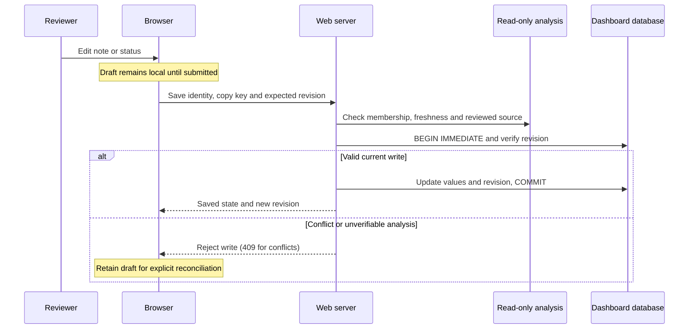

# Web dashboard database and review lifecycle

Current macOS persistence acceptance (2026-10-27), the immediate filtered-queue
correction, fresh tests and the remaining native browser procedure are recorded
in [dashboard macOS acceptance](dashboard-macos-acceptance.md). Native acceptance
remains unverified because loopback binding fails even with elevated execution.

Current follow-up: Phase6 implementation/semantics are in section17 and current
execution evidence in storage-reliability-verification.md. Earlier dated status
tables below are historical observations; backup automation and coordination
were subsequently implemented locally, without production deployment.

Status snapshot: 2026-10-25. Implementation branch: `feature/dead-code-editor`.
Base commit: `b61cc7ce971fdc46a61259af95af7fac823ae352`, with uncommitted changes.

Reliability follow-up (2026-10-25, local uncommitted work): manual
`dashboard-backup` and `dashboard-backup-verify` now implement consistent
snapshots and disposable restore checks. See the [reliability verification
record](storage-reliability-verification.md) for exact scope and new results.
Earlier backup/browser/runtime observations below remain dated evidence;
automatic backup policy and production cutover are still pending.

This document explains current persistence, indexing, review behavior, implementation
boundaries, verification evidence and proposed improvements. The architecture
decision is [ADR-019](adrs/019-dashboard-sqlite-store.md); the ordered follow-up
plan is [tasks/plan.md](../../tasks/plan.md). This is a dated implementation
snapshot, not a claim that all local changes have been integrated or deployed.

## 1. Current delivery status

| Capability | Current state | Remaining acceptance |
| --- | --- | --- |
| Separate analysis and user-state databases | Implemented; isolated WAL recovery verified | Operational backup/cutover remains proposed; see section 12 |
| Finding decisions, comments and decision history | Implemented | Complete native browser lifecycle acceptance |
| Independent labels and notes for copies sharing one file | Implemented locally; automated checks passed | Native browser save/reopen check |
| Warning when previously labeled copy content changes | Implemented locally; automated checks passed | Native browser presentation check |
| Optimistic revisions and stale-analysis protection | Implemented | Cross-tab acceptance in a working browser environment |
| Reindex preserves user-state database | Isolated indexer/store/HTTP scenario matrix verified | Native browser lifecycle remains unverified |
| Open/close all duplicate code panes beside search | Implemented, assets and executable rebuilt | Restart live instance and inspect placement/responsiveness |
| Clearer explanation of copy versus group scope | Implemented in the SPA with draft/reindex help | Native browser wording/interaction review |
| Consistent backup/restore procedure | Snapshot/restore design validated in an isolated live-WAL test | No shipped backup command or production cutover |
| Complete audit trail of copy-note/status edits | Not implemented | Separate product/schema decision |

The local implementation remains in REVIEW. Automated success does not establish
live delivery. The last diagnosed local listener still used a previously loaded
executable; rebuilding its file does not replace that running process. Restart
and visual acceptance have not been verified after that diagnosis.

## 2. Storage ownership

| Store | Contents | Writer | Rebuild policy |
| --- | --- | --- | --- |
| `.mct-index/index.sqlite3` | Derived files, symbols and relations | Project indexer, through project APIs/CLI | Can be reconstructed from source using project tooling |
| `.mct-index/dashboard.sqlite3` | Decisions, comments, copy labels, notes, revisions and retention metadata | Dashboard store | User data; never reconstructed by reindex |
| Legacy review files | Earlier saved decisions and history | Retained for compatibility/import | Not rewritten or deleted by migration |
| Browser memory | Unsaved drafts and editor presentation state | Current tab | Not durable crash recovery |

The dashboard opens the analysis index read-only. User annotations are not stored
in index rows, and user records do not refer to unstable index row IDs. The
server combines the current analysis and saved state using stable identities.

**Do not delete the entire `.mct-index` directory to rebuild analysis.** It also
contains user data. Access to the index must use this project's own software,
as required by [rules.md](../../rules.md).

The last observed local preview used a project under a temporary directory.
That observation concerns the preview's storage location, not the schema. A
durable project location and a consistent backup are needed before relying on
that preview as the long-term home of review data. Machine-specific paths and
secret access URLs are intentionally excluded from this document.

## 3. Dashboard data model

| Table | Responsibility | Update and retention behavior |
| --- | --- | --- |
| `reviews` | Current finding decision, reviewed fingerprint and fingerprint version | Replaced by an explicit decision save; separate from copy labels |
| `review_history` | Finding decision transitions | Bounded to 50,000 rows; not an unlimited audit archive |
| `file_reviews` | Current working status and note for each duplicate copy | Updates replace current values; no append-only edit history |
| `comments` | Finding discussion | Create/edit/delete supported; edits are not a complete audit trail |
| `meta` | Import flags, revisions and deletion/retention metadata | Supports conflict detection and legacy fallback policy |

Current per-copy rows use `(identity, path, member_key)` as their primary key,
with `member_base`, nullable `code_hash`, status, note and timestamp. Allowed
working statuses are `pending`, `accepted`, `rejected`, `in_review` and `ignored`.
Copy notes are bounded to 2,000 bytes; the copy-row limit is 20,000, including
retained and override rows. Comments are bounded to 2,000 bytes and 500 per finding.
Active decisions and restored Pending records have separate 100,000-row bounds.

### Migrations and compatibility

- Initial schema: decisions, history, comments and metadata.
- Version 2: path-based working labels in `file_reviews`.
- Version 3: fingerprint versioning for content-based decisions.
- Version 4: rebuild `file_reviews` for per-copy keys and code hashes.

Version-4 migration retains previous labels, notes and timestamps. Old path-level
rows have empty member keys and null hashes. They act as inherited labels until
a concrete copy override is saved. An explicit empty/Pending override can mask
an inherited label. Unmatched and inherited records remain inspectable through
retained annotations rather than being silently assigned or deleted.

Older binaries refuse an unsupported newer dashboard schema. Replacing the
executable with an older build is therefore not a guaranteed rollback strategy.

## 4. Saving changes from the web



1. Copy notes/statuses are edited as drafts and submitted using Save. Comments
   and group decisions have their own actions.
2. The request identifies the finding and target copy. A copy save carries
   `member_key`, path and `expected_revision`; finding decisions also require
   the reviewed fingerprint. Copy saves can check the displayed fingerprint.
3. The server checks the capability/session boundary, CSRF, allowed fields,
   limits, membership, current analysis and required source verification.
   The browser cannot supply a trusted `code_hash`.
4. A short `BEGIN IMMEDIATE` transaction checks the revision and updates related
   rows/metadata atomically. Failed mutations roll back. Copy and comment writes
   also advance the finding revision without changing its verdict.
5. Success updates saved details. A conflicting revision or stale analysis
   returns HTTP 409 instead of silently overwriting newer work. The editor
   retains the draft for explicit reconciliation.

The database uses WAL, `synchronous=NORMAL`, foreign keys and a five-second busy
timeout. Writers serialize through SQLite; concurrent processes do not imply
simultaneous writes. These settings are not a promise that every save succeeds
under contention, disk failures or interrupted execution.

## 5. Indexing and live refresh

Reindexing updates derived analysis through the project indexer. Annotation
writes do not themselves rewrite source code or reindex the project. Refreshing
the dashboard snapshot reads the analysis; it is distinct from reindexing.

The browser polls `api/version` approximately every two seconds. The version
combines index change markers, the loaded snapshot and dashboard changes.
Visible data is refreshed when that version changes. If rebuilding analysis
takes time, the server can continue serving the previous snapshot while a worker
builds its replacement and reports stale/rebuilding state. Writes against stale
served analysis are refused.

The refresh target is 1–5 seconds, not a measured guarantee for every project.
ADR-019 records earlier rebuilds exceeding five seconds under load. Unsaved
drafts survive navigation/polling within the tab, but closing or crashing it is
not guaranteed to preserve them.

## 6. Identity, fingerprints and copy association

Group identity uses language and sorted member path/name/kind information.
Line numbers and body contents are excluded. Moving code lines alone therefore
does not necessarily create a new identity; renaming paths/symbols or changing
membership can create one.

Finding fingerprints describe the complete verified reviewed ranges. Whitespace,
comments and line endings count as text changes. Unreadable, oversized, invalid,
ambiguous or stale source cannot provide proof that an earlier review is valid.

Copy keys additionally use indexed parent context and sibling disambiguation.
Unique verified content matches preserve associations through movement; a unique
copy can keep its association after a body edit. Ambiguous associations are
reported conservatively rather than attaching an old note to an unproven body.
There is no automatic label transfer between different group identities.

Saved copy hashes are computed on the server from verified indexed source:

- `code_changed`: associated current body differs from the saved hash.
- `code_unavailable`: content or association cannot be verified.
- Legacy null hash: no claim that the code changed or was verified unchanged.

The warning is informational. It neither changes the copy label nor sets the
group verdict. Restoring the original body can clear its change warning when
the identity and association still match.

## 7. What happens after rejection and reindexing?

**“Rechazar duplicado” on one copy is a working label, not a group dismissal.**
It does not suppress the group before or after reindexing. A finding decision
such as `false_positive` or `ignored` is a separate group-level action.

| Event | Copy labels and notes | Group decision and visibility |
| --- | --- | --- |
| Reject one copy | Saved for that copy | Group can remain visible immediately and after reindex |
| Reindex unchanged code with the same identity | Retained | Valid decision retained; web visibility depends on filter |
| Move lines or edit outside reviewed ranges | Retained if association remains verifiable | Reviewed-range fingerprint can remain valid |
| Edit a reviewed body without changing group identity | Retained where association is proven; warning shown | Existing nonpending decision requires reevaluation; undecided group stays pending |
| Rename path/symbol or add/remove members | No automatic transfer to new identity | New detected group is pending; old saved state is retained |
| Remove duplication entirely | Saved annotations retained | No current candidate; retained state remains available |
| Dismiss whole unchanged group as false positive/ignored | Copy labels independent | Valid dismissal suppresses MCP/CLI results; web All may still show it |
| Change previously dismissed code | Retained labels may warn | Old dismissal cannot suppress changed work requiring reevaluation |

Saved decisions whose identities have no current finding are orphans. Reindex
does not erase them. Explicit orphan-decision deletion removes the current
decision only; history, comments and annotations remain. Stale analysis blocks
that deletion. Retention is not the same as automatic reassignment or indefinite
preservation of every historical edit.

## 8. Implementation map

These are implementation pointers supported by the existing source investigation
and ADR, not a new source audit performed for this documentation change.

| Area | Main paths/symbols |
| --- | --- |
| SQLite store, migrations and atomic mutations | `crates/mct-cli/src/web/store.rs`: `state`, `set_inner`, `set_member_review`, `add_comment` |
| Copy membership and source association | `crates/mct-cli/src/web/member_reviews.rs` |
| HTTP lists, filtering and write contracts | `crates/mct-cli/src/web/api.rs`: `duplicates`, `matches_status`; finding/file-review routes |
| Source verification and preview limits | `crates/mct-cli/src/web/source.rs` |
| Drafts, saves, translations and code panes | `crates/mct-cli/src/web/spa/spa.js`: `saveFile`, `rebuildDup`, `openAll`, `closeAll` |
| Toolbar placement | `crates/mct-cli/src/web/spa/index.html`; generated `spa.css` |
| Shared identities and fingerprints | `crates/mct-index/src/review_keys.rs`: `group_identities` |
| AI-facing effective decisions | `crates/mct-index/src/review_state.rs`: `suppresses`, `duplicate_visibility` |
| Focused regressions | `web/store_copy_tests.rs`, `web/tests_copy_labels.rs`, `web/tests_decisions.rs`, `web/tests_identity.rs`, `tests/dashboard_copy_labels.cjs` |

The HTML, JavaScript and generated assets are embedded in the executable. Asset
changes require regeneration when applicable, compilation and a server restart
to reach a running instance. The current bulk controls open/close complete
duplicate code panes, preserve drafts and make no save/delete requests. They
remain outside collapsed content beside search. Expansion of other unrelated
review sections is not claimed as implemented.

## 9. Verification evidence and limitations

Recorded checks from the preceding implementation on 2026-10-25:

| Check | Recorded result |
| --- | --- |
| Node dashboard suites | 35 passed, 0 failed, 0 skipped |
| `scripts/unix/check.sh -p mct-cli` | 228 Rust tests passed, 0 failed, 0 ignored; formatting and strict Clippy passed |
| JavaScript syntax and whitespace checks | Passed |
| Dashboard assets | Regenerated from pinned cached dependencies |
| Debug and release executable builds | Passed |

Earlier copy-label verification also recorded MCP evaluation passing. These are
prior results, not fresh executions for this document, and do not certify the
entire workspace or all platforms. Native HTTP/browser acceptance remains
unverified: local access/binding was restricted even after escalation, and an
earlier WebKit launch failed. No Chrome verification was authorized or performed.

This documentation change uses existing ADR, plan and checkpoint evidence; it
does not mutate either database, reindex, inspect source anew, rerun runtime
tests or recheck MCP index health. Known parser diagnostics are tracked in
[the error registry](../../errors/REGISTRY.md), not treated as newly resolved.

## 10. Improvement plan

The identifiers below refer to the existing plan; this document is not a second
task board. Items marked proposed are not implemented by documenting them.

| Priority / item | Proposed work | Acceptance evidence |
| --- | --- | --- |
| First: live UI acceptance (UI-1) | Restart rebuilt executable against the same project root without rotating its token; inspect toolbar | Both buttons beside search, usable at narrow widths and after closing all panes; notes/drafts intact |
| First: lifecycle validation (DB-2) | Reuse coverage and fill save/reopen/reindex/conflict gaps | Matrix in section 7 verified; unchanged saves survive, changed work reevaluates, stale writes retain drafts |
| Next: understandable review scope (DB-3) | Explain copy labels versus group decisions, saved versus draft state, conflicts and warnings | Reviewer can predict whether an action dismisses a group and whether saving succeeded |
| Next: retention and recovery (DB-4) | Document overwrite/history limits; design consistent backup and restore | Isolated restore recovers decisions, labels, notes and comments without loss |
| Operational follow-up | Move temporary preview data to a durable project location with an appropriate consistent backup | Correct project root, preserved data and successful reopen verified |
| Separate future decision | Full audit history, durable draft recovery, or explicit cross-identity reassociation | Approved behavior/schema and focused regressions before implementation |

For backup design, choose either a project-supported consistent live backup or
a verified clean shutdown before copying required data. Copying only the main
database while a live WAL contains committed changes is not a recovery procedure.
No backup command, automatic cleanup or history-schema extension is introduced
here. Any recovery implementation must first be exercised on an isolated store.

## 11. Completion criteria

The work can move beyond REVIEW after the scenario matrix and real UI behavior
are verified, relevant limitations are resolved or explicitly accepted, and the
reviewed changes are integrated through the project workflow. Commit, publication
and integration are separate authorized actions; this document performs none.

## 12. Reliability audit and recovery design — 2026-10-25

This later audit supersedes the proposed-only status of DB-2/DB-3/DB-4 above.
The owner authorized implementation and isolated validation in tasks/plan.md.
No commits or integration were authorized. Historical test counts in section 9
remain historical; current results are recorded below after verification.

### Verified findings

- Git still reports the branch/base at the top of this document. Existing dirty
  work includes store migration/copy identity work, source verification, the SPA
  redesign and generated assets. The audit preserves that work, prototype/ and
  the unrelated fuzz lockfile. No new dependency or migration is introduced.
- Executable mapping inspection found multiple live instances. Two instances
  using this checkout's dashboard store map older debug/release executable
  inodes than the files currently on disk. A different instance on the default
  port uses the latest release file but a temporary project's dashboard store.
  A process working directory alone therefore does not establish its project
  root. These are distinct causes of inspecting an unexpected interface/data set.
- Current source already implements Open all/Close all beside search. HTTP wire
  tests confirm the embedded shell delivers both buttons outside the panes.
  Node tests confirm idempotence, independent reopening and no save/delete calls.
  CSS/template inspection supports wrapping, but cannot establish rendered layout.
- The copy form did not itself display its existing scope explanation. Conflict
  reconciliation was reachable only inside the separate collapsed group-decision
  section. The audit shows scope/draft help and exposes the existing explicit
  reconciliation action directly beside the copy form's Save/Discard controls.
- SQLite persistence defects were not reproduced by this audit. Fresh isolated
  regressions exercise real indexing, real dashboard SQLite, and the actual HTTP
  parser/handlers without network sockets. This is stronger than a mocked API,
  but does not verify native socket delivery or browser rendering.

### Documentation inventory

| Document | Audience / purpose | Update condition / relationship |
| --- | --- | --- |
| rules.md | Contributors; technical and indexing policy | Change engineering policy; authoritative over implementation notes |
| PROJECT_MANAGER.md | Maintainers; ownership/recovery/review process | Change process; points to canonical task records |
| tasks/plan.md | Implementer/reviewer; specification and acceptance | Change authorized scope/design or acceptance; links here |
| ADR-019 | Architects/maintainers; separate SQLite store and contracts | Change storage/identity/security decisions; this audit does not change those contracts |
| ADR-018 | Maintainers; retained server-rendered dashboard | Change fallback interface/review behavior; ADR-019 keeps it available |
| This lifecycle document | Operators/reviewers; save/reindex/recovery behavior and evidence | Verify/change runtime behavior or procedures; complements the ADR and plan |
| errors/README.md, REGISTRY.md, HISTORY.md | Contributors; diagnostic policy, stable findings, observation timeline | Observe/retest project MCP failures; preserve history and avoid claiming parser recovery |
| README.md, COMMANDS.md, scripts/README.md | Users/contributors; entry points, CLI and validation commands | Change public command/operational contracts; no new CLI command is added here |
| CHANGELOG.md | Release consumers; delivered behavior | Integrate/release user-visible changes; existing uncommitted entries are preserved |

Private coordination records remain excluded from public version control. They
record ownership, the initial dirty-tree snapshot and exact continuation steps;
they are not an additional public specification.

### Acceptance evidence map

| Scenario | Evidence / practical limit |
| --- | --- |
| Independent copy status/note and reopen | copy_labels_two_copies_in_one_file_keep_independent_states_and_notes |
| Rejected copy remains a pending group after reindex | copy_labels_survive_unchanged_reindex_and_unavailable_source_is_explicit |
| Moves retain proven associations | copy_labels_same_named_methods_in_distinct_parents_keep_labels_after_moves; member resolver reorder tests |
| Body edit warns, restoration clears warning | copy_labels_warn_after_code_edit_and_reindex_without_changing_the_label |
| Renamed path/symbol, added/removed member, disappeared group | copy_labels_are_retained_without_transfer_after_rename_membership_change_and_removal; compares retained rows and rejects transfer to new groups |
| Unavailable code rejects writes and retains notes | copy_labels_survive_unchanged_reindex_and_unavailable_source_is_explicit |
| Ambiguous siblings remain uncertain | member_reviews tests plus conservative API source checks; no browser association claim |
| Concurrent stale revisions, ABA clear/recreate and quota rollback | store_copy_tests plus copy_labels_api_rejects_forged_members_hashes_and_stale_copy_revisions |
| Migrations/future versions | store_copy_tests v3-to-v4, concurrent openers and future-version refusal; existing store legacy migration tests |
| 409 retains drafts; explicit reconciliation | Node revision/conflict/poll/navigation tests and new copy reconciliation regression |
| Bulk controls preserve drafts and issue no mutations | dashboard_copy_labels.cjs; embedded_http_shell_delivers_bulk_controls_and_scope_help |
| WAL recovery | live_wal_snapshot_restores_all_user_tables_and_revisions, described below |

### WAL-safe backup proposal, validated on an isolated store

There is no shipped backup/restore command. Use a SQLite-consistent snapshot as
the design for a future supported command or a separately reviewed operator tool.
[SQLite documents VACUUM INTO](https://www.sqlite.org/lang_vacuum.html) as a live
snapshot into a separate destination; it refuses a nonempty destination. The
[online backup API](https://www.sqlite.org/backup.html) is another supported option.
The [WAL is part of live database state](https://www.sqlite.org/wal.html): copying
only dashboard.sqlite3 can omit committed reviews. Never manually delete WAL/SHM.

Proposed procedure:

1. Select the correct durable project root and a private backup directory. Record
   application revision, SQLite version, UTC time, schema version, project identity
   and a content checksum. Keep backups owner-only (database mode 0600 on Unix).
2. Through SQLite, snapshot **dashboard.sqlite3 only** into a new destination
   using bound `VACUUM main INTO ?1`, outside any open transaction. Leave the live
   file and sidecars untouched. Treat errors/interruption as an incomplete backup;
   keep earlier verified backups. Sync the destination and its directory before
   reporting a durable backup. Protect against symlinks, overwrites and disk-full
   conditions in any future production wrapper. None is added by this audit.
3. Preserve legacy reviews.toon and duplicate-reviews.toon if present: they affect
   import/fallback. Preserve their exact bytes under a short pause of all writers
   if necessary. Preserve relevant project configuration and the source revision
   for later association verification. The derived index is rebuilt only through
   project tooling. Keep web-token private and separate if preserving access links
   is required; backup reports must never contain its value.
4. Restore first into a new isolated project directory with matching source and
   a compatible executable. Never replace a live database or combine an old WAL
   with a restored main file. Use a fresh .mct-index directory for this isolated
   restore; do not delete the real project's directory. Reindex via mct-cli there.
5. Run integrity_check (must return only ok) and foreign_key_check (no rows), check
   schema version, then reopen through Store/dashboard. Check decisions, history,
   copy statuses/notes, comments, revisions and retained/deletion metadata. Older
   schema support must be proven with a compatible executable, not by downgrading.
6. Operational cutover requires a separate maintenance step: identify and stop all
   writers safely, retain the original database and sidecars together as recovery
   evidence, and use the validated restored store. This audit performs no cutover.

The regression disables autocheckpoint, truncates the WAL before writing and
proves the main file remains byte-identical while committed user data accumulates
in WAL. A second connection makes the snapshot; a later source commit stays out
of it. The restored store matches every row of reviews, review_history,
file_reviews, comments, meta and sqlite_sequence, including revision metadata and
schema version 4. It passes both integrity checks and refuses backup overwrite.
This verifies the snapshot/reopen design, not power-loss durability, disk-full
handling, an operational backup service or a production cutover.

### Native delivery limitations and safe next steps

Native HTTP requests cannot reach the inspected local listeners. Launching the
rebuilt executable against a new temporary root on a free port fails with
`cannot bind the localhost web port: Operation not permitted (os error 1)`, also
with escalation. No active server was stopped, restarted or reconfigured. No
access token was printed or rotated. Chrome remains unauthorized; browser checks
were not attempted against an unreachable listener.

On a host where localhost works, identify the intended process by listener,
executable **and database root**, preserve its existing token, restart only that
owned instance with the rebuilt binary and the same --root/port/no-obsidian
configuration. Verify HTTP assets, keyboard access, narrow/wide layout, all-pane
collapse, draft preservation, save/reopen and two-tab conflicts. Do not equate a
restart command or a successful build with that acceptance.

Asset generation was attempted offline and with bounded elevated network access.
The default cache lacks Alpine CSP and the registry request fails with
`getaddrinfo ENOTFOUND registry.npmjs.org`. No new utility classes/icons/vendor
versions were introduced in this audit; existing generated CSS/sprite/vendor
bytes are preserved. HTML and JavaScript are embedded directly by the rebuilt
executable. Full regeneration remains an explicit unverified check.

### Final verification for this audit

`scripts/unix/check.sh --no-fail-fast` completed successfully on the final code:
1,870 tests passed, zero failed, 24 ignored. It runs cargo fmt --all --check,
cargo test --workspace --no-fail-fast, cargo clippy --workspace --all-targets
--all-features with -D warnings and denied unwrap/expect/panic, and mct-eval.
Evaluation accuracy is 1.000 with no baseline regressions. The 24 ignored tests
were already ignored; this audit neither removes nor weakens existing assertions.

`node --test crates/mct-cli/tests/dashboard_spa.cjs
crates/mct-cli/tests/dashboard_copy_labels.cjs` passes all 36 tests. JavaScript
syntax, git diff --check and cargo build -p mct-cli pass. Four new Rust tests
and one new Node test are included. A transient wording assertion failed during
development; wording was corrected while preserving the existing assertion,
and the final suite passes.

Only nine repository files differ from this audit's startup tree: SPA index.html
and spa.js, web/store_copy_tests.rs, web/tests_copy_labels.rs,
tests/dashboard_spa.cjs (all under crates/mct-cli), tasks/plan.md, this document,
and errors/REGISTRY.md and errors/HISTORY.md. Other preexisting dirty files,
including generated CSS/SVG, remain byte-identical to the startup snapshot.
The HTML introduces no new utility classes; no vendor file or dependency changed.

Acceptance status: **PARTIALLY DONE / REVIEW**. The isolated persistence matrix,
HTTP handlers and component logic pass; native HTTP/browser acceptance, restart
of the intended owned instance, and full asset regeneration remain unverified
for the specific environmental reasons above. No production database was modified
by the tests, and no commit, push, merge, release or live-server cutover occurred.

## 13. Delivery validation follow-up — 2026-10-25

This follow-up supersedes section 12's asset-generation blocker only. Branch and
HEAD remain `feature/dead-code-editor` at
`b61cc7ce971fdc46a61259af95af7fac823ae352`, with the existing uncommitted work.
Status: **PARTIALLY DONE**. No product source or dependency change was required.

### Process and delivery evidence

`lsof` reports seven existing loopback listeners owned by the current user.
The table uses portable root descriptions; private paths and tokens are omitted.
Project identity is established from open database files, not merely `cwd`.

| PID | Port | Executable / observed mapped inode | Database root |
| --- | --- | --- | --- |
| 4698 | 8787 | Primary release, 41055423; matches current release file | Temporary fixture project, dashboard store |
| 57626 | 53067 | Primary release, 39237983; differs from current file | Primary checkout, dashboard store |
| 58012 | 8799 | Primary debug, 40488042; differs from current file | Primary checkout, dashboard store |
| 12549 | 47831 | Separate remediation worktree debug | Separate remediation index |
| 24242 | 8801 | Separate editor worktree debug | Separate editor index |
| 69291 | 8793 | Separate review build | Temporary fixture index |
| 81531 | 18871 | Separate build | Root not established from open database handles |

The primary debug file inode is 41124843; its SHA-256 after the successful build is
`afe1915a47170b019040ee98c754fd25edfa7f20a672dbd0d2ca2cd75ad18b84`.
Both primary files report version 0.2.0; that version alone cannot identify the
loaded build. No existing process was stopped. No updated native instance was
successfully started. Full command-line/environment inspection remains unavailable:
`ps` returns `operation not permitted`, including with escalation. No active token
was read or rotated. Authentication behavior is covered by isolated tests, not
by authenticated access to these listeners.

### Frontend pipeline and fresh verification

`scripts/unix/build-dashboard-assets.sh` creates a temporary npm project and
installs Tailwind 3.4.17, Alpine CSP 3.14.8 and Lucide Static 0.468.0. It compiles
CSS, copies Alpine and generates the SVG sprite. The dashboard has no dedicated
lockfile; `website/package-lock.json` belongs to a separate build. HTML and spa.js
are direct embedded inputs, not transpiled outputs. No lockfile or integrity
checks were bypassed or changed.

Node 24.12.0 / npm 11.6.2 are available. The sandboxed offline attempt failed with
`ENOTCACHED` for `https://registry.npmjs.org/@alpinejs%2fcsp`, despite cache listings
showing matching keys; npm also could not write its default log directory.
The bounded elevated official build **succeeded**, producing 21,507 CSS bytes,
45,328 Alpine bytes and a 100-line sprite. The script labels its line count as
"icons"; section 14 verifies the actual 35 symbols. The prior DNS failure was not reproduced by
that successful install. A Browserslist age warning did not fail generation;
no unrelated dependency update was performed.

All generated bytes match the startup snapshot. `cargo build --locked -p mct-cli`
succeeded. Exact full-file byte comparisons locate index.html, spa.js, spa.css,
sprite.svg and vendor/alpine.js inside the debug executable. This proves embedding
in the built file, not delivery from an existing running process.

Fresh `scripts/unix/check.sh -p mct-cli`: **232 passed, 0 failed, 0 ignored**,
format and strict Clippy passed. Both Node suites: **36 passed, 0 failed**.
The 1,870-test workspace/evaluation result in section 12 is earlier evidence,
not a newly executed full-workspace result. Product source remained unchanged.

### HTTP and browser limits

Unauthenticated curl to 127.0.0.1:8787 fails with exit 7 / HTTP 000, normally and
elevated. A new indexed fixture contains one duplicate group with two copies.
Starting its server with `web --port 0 --no-obsidian` fails with
`cannot bind the localhost web port: Operation not permitted (os error 1)`,
normally and elevated. An independent Python socket bind to loopback also fails
with errno 1. An automatically allocated port removes fixed-port collision as
the explanation for this isolated startup failure. Existing listeners do exist;
their presence does not prove this execution context can reach them.

The evidence supports a capability restriction affecting this environment, but
does not identify the responsible sandbox, OS policy, firewall or isolation layer.
No security control was weakened and no public interface was bound. WebKit 2370
via the existing Playwright dependency aborts during launch with exit 134 both
normally and elevated, before any page renders. Chrome was not used. Browser
connector tools are advertised, but a working local browser/server route was not
established; their availability is not acceptance evidence.

### Acceptance result

| Criterion | Automated evidence | Real browser result |
| --- | --- | --- |
| 1. Both controls beside search | Shell/binding tests pass | Blocked |
| 2. Open/close behavior | Node bulk/idempotence tests pass | Blocked |
| 3. Collapse preserves drafts | Node copy/group draft tests pass | Blocked |
| 4. Narrow layout | No rendered evidence | Blocked |
| 5. Keyboard/accessibility | No real keyboard/focus evidence | Blocked |
| 6. Copy status independent of group | Rust and Node tests pass | Blocked |
| 7. Saved notes reopen | Real isolated SQLite tests pass | Blocked |
| 8. Reindex retains reviews | Real isolated index/store tests pass | Blocked |
| 9. Two-tab conflict | Store concurrency/SPA revision tests pass | Blocked |
| 10. HTTP 409 retains drafts | Handler and Node tests pass | Blocked |
| 11. Source-change warning | Real index/store and Node tests pass | Blocked |
| 12. No unexpected writes | Node bulk tests pass | Network observation blocked |

No acceptance regression failed in the executed suites. Native delivery and
browser criteria remain unaccepted. Main database, WAL and SHM hashes for the
primary dashboard remain identical to the startup snapshot. All preexisting
modified/untracked product files and generated assets remain byte-identical.
This is preservation evidence, not a new integrity audit of active user data.
No primary reindex, database replacement, token change or publication occurred.

### Executable manual acceptance on a working native host

Run from the checkout root in a native terminal; this creates a new fixture and
leaves all existing servers untouched. Retain the terminal's private URL locally.

```sh
fixture_root="$(mktemp -d "${TMPDIR:-/tmp}/mct-acceptance.XXXXXX")"
printf 'fixture_root=%q\n' "$fixture_root"
cp crates/mct-cli/tests/fixtures/duplicates/blocks.rs "$fixture_root/blocks.rs"
target/debug/mct-cli --root "$fixture_root" init --no-obsidian
target/debug/mct-cli --root "$fixture_root" web --port 0 --no-obsidian
```

1. Open the printed URL in Safari and enter the duplicate editor. Keep Network
   recording enabled. At wide and 375px widths, confirm both controls beside
   search remain reachable without overlap. Use Tab/Shift-Tab/Enter/Space to
   check labels, visible focus, control order and individual/bulk toggles.
2. Draft a copy note and group reason. Close/open all repeatedly and toggle one
   pane. Both drafts must remain; these actions must issue no save/delete calls.
3. Save different notes/statuses for the two copies, including a rejected copy.
   Reload and reopen: notes survive and the group remains independently pending.
4. Open the same finding in two tabs. Draft in both, save in A, then submit B
   without reconciling. Expect HTTP 409, B's draft retained and A's saved value
   intact. Use explicit reconciliation before resubmitting B.
5. In a second terminal at the checkout root, paste the printed `fixture_root=...`
   assignment, retaining the first server terminal, then run:
   `target/debug/mct-cli --root "$fixture_root" reindex --no-obsidian`.
   Reload analysis: saved notes/statuses survive. Change a reviewed line in the
   fixture copy_left body without renaming it, reindex again and reload analysis:
   the affected saved copy must show the changed-code warning and retain its note.
6. Record viewport, browser/version, response statuses and redacted screenshots.
   Stop only this newly created fixture server with Ctrl-C. Existing servers
   require separate owner authorization before cutover.

For production cutover, first choose the intended durable root and port, verify
the current owner/executable/database mapping again, and obtain a verified
WAL-consistent backup using the section 12 recovery design. Do not assume copying
the main file alone is a backup. After authorization, stop only the selected
instance through its owning terminal/supervisor, then run the rebuilt executable
with the same explicit root, port and Obsidian setting, without --rotate-token.
Verify authenticated HTTP assets against these source files and repeat acceptance
before declaring delivery. No production cutover was performed by this follow-up.

## 14. Native acceptance recheck and operator handoff — 2026-10-25

This recheck resumes section 13 without regenerating assets or changing product
code. The owner selected an operator handoff after the capability check; no
remote execution target was supplied. **Remaining runtime work is BLOCKED.**
Earlier implementation and automated acceptance evidence remains valid within
its stated limits. No production restart is authorized.

### Reverified runtime and candidate

Branch and HEAD remain `feature/dead-code-editor` and
`b61cc7ce971fdc46a61259af95af7fac823ae352`, with the preexisting uncommitted work.
All seven PID/port/mapped-inode/database associations in section 13 were observed
again through `lsof`, with current-user ownership. The primary debug file now has
inode 41145481, but its SHA-256 is still
`afe1915a47170b019040ee98c754fd25edfa7f20a672dbd0d2ca2cd75ad18b84`.
The release file remains inode 41055423. Thus 57626 and 58012 still map older
images, while 4698 maps the current release against a temporary database.
The common `cwd` does not establish the effective project root.

The complete current HTML (45,422 bytes), CSS (21,507), application JavaScript
(88,086), SVG sprite (10,256) and Alpine (45,328) were found byte-for-byte in the
debug executable. Their checksums match the prior verified build. The sprite
contains 35 unique symbols, exactly matching the 35 nonempty icons.txt entries.
The earlier "100 icons" report counted SVG lines, not icons; this correction
does not change any generated bytes. The candidate is the previously built **dirty source tree**,
not the clean HEAD alone; version 0.2.0 is not sufficient build provenance.
No asset regeneration or executable build was needed. Serving these bytes from
the intended runtime remains unverified.

Independent Python sockets again return `[Errno 1] Operation not permitted`
for both loopback port-zero binding and connection to 8787. The same bounded
probe outside the sandbox returns the same results. Unauthenticated curl returns
exit 7 / HTTP 000; restricted `ps` metadata inspection also remains denied.
Child process execution and temporary-directory writes pass. This identifies an
environmental socket capability blocker independently of application startup,
without identifying its precise policy layer. No additional server restart,
privilege retries, firewall changes or public bind was attempted.

Native UI inventory and a read-only Safari accessibility observation succeed;
there are no browser-provider tabs exposed by the inventory. Therefore Safari
is available through native UI, even though the earlier Playwright WebKit launch
failed. No dashboard page or browser acceptance criterion was tested in this
recheck. Chrome was not used. The section 13 browser matrix remains blocked.

### Data preservation and focused recovery evidence

Primary dashboard main/WAL/SHM hashes match both this recheck's startup snapshot
and the earlier delivery snapshot. No token was read or rotated. All preexisting
product changes remain byte-identical. These checks establish preservation, not
the logical integrity of an uninspected production database.

Fresh execution:

```sh
cargo test --locked -p mct-cli --bin mct-cli live_wal_snapshot_restores_all_user_tables_and_revisions -- --nocapture
```

Result: **1 passed, 0 failed, 169 filtered out**. It verifies a separate-connection
VACUUM INTO snapshot containing committed live-WAL data, restored user tables and
revisions, schema 4, integrity_check, foreign_key_check and overwrite refusal as
described in section 12. An initial overqualified exact filter selected zero tests;
it was corrected and is not counted as validation. The earlier 232 Rust / 36 Node
and 1,870 workspace results were not rerun or reported as new results.
This test is not a production backup or proof that an older binary can reopen
schema 4.

### Operator continuation and production gates

Use the existing [executable manual acceptance procedure](#executable-manual-acceptance-on-a-working-native-host)
on a native terminal with loopback permission and Safari. Keep the fixture server
separate from every active instance. Record actual pass/fail for every section 13
row, HTTP statuses and endpoint/method observations, browser version, viewport,
keyboard focus and the two-tab 409 scenario; redact private URLs and tokens.
If the host rebuilds the binary, record its new checksum and reverify embedding.
Do not substitute this recheck's unit-test result for browser evidence.

Production readiness remains gated by all of the following:

1. The owner identifies the intended root/port and selects the service to replace.
   Both 57626 and 58012 currently open the same primary dashboard database;
   replacing one does not quiesce the other writer. The database root for 81531
   is still unknown and must not be inferred from its working directory.
2. The operator privately verifies startup arguments, environment dependencies,
   token configuration, supervisor and graceful stop/restart route on that host.
   Never paste full environment or token-bearing command lines into reports.
3. Follow the section 12 WAL-safe recovery design with a reviewed operator tool;
   this repository has no shipped backup command. Before downtime, validate a
   consistent backup by restoring into a separate root, checking integrity,
   schema and user rows/revisions, and reopening with the candidate. Quiesce all
   writers for the final snapshot, preserve legacy files/configuration separately
   and retain original database/sidecars together. No production backup was taken
   in this recheck.
4. Prove rollback compatibility with the saved executable on a **copy** of the
   snapshot before cutover. If compatibility cannot be proven, keep deployment
   blocked; never downgrade the live schema or assume old executable support.
5. Only after isolated acceptance and explicit owner authorization, restart the
   selected service with the verified root/port/settings and unchanged token.
   Verify its loaded executable identity, database handles, authenticated HTTP
   assets, existing reviews and critical interactions; inspect redacted logs.
   Keep all other services untouched unless separately authorized.

This is a gated handoff, not an assertion that production deployment is ready
or complete. The next executable action is isolated native acceptance from
section 13; final startup configuration, production backup/restore and cutover
still require operator evidence and authorization.

## 15. Runtime restriction and hook investigation — 2026-10-25

Fresh session evidence only; earlier test counts are not included below.
Status: **BLOCKED**. Branch/HEAD remain feature/dead-code-editor at
b61cc7ce971fdc46a61259af95af7fac823ae352, with the preexisting dirty tree.
No application code, hooks, security policy, tokens or running services changed.

### Environment, hooks and native execution

- macOS 27.0 (26A428); lo0 is UP/RUNNING with 127.0.0.1 and ::1.
  Application Firewall reports disabled; enrollment reports no DEP/MDM.
  PF inspection is denied and system-extension listing fails with
  OSSystemExtensionErrorDomain error 1. These observations do not exclude other
  security controls. No policy was changed or additional privilege retry made.
- Independent Python bind to 127.0.0.1 port zero and connect to port 8787 each
  fail with PermissionError(1, 'Operation not permitted'). One authorized
  outside-sandbox bind probe also fails with errno 1. Port-zero failure is not
  a fixed-port collision. No application startup is needed to reproduce this.
- Environment reports CODEX_SANDBOX=seatbelt, CODEX_SANDBOX_NETWORK_DISABLED=1
  and TERM_PROGRAM=herdr. libsandbox sandbox_check for the current Python process
  returns 1 for network-bind and network-outbound (errno 0). Together these
  support an effective sandbox network restriction. They do not identify the
  responsible inherited profile or ancestor, or prove the elevated request
  actually escaped every enclosing restriction. ps remains denied.
- At the owner's follow-up request, inspected project/global hook registrations
  and relevant registered integration files without changing them. The active
  project Codex PreToolUse hook is sqlite_guard.py; its indexed main only denies
  direct sqlite3 commands. Feeding it the minimal Python socket command returns
  exit 0, empty stdout/stderr. Global registrations concern session reporting,
  usage logging and notifications. The inspected Herdr session hook reports via
  AF_UNIX; inspected Warp/Ponytail registrations provide notifications/instructions.
  No evidence attributes the network denial to those hooks. This is not an
  exhaustive audit of every installed plugin or the session launcher.
- A child launched with env -i still gets socket-bind EPERM. Removing environment
  variables therefore does not remove the restriction; this is consistent with
  inherited process policy. The system Python launcher additionally emits cache
  path/FSEvents warnings, not an application failure. No hook bypass was used.
- Native inventory exposes Terminal and Safari. Computer Use rejects Terminal:
  `Computer Use is not allowed to use the app 'com.apple.Terminal' for safety reasons.`
  No alternate UI route was used to bypass that denial. Safari accessibility can
  read its start page; no HTTP page was opened because the independent test did
  not pass. Native-terminal HTTP capability remains unknown, not proven absent.

### Processes, candidate and data

All seven section 13 PID/port/root associations were observed again with lsof.
57626/53067 and 58012/8799 still open the same primary dashboard main/WAL/SHM
inodes (39218419/39218421/39218422). A database-specific lsof query finds those
two processes, subject to current-user visibility. Their mapped binary inodes
remain 39237983 and 40488042. The candidate debug file inode is now 41151565;
its SHA-256 remains afe1915a47170b019040ee98c754fd25edfa7f20a672dbd0d2ca2cd75ad18b84.
Complete HTML/CSS/JS/SVG/Alpine bytes are still embedded. No build was needed.
4698/8787 maps release inode 41055423 with a temporary dashboard store;
12549/47831 and 24242/8801 use separate worktree indexes, 69291/8793 a temporary
index. 81531/18871 still has no database handle establishing its effective root.
Startup arguments, supervisor, environment dependencies and intended production
service are unverified. A cwd is insufficient to establish that root.

The isolated live_wal_snapshot_restores_all_user_tables_and_revisions test was
executed with the section 14 command: **PASS, 1 passed, 0 failed, 169 filtered**.
Its scope is the section 12 snapshot/restore invariant, including integrity and
foreign-key checks, schema/revisions and overwrite refusal. Production integrity,
backup, restore and old-binary rollback compatibility are **NOT TESTED**.
All 34 baseline files (existing dirty/untracked files and primary dashboard
main/WAL/SHM) matched before documentation edits. Hash equality establishes
preservation during observation, not a consistent backup or logical integrity.

SQLite WAL serializes writes, but coexistence of these particular old/new images
and their schema/revision semantics is **NOT TESTED**. Do not approve mixed-version
writers on that basis. Keep production blocked until section 14's owner selection,
verified startup configuration, validated snapshot/restore, rollback and explicit
authorization gates are satisfied. Stop every identified writer gracefully via
its owner/supervisor, verify no handles remain, preserve original files together,
then restart only the selected service with the verified root/port/settings and
unchanged token. No stop/restart command is issued while ownership is unresolved.

### Current-session acceptance matrix

| Criterion | Status | Evidence / gate |
| --- | --- | --- |
| Independent agent loopback HTTP prerequisite | FAIL | Minimal bind/connect EPERM |
| Native terminal independent HTTP prerequisite | BLOCKED | Terminal automation denied; operator run required |
| Updated dashboard served by candidate | BLOCKED | No independent HTTP route |
| Open All / Close All | BLOCKED | No rendered dashboard |
| Draft preservation across interactions | BLOCKED | No rendered dashboard |
| Independent copy/group decisions | BLOCKED | No browser save |
| Saved reviews survive reload | BLOCKED | No browser save/reload |
| Reindex preserves annotations | BLOCKED | No browser reindex scenario |
| Changed-code warning | BLOCKED | No browser source-change scenario |
| Responsive layout and control placement | BLOCKED | No rendered viewport |
| Keyboard access and visible focus | BLOCKED | No dashboard focus traversal |
| Two-tab concurrency | BLOCKED | No dashboard tabs |
| HTTP 409 and retained stale draft | BLOCKED | No runtime conflict scenario |
| Expected methods/endpoints; no unexpected writes | BLOCKED | No Network recording |
| Isolated live-WAL recovery regression | PASS | Fresh 1-test run above |
| Production integrity/backup/restore/rollback | NOT TESTED | No production audit or backup authorized/performed |
| Production cutover and post-deploy verification | BLOCKED | Section 14 gates unmet; no restart authorization |

### Exact operator prerequisite

Run this in an owner-controlled native macOS terminal. It serves only a fixed
marker on loopback, self-checks HTTP without proxies, opens Safari and exits after
120 seconds (or Ctrl-C). It does not expose a directory or touch project data.
Expected: `BIND PASS`, `HTTP PASS 200`, then Safari visibly shows `MCT HTTP PROBE OK`.
An open command succeeding alone is not browser evidence. On failure, retain the
exact error and stop; do not change security settings. This snippet is prepared,
**not executed** in this session.

```sh
python3 - <<'PY'
import http.server
import subprocess
import threading
import time
import urllib.request

marker = b'MCT HTTP PROBE OK\n'
class Probe(http.server.BaseHTTPRequestHandler):
    def do_GET(self):
        self.send_response(200)
        self.send_header('Content-Type', 'text/plain; charset=utf-8')
        self.send_header('Content-Length', str(len(marker)))
        self.end_headers()
        self.wfile.write(marker)

server = http.server.ThreadingHTTPServer(('127.0.0.1', 0), Probe)
url = 'http://127.0.0.1:%d/' % server.server_port
print('BIND PASS', url, flush=True)
threading.Thread(target=server.serve_forever, daemon=True).start()
try:
    opener = urllib.request.build_opener(urllib.request.ProxyHandler({}))
    with opener.open(url, timeout=3) as response:
        if response.status != 200 or response.read() != marker:
            raise RuntimeError('HTTP marker mismatch')
        print('HTTP PASS', response.status, flush=True)
    subprocess.run(['open', '-a', 'Safari', url], check=True)
    time.sleep(120)
finally:
    server.shutdown()
    server.server_close()
PY
```

Only after that passes, run the existing section 13 fixture procedure from the
checkout root and the section 14 evidence checklist. Record Safari version,
viewports, keyboard observations, redacted screenshots,
methods/endpoints/statuses and each matrix result. Keep URLs/tokens private.
Production remains a separate authorized operation after those results and the
backup/rollback gates are concrete and reviewable. No commit, push or publication.

### Session restart checkpoint and operator permission helper — 2026-10-25

The owner requested a reversible permission setup and a continuation prompt before
restarting the tab. Current branch/base remain feature/dead-code-editor /
b61cc7ce971fdc46a61259af95af7fac823ae352. Preserve the entire dirty tree.
The latest independent HTTP recheck failed at bind with errno 1 EPERM both
normally and when outside-sandbox execution was requested. Curl was not reached;
Safari and dashboard acceptance remain BLOCKED. No production operation ran.

Fresh configuration evidence: the project selects default_permissions
workspace-no-copilot, extending :workspace with .github/agents denied. Its
network settings and features.network_proxy are absent. The inspected global
configuration does not explicitly set sandbox_mode, sandbox_workspace_write,
permissions or default_permissions. Absence is not proof of the effective
launcher/managed policy. The active process still reports CODEX_SANDBOX=seatbelt
and CODEX_SANDBOX_NETWORK_DISABLED=1. The exact enforcing ancestor remains unknown.

The installed codex --help exposes permission configuration overrides and local
sandbox commands. Official permission-profile documentation explains that
network.enabled alone permits direct network access; features.network_proxy is
required to enforce destination rules. Permission profiles must not be mixed
with legacy sandbox settings. Reference:
https://learn.chatgpt.com/docs/permissions

A local operator helper is prepared at /private/tmp/mct-enable-local-network.py.
It is local temporary tooling, not a shipped project command. Its default dry
run passed against the current configuration: TOML parsing, expected profile and
filesystem denial, and semantic equality of all unrelated settings were checked.
Apply, rollback, effective proxy operation and actual HTTP are NOT TESTED.

Run from a user-operated native Terminal:

```sh
python3 /private/tmp/mct-enable-local-network.py --apply
```

The helper enables the existing project's permission-profile network and proxy,
with exact allowed destinations 127.0.0.1 and localhost. It preserves hooks,
filesystem restrictions and other settings. It does not change global Codex or
macOS settings. It saves an owner-only backup beside config.toml, atomically
replaces the file, and prints the exact rollback command. Rollback refuses to
overwrite subsequent configuration edits. Existing network/proxy or legacy
sandbox settings cause a stop for review rather than silent replacement.

Expected: APPLY PASS, backup hash and rollback command. Retain that output, then
restart the tab in the same project. This is a requested configuration, not proof
of effective networking; managed requirements or the native launcher may still
restrict it. Do not disable those controls or enable unrestricted execution.
Restarting the tab alone without applying a supported permission change is not
evidence of a changed network environment.

After restart, read this checkpoint and sections 13–15, inspect Git preservation
and permission state, and perform one independent loopback HTTP probe. Only
proceed to the isolated dashboard and real Safari matrix after the prerequisite
passes. If EPERM persists, stop repeated attempts and use the native operator
prerequisite above. Do not control Terminal through a denied automation route.
Historical process IDs and candidate hashes must be reverified before use; do not
restart existing listeners, access tokens or change production data. Section 14's
production backup, restoration, rollback, ownership and authorization gates remain.
No compilation, recovery or browser checks from earlier sessions count as fresh
results after restart. Final delivery status remains BLOCKED.

## 16. Operator marker report and bounded continuation — 2026-10-25

The operator reported `MCT HTTP PROBE OK` after receiving the native-terminal
prerequisite. This is operator-reported page-marker evidence, not an agent-run
browser check or a complete Terminal transcript. A subsequent operator screenshot
shows Safari rendering the exact marker at 127.0.0.1:57765. Native loopback HTTP
serving and Safari rendering are PASS based on operator screenshot evidence;
the operator subsequently supplied curl output with the exact marker and HTTP
200: native curl is PASS. This does not establish dashboard acceptance.
Do not repeat agent network
diagnostics: the existing EPERM evidence stands, and native success does not
establish changed agent permissions.

A read-only SHA-256 check in this session confirms that target/debug/mct-cli
still matches afe1915a47170b019040ee98c754fd25edfa7f20a672dbd0d2ca2cd75ad18b84.
The section 13 fixture source exists. No server was started or stopped, no
database or authentication configuration was accessed, and no runtime test ran.
Existing uncommitted work is retained. The permission-changing helper above is
historical and must not be applied for this continuation: the current instruction
forbids changing permissions, profiles, hooks or system security settings.

The operator ran the section 13 fixture: candidate checksum verification passed,
and init reported 1 parsed file, 5 symbols. Dashboard startup then failed with
`Error: refusing review state through a symlink`. The supplied root begins with
/var/folders; read-only filesystem inspection confirms /var is a symlink to
private/var. This is a concrete symlink ancestor, but the precise rejected
component has not been established by source tracing. Do not weaken the guard.
The operator subsequently started web with the same fixture's physical path:
`/private/var/folders/83/6l9tgnkx3k7b2_4hvfrm5pb00000gn/T/mct-acceptance.1H3gnP`.
Their Terminal screenshot shows the loopback listener on port 57932 and the
normal persistent-server message. Startup is PASS. Their Safari screenshot
shows the expected fixture, one duplicate group and four dead-code candidates.
The agent then used native Safari accessibility automation, opening Grupo 1 in
the updated editor. No Terminal automation or agent network probe was used.

Fresh isolated acceptance observations (2026-10-25):

| Scenario | Status | Actual evidence |
| --- | --- | --- |
| Expected dashboard and updated editor served | PASS | Fixture identity, copy_left/right, two code panes, Abrir todos/Cerrar todos and per-copy review UI rendered in Safari |
| Close All / Open All | PASS | Empty-pane message, then both panes return |
| Draft preservation | PASS | A's unsaved note survives close/open and A→B→A; second-tab draft survives external saves/polling |
| Save and reopen | PASS | A rejection and exact note survive browser reload and opening another editor tab |
| Copy versus group | PASS | A rejected, B accepted with distinct notes; group initially pending, then explicitly confirmed without changing copy statuses |
| Keyboard controls | PASS | Option+Tab and Option+Shift+Tab reach visible focused buttons; Return closes all, Space reopens all. Plain Tab skips buttons under current Safari configuration; no preference changed |
| Wide layout | PASS | Two panes and review controls render in the native wide window; screenshot dimensions are device pixels, not measured CSS viewport |
| Narrow/mobile layout | NOT TESTED | Native half-screen sizing did not establish a mobile CSS viewport; original size restored |
| Two-tab concurrency UI | PASS | External save warns of changed code/review; stale Save preserves draft and displays warning |
| Actual HTTP 409 / Network inspection | PASS | Safari Network shows `file-review`, HTTP 409, initiated by `spa.js:334`, 508 B, 5.83 ms after stale Save; UI still shows draft and conflict warning. Dashboard assets and API reads also show HTTP 200. Inspector labels request type as `obtener` (GET); no request body was observed |
| Isolated unchanged reindex | PASS | Agent executed CLI against physical fixture only: 0 parsed, 1 unchanged, 0 removed, 0 symbols written |
| Reload analysis after reindex | FAIL | Clicking Recargar análisis on Estado renders Request rejected / Solicitud rechazada (403) at /reload |
| Full persistence across successful analysis reload | BLOCKED | Reload action fails; prior copy note/status remain visible, but this is not a successful reload scenario |
| Changed-source reindex and warning | NOT TESTED | Fixture source was not edited |

The reindex command actually executed by the agent was:

```sh
'/Users/arkaitz/Desktop/git/mini-consume-tokens/mini-consumes-tokens/target/debug/mct-cli' \
  --root '/private/var/folders/83/6l9tgnkx3k7b2_4hvfrm5pb00000gn/T/mct-acceptance.1H3gnP' \
  reindex --no-obsidian
```

The fixture now contains explicitly saved QA notes and decisions. The second
editor tab retains an unsaved concurrency draft and displays the conflict
warning after the observed 409. Do not discard or reload that tab before any
further evidence capture. No security, authentication, hook or application
changes were made. Capability URL paths are intentionally omitted from this
record.

Production integrity, backup, restoration and rollback remain NOT TESTED;
production cutover remains BLOCKED by section 14's ownership, coordination,
backup/restore, rollback and authorization gates. No existing service was stopped
or restarted. No commit, push, merge or publication is authorized.
Overall work: PARTIALLY DONE; runtime acceptance and deployment: BLOCKED.

## Phase 3 backup management integration

`dashboard-backup-manage --enabled` adds optional OS-scheduled one-shot maintenance,
not a web worker. It retains the existing persistent/derived database separation
and SQL schema. `dashboard-backup-status` verifies recovery candidates;
`dashboard-backup-restore` exports only to a new isolated directory. Dashboard
saves retain WAL/optimistic revisions while backups hold shared source access.
See [COMMANDS](../../COMMANDS.md#managed-dashboard-backups-opt-in),
[ADR-020](adrs/020-user-state-backup.md), [SDD](storage-reliability-spec.md) and
[new evidence](storage-reliability-verification.md). This does not resolve earlier
browser/reload observations or authorize installing a production task/cutover.


## 17. Phase 6 saved versus effective decision contract

Local implementation, 2026-10-25; acceptance evidence is in the reliability
verification record. No new migration: dashboard schema remains4.

`api/finding?kind=dead|duplicate&id=<identity>` retains existing fields and adds:

| Field | Meaning |
| --- | --- |
| saved_decision | Current SQLite row, including explicit Pending resets and orphans; null if absent; history is separate |
| effective_decision | Currently applicable finding decision, null for pending/unverified/orphan state |
| review_validity | not_reviewed, reset, unchanged, changed, unavailable or not_current |
| source_verified | Current indexed range was reverified against on-disk source; not a guarantee about future changes |
| actionable | A current candidate without an effective false_positive/ignored dismissal; not the same as the Pending filter |

Validity precedence: not_current for orphans, reset for explicit pending rows,
not_reviewed for no current decision, unavailable for failed source verification,
changed for a verified different fingerprint, unchanged for an applicable verdict.
Consult source_verified independently for pending/reset states. Ambiguous matching,
stale index, unreadable/missing/oversized source and source/index mismatch are
unavailable evidence, not proof of a specific source edit. Current API fields
remain compatible; this is not a Phase7 UI redesign. Old clients may ignore them.

Each detail response pins a short deferred dashboard WAL read transaction through
saved/effective state, history, comments, copy revisions and optimistic revision.
A second connection can commit while the response retains the old coherent view;
saving that old revision conflicts. RAII ends the read on every return. Failures
in these reads return500 instead of fabricated Pending state. Existing paged
endpoints retain their generation checks. Dashboard decision reads also reverify
previously applicable decisions, rather than trusting a cached fingerprint after
a source file disappears before watcher reconciliation. No read rewrites reviews.

| Finding decision | Verified same content | Changed/unavailable | MCP/CLI actionable | Dashboard |
| --- | --- | --- | --- | --- |
| Pending / explicit restore | No suppression | No suppression | Included | Pending; All includes it |
| Confirmed | Applies, problem confirmed | Reevaluation | Included | Confirmed or reevaluation; All includes it |
| False positive | Applies | Reevaluation, saved verdict retained | Excluded only when applicable | Filtered state; All includes it |
| Ignored | Applies | Reevaluation, saved verdict retained | Excluded only when applicable | Filtered state; All includes it |
| Any copy label | No group effect | No group effect; warning may apply | Does not suppress group | Independent copy label/note |
| Retained orphan | No current finding | not_current | No current candidate to return | Review/orphan detail retains saved/history data |

All explicit transitions among the five copy labels are supported. All four
finding statuses can be saved explicitly (pending via restore). A user reset is
a new history entry, whereas invalidation never writes a reset. History is bounded
at50000 rows; copy-note/comment edits are not a complete immutable audit log.
Backups retain snapshots only at available recovery points. Original content may
reactivate the current saved decision when identity and fingerprints match; no
arbitrary historical status is replayed. Renames/membership changes preserve
orphans without transferring their decisions. Existing backup/cutover procedures
and production authorization requirements remain in force.

Same-comment concurrency limitation: comment update/delete currently take a
comment ID without expected_revision. They serialize transactionally and advance
the owning finding revision, protecting stale finding saves, but two editors of
the same comment can still overwrite text. This is not covered by the decision/
copy409 guarantee. A versioned compatible comment mutation contract remains open;
no claim of complete concurrency or immutable comment audit acceptance is made.

Surface scope: MCP currently exposes find_dead_code; no dedicated duplicate
MCP tool is added here. Duplicate filtering is exercised through the CLI and
dashboard, using the same read-only ReviewSnapshot suppression contract. A
detail read transaction is scoped to one response, not a hard real-time deadline;
large duplicate groups can increase verified-source IO and WAL snapshot lifetime.


## 18. Phase 7 — comment concurrency and dashboard contract

The earlier same-comment last-writer-wins limitation is superseded for this
binary. Schema remains4. `POST api/comment/update` now requires kind,id,comment_id,
body,expected_revision; `POST api/comment/delete` requires the same fields except
body. The revision comes from the owning finding detail's coherent snapshot.
It is not a timestamp. Missing token/owner or invalid fields returns400; a
nonexistent or differently owned comment returns404; an existing comment with
a stale aggregate revision returns409. Success returns comment_id and revision.
All mutations and revision advancement remain in one IMMEDIATE transaction.
Creation retains kind/id/body and atomic per-finding bounds. Authentication,
origin, CSRF, size limits and escaping are not relaxed. All holders of the
project link share the existing local dashboard authority; this is association
validation, not a new per-human author authorization system.

The SPA now exposes existing finding comments. In duplicate views these are
**Group comments**, distinct from an individual copy's **Notes**. A rejected
copy still does not reject or suppress its group. The shared section shows
saved/effective decisions and the Phase6 applicability explanation; invalid
source never becomes verified merely because a previous decision exists.

Comment drafts use finding kind/id/comment id keys. Refresh, navigation and
Open/Close All retain draft text and its original revision. A409 keeps the
draft; an explicit load-current action can acknowledge the newer revision.
A404/deleted comment disables mutation but retains the draft for inspection.
Text entered during a save remains unsaved; duplicate submission is blocked.
No localStorage persistence of review contents, no crash/restart durability,
no automatic retry of possibly committed append. Full reload/close can lose
in-tab drafts after the browser warning; save or copy them first.

Rendered analysis GETs now request the same throttled asynchronous refresh as
API reads. Applicable source content can remain verified across an unchanged
reindex while a background generation refresh is pending. All writes retain
the stricter stamp check. CSS adds a visible focus outline; pressed-state native
buttons replace misleading radio roles without arrow-key radio behavior.

### Native operator acceptance

Use the current exact candidate and a physical temporary root (`pwd -P`) so
macOS /var symlink aliases do not bypass/reject path guards. Initialize only
that fixture with `init --no-obsidian`, then serve with `web --port 0 --no-obsidian`.
The local Phase7 helper verifies candidate SHA-256 before creating the fixture.
Keep the printed capability URL private. Open Safari directly; never disable
security settings or restart existing servers. Check saved/effective group and
dead decisions, unchanged and changed source, independent copy notes, two-tab
review/comment edit/delete, 375/768/1440 CSS widths, keyboard and Network.
Inspect actual method, association, expected_revision and409. Do not confuse
Safari's localized fetch resource type with the HTTP method. Clear sensitive
headers/URLs before capturing evidence. Only stop the isolated instance, with
Ctrl-C in its operator Terminal, after retaining needed drafts/evidence.

Actual Phase7 results and exact candidate hashes belong to the verification
record; old Safari observations above remain historical rather than new passes.

The existing stale-index write guard may return409 before route-specific token/
association checks. The400/404 cases above describe requests against a current
served snapshot. This precedence preserves the previous fail-closed behavior.


## Phase 9 acceptance follow-up

Native Safari reproduced an undefined activeFile.warning at Alpine CSP bootstrap.
The default object now initializes an empty warning, matching loaded rows;
CSP restrictions and persisted data are unchanged. New Node red/green regression
covers pre-load and loaded state. Browser fixture verified independent copy
status, saved note, preserved stale comment draft and network409. Responsive
375x812/768x1024 control actions were exercised, but full visual/keyboard/assistive
technology acceptance and corrected-binary native recheck remain outstanding.
See the existing verification document Phase9 for exact evidence and gates;
use scripts/phase9-native-dashboard.py only with disposable data.

Phase9.1 acceptance: corrected CLI3557bacb... served the native isolated Safari
editor. A=rejected persists after serverreload whileB/group remainpending.
Option-Tab/Shift-Option-Tab and Space/Enter operate Open/CloseAll;375x812 and
768x1024 controls remain operable. Full inspector headers/console and visual
focus/contrast/screen-reader acceptance remain outstanding; no WCAG claim.
Official asset regeneration stillblocked byregistry403/offlinemetadataabsence.
Full evidence and candidate identities: storage-reliability-verification.md.
Superseded by later evidence: the owner's native official build is now
reproducible on that host, and patched CLI d66aed80... embeds and serves those
exact bytes with the expected security headers and 403/404 rejections
(scripts/phase91-http-assets.py). Safari acceptance on that binary is recorded
separately in the verification document.
